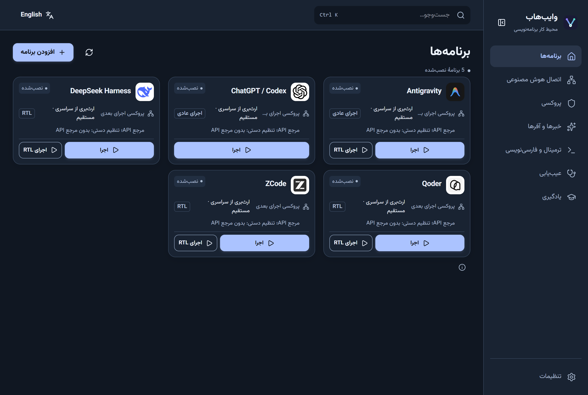
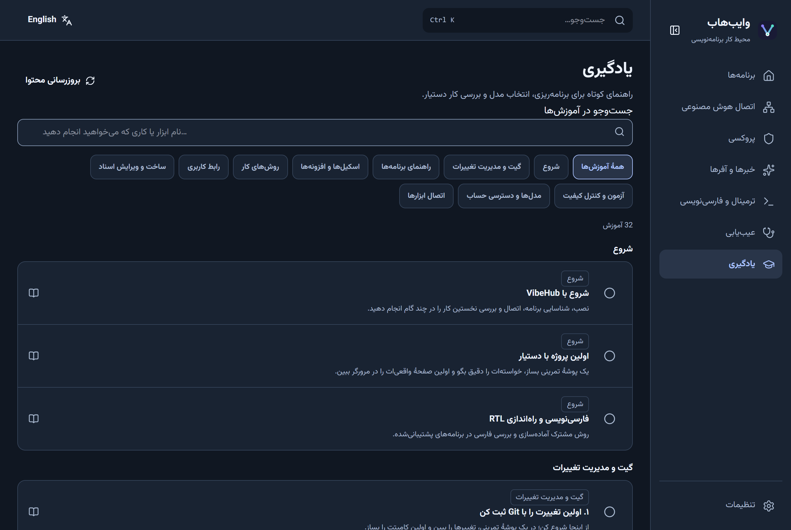
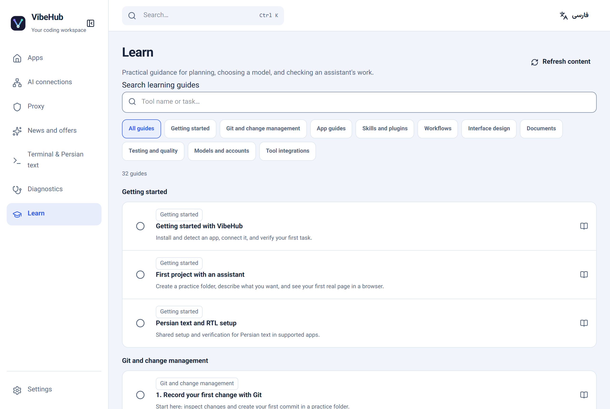
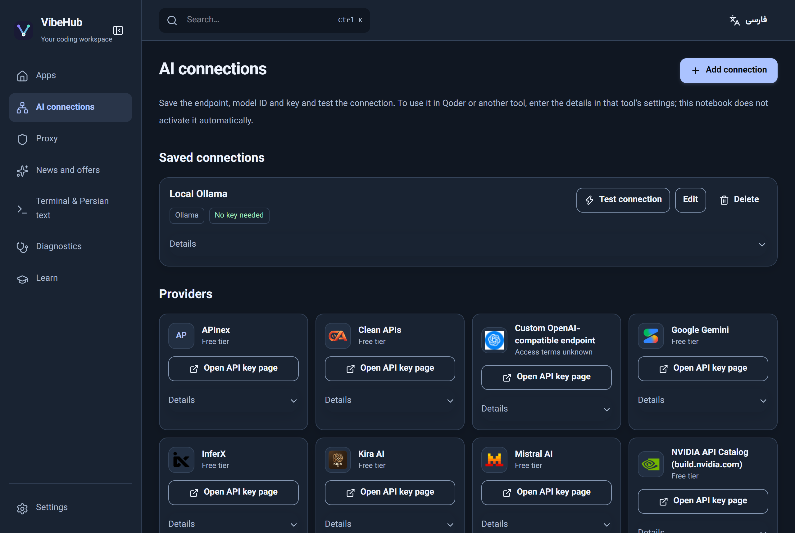
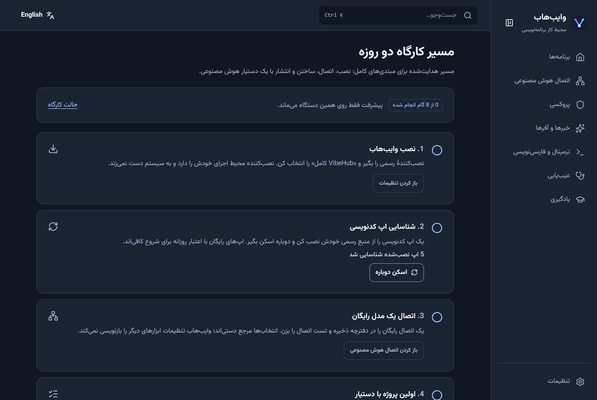

# وایب‌هاب

<div align="center">

[](https://github.com/ahmadkhanloo/VibeHub/actions/workflows/ci.yml)
[](https://github.com/ahmadkhanloo/VibeHub/releases)
[](LICENSE)


**هاب دسکتاپ آزاد و رایگان برای شناختن، اجرا کردن و یادگیری ابزارهای کدنویسی با هوش مصنوعی — فارسی‌محور، انگلیسی‌دوست.**

[English](README.md) · [دانلود (ویندوز)](https://github.com/ahmadkhanloo/VibeHub/releases/latest/download/VibeHub-Setup.exe) · [یادداشت‌های انتشار](https://github.com/ahmadkhanloo/VibeHub/releases)



</div>

## وایب‌هاب چیست؟

وایب‌هاب اپ همراهی است برای کسانی که با دستیارهای هوش مصنوعی کد می‌زنند. به‌جای دست‌وپنجه نرم‌کردن با نصب‌کننده‌ها، ترمینال‌ها و تنظیمات جداگانهٔ هر ابزار، یک فضای کاری واحد می‌دهد:

- **شناختن و اجرای ابزارهای کدنویسی با هوش مصنوعی** — اپ‌های نصب‌شده را پیدا می‌کند، پروژه‌تان را روی آن‌ها باز می‌کند یا پنجرهٔ فعلی‌شان را فوکوس می‌کند.
- **راه‌اندازی درست متن فارسی** — اجراگرهای RTL یک‌کلیکی برای اپ‌های پشتیبانی‌شده، به‌همراه راهنمای ترمینال، فونت و PowerShell برای کار راست‌به‌چپ.
- **نگه‌داشتن انتخاب‌های API در یک‌جا** — ذخیرهٔ نقطهٔ اتصال، شناسهٔ مدل و آزمودن اتصال. انتخاب‌ها فقط مرجع راه‌اندازی دستی‌اند؛ وایب‌هاب هرگز تنظیمات ابزارهای ثالث را بازنویسی نمی‌کند.
- **یادگیری مسیر کار** — کتابخانهٔ یادگیری دوزبانه (فارسی/English) با فیلتر موضوع و سطح، ذخیره برای خواندن آفلاین و تازه‌سازی از فید محتوای امضاشده.
- **عیب‌یابی** — ابزار عیب‌یابی داخلی برای بررسی پوسته، اپ‌ها و اتصال‌ها.

وایب‌هاب میزبان مدل نیست، ترافیک پروکسی نمی‌کند و حساب نمی‌فروشد. مجوز، شرایط دسترسی رایگان و محدودیت منطقه‌ای هر ابزار را جدا نگه می‌دارد و مقادیر ناموجود را صریح «ناموجود» نشان می‌دهد.

## اتصال هوش مصنوعی و آیکون کنار ساعت

صفحهٔ «اتصال هوش مصنوعی» سرویس‌ها و اتصال‌های ذخیره‌شده را در یک گرید قابل جست‌وجو نشان می‌دهد. با انتخاب هر سرویس، آدرس پیشنهادی، اتصال‌های ذخیره‌شده و یادداشت شخصی آن باز می‌شود. «یادداشت‌های من» یادداشت‌ها را برای ویرایش سریع یک‌جا نشان می‌دهد. یادداشت‌ها به‌صورت متن ساده روی دستگاه و کلیدهای API جداگانه در مخزن امن اطلاعات ویندوز ذخیره می‌شوند. برای آدرس‌های دلخواهی که لوگوی محلی ندارند، نشان جایگزین نمایش داده می‌شود.

با «آزمایش آدرس دلخواه» می‌توانید پیش از ذخیره، فهرست مدل‌ها را بگیرید یا پاسخ یک مدل را آزمایش کنید. تست مدل درخواست واقعی می‌فرستد و ممکن است سهمیه مصرف کند؛ ذخیرهٔ اتصال اقدامی جداگانه است. وضعیت هزینهٔ «نامشخص» به معنی تأیید رایگان یا پولی بودن نیست. Cloudflare Workers AI به شناسهٔ حساب نیاز دارد و فهرست مدل‌های آن از مستندات رسمی باز می‌شود. جزئیات در [راهنمای اتصال‌ها](docs/tutorials/rtl-setup.fa.md#اتصال-هوش-مصنوعی) آمده است.

با بستن پنجره، وایب‌هاب در ناحیهٔ اعلان کنار ساعت باقی می‌ماند. با انتخاب آیکون آن دوباره بازش کنید یا از منوی آیکون «خروج / Quit» را برای خروج کامل بزنید. منوی آیکون سینی برای هر اپ شناسایی‌شدهٔ دارای اجراگر RTL یک آیتم «· RTL» نشان می‌دهد تا اجرای متن فارسی بدون باز کردن پنجره یک‌کلیکی باشد؛ اپ‌های در حال اجرا با نقطه علامت می‌خورند. وایب‌هاب تک‌نمونه است — اجرای دوبارهٔ آن پنجرهٔ موجود را فوکوس می‌کند. عملکرد آیکون سینی در نسخهٔ بتای نصب‌شده هنوز جداگانه تأیید نشده است.

نسخهٔ آزمایشی فعلی [v0.2.6-beta.2](https://github.com/ahmadkhanloo/VibeHub/releases/tag/v0.2.6-beta.2) است ([نصاب ویندوز](https://github.com/ahmadkhanloo/VibeHub/releases/download/v0.2.6-beta.2/VibeHub-Setup.exe)) و از آخرین نسخهٔ پایدار جداست. تصویر اتصال‌ها در پایین مربوط به قبل از بازطراحی است.

## تصاویر

| کتابخانهٔ یادگیری (فارسی) | کتابخانهٔ یادگیری (English) | اتصال هوش مصنوعی (English) |
|---|---|---|
|  |  |  |

## اپ‌های پشتیبانی‌شده

| اپ | توضیح |
|---|---|
| ZCode | اجرا، اجراگر RTL، راهنما |
| Qoder | اجرا، اجراگر RTL، راهنما |
| DeepSeek Harness | اجرا، اجراگر RTL، راهنما |
| Antigravity | اجرا، اجراگر RTL (چت Antigravity آزمایشی)، راهنما |
| ChatGPT / Codex | اجرا به‌همراه مدیریت حساب Codex CLI (در حال حاضر Codex CLI 0.148.0) |
| OpenCode، Claude Code، Claude Desktop، MiMo Code، Freebuff، Freebuff Desktop | ورودی کاتالوگ، مرجع راه‌اندازی دستی و راهنما |

سوییچ خودکار حساب Codex به‌طور پیش‌فرض **خاموش** است، برای اپ‌های دسکتاپ باز تأیید صریح می‌خواهد و روی ویندوز همچنان آزمایشی و راستی‌آزمایی‌نشده است.

## کارگاه دو روزهٔ مبتدی

وایب‌هاب هستهٔ آموزشی یک کارگاه دودومهٔ عملی «برنامه‌نویسی با هوش مصنوعی برای مبتدیان» است. **مسیر کارگاه** داخل اپ (تنظیمات ← حالت کارگاه) قدم‌به‌قدم نصب، اتصال، اولین پروژه، اولین کامیت، دیباگ و بازبینی را با ثبت پیشرفت روی خود دستگاه طی می‌کند:

<p align="center"></p>

سرفصل‌ها، چک‌لیست مدرس و روال ریست ماشین در [سند کارگاه](docs/product/VibeHub_Workshop_2Day_Plan_FA.md) آمده است؛ محتوای درس‌ها در بخش **یادگیری** داخل اپ و [کتابخانهٔ آموزش‌ها](docs/tutorials/README.md) است.

## راه‌اندازی در ویندوز

فایل [`VibeHub-Setup.exe`](https://github.com/ahmadkhanloo/VibeHub/releases/latest/download/VibeHub-Setup.exe) را دانلود و اجرا کنید. نصب‌کننده دو انتخاب می‌دهد:

- **وایب‌هاب کامل** — هاب دسکتاپ به‌همراه هر چهار آداپتور RTL.
- **فقط اجراگرهای RTL** — میان‌برهای RTL جداگانه برای ZCode، Qoder، DeepSeek Harness و Antigravity، بدون هاب.

نصب‌کننده یک محیط اجرای Node.js 24.22.1 LTS اختصاصی و راستی‌آزمای‌شده با SHA-256 همراه دارد؛ به Node سیستم یا PATH دست نمی‌زند. اپ‌های هدف را اول از منبع رسمی خودشان نصب کنید یا اجراگر RTL را هنگام اجرا به مسیر سفارشی فایل اجرایی‌شان نشان دهید. نبود برنامهٔ اصلی مانع نصب میانبر RTL نیست. خروجی MSI غیرفعال است. جزئیات هر اپ در [راهنمای نصب RTL](docs/tutorials/rtl-setup.fa.md) آمده است.

**به‌روزرسانی:** اپ فقط با درخواست شما (تنظیمات ← به‌روزرسانی‌ها) فید به‌روزرسانی امضاشده را بررسی می‌کند؛ هیچ دانلود یا نصبی در پس‌زمینه انجام نمی‌شود. نصب RTL-only با اجرای همین Setup به‌روزرسانی می‌شود. فایل `VibeHub-Setup.exe` امضای Authenticode ناشر ویندوز ندارد؛ بستهٔ به‌روزرسانی جداگانه امضا و توسط خود برنامه راستی‌آزمایی می‌شود.

پذیرش نصب، ارتقا و حذف تمیز روی ویندوز ۱۰ و ۱۱ هنوز باز است؛ [ماتریس پذیرش انتشار](docs/validation/VibeHub_Release_Acceptance_Matrix.md) شواهد تا این لحظه را ثبت می‌کند.

## مستندات

| سند | محتوا |
|---|---|
| [آموزش‌ها](docs/tutorials/README.md) | راهنمای هر اپ و درس‌های عمومی RTL، کارهای طولانی و بازبینی کد (فارسی/English) |
| [سند کارگاه](docs/product/VibeHub_Workshop_2Day_Plan_FA.md) | برنامهٔ درسی دو روزهٔ مبتدی و کیت مدرس |
| [راهنمای ویرایش محتوا](content/learning/README.md) | افزودن یا ویرایش درس‌ها، خبرها و آفرها |
| [ماتریس پذیرش انتشار](docs/validation/VibeHub_Release_Acceptance_Matrix.md) | شواهد آزمون هر سناریوی انتشار |
| [طرح جامع فارسی](docs/product/VibeHub_Final_Master_Plan_v4_FA.md) | جهت محصول و محدودیت‌ها |

## توسعه

پیش‌نیازها: Node.js نسخهٔ ۲۰ یا جدیدتر، pnpm نسخهٔ ۱۲٫۱۵٫۰، Rust پایدار و در ویندوز WebView2.

```powershell
corepack pnpm install --frozen-lockfile
corepack pnpm test          # تست‌های Node و بستهٔ core
corepack pnpm check         # بررسی TypeScript
corepack pnpm build         # ساخت پروداکشن وب
corepack pnpm --filter @vibehub/desktop tauri dev   # اپ دسکتاپ واقعی از سورس
corepack pnpm test:ui       # سویت Playwright (سرورهای توسعه را خودش روشن می‌کند)
```

برای کار روی رابط کاربری بدون نصب دوباره، `pnpm dev:browser` پیش‌نمایش شبیه‌سازی‌شده را در `http://127.0.0.1:1422/` سرو می‌کند و `pnpm dev:desktop` اپ واقعی با هات‌ریلود را اجرا می‌کند. ساخت وب فقط رابط را بررسی می‌کند؛ اجرای Tauri، آداپتورهای نیتیو، updater امضاشده و نصب‌کنندهٔ پروداکشن گیت‌های جدا خودشان را دارند.

برای ساخت Setup ویندوز، ابتدا Runtime پین‌شدهٔ Node.js و فایل‌های آداپتر را آماده کنید:

```powershell
./scripts/prepare-windows-rtl-payload.ps1
corepack pnpm --filter @vibehub/desktop tauri build --bundles nsis
```

## حریم خصوصی و ایمنی

- حساب VibeHub، اشتراک، تلمتری، API مدل میزبانی‌شده یا VPN داخلی جزو طرح محصول نیست.
- دسترسی رایگان، مجوز متن‌باز و دسترسی منطقه‌ای سرویس‌های ثالث ویژگی‌های جداگانه‌اند و ممکن است تغییر کنند.
- فید کاتالوگ و راهنما داده است و نمی‌تواند فرمان یا کد اجرایی ارائه کند.
- ثبت‌نام referral و دانلود رسمی هر ابزار دو کار اختیاری و جدا هستند. مسیر بدون referral برای ZCode در [zcode.z.ai](https://zcode.z.ai/) قرار دارد.

## مجوز

[MIT](LICENSE) © 2026 ahmadkhanloo
