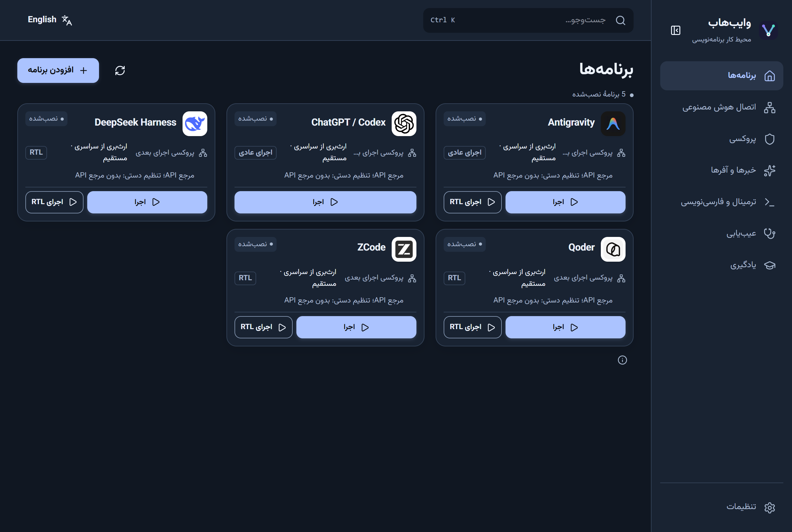
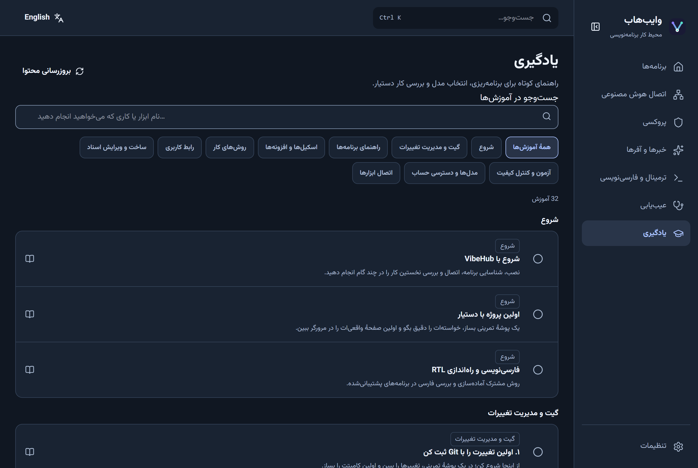
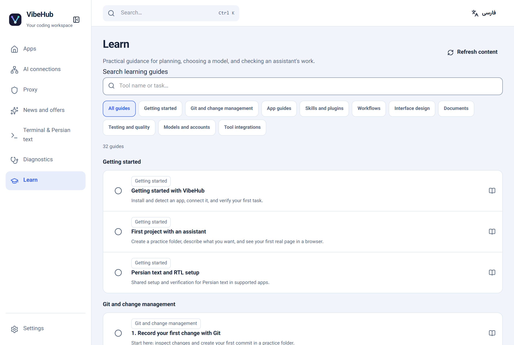
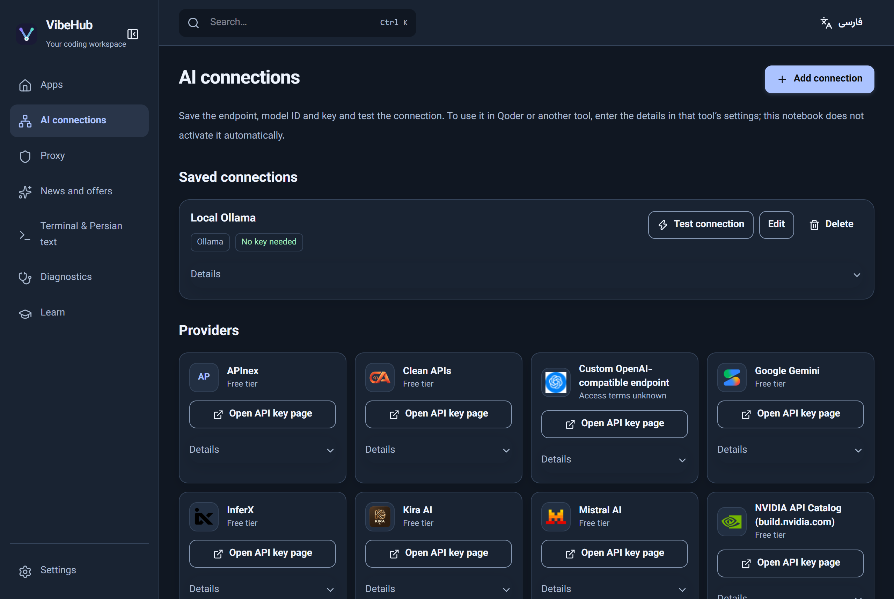
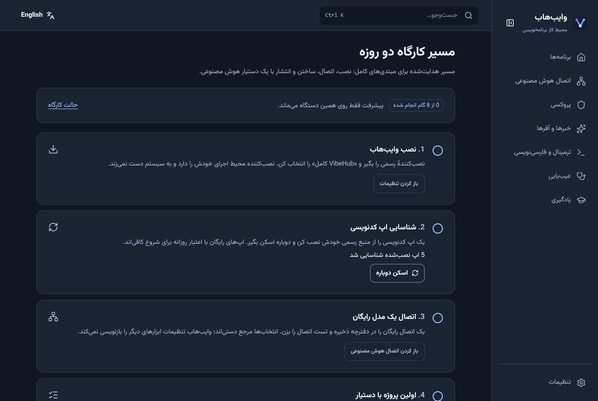

# VibeHub

<div align="center">

[](https://github.com/ahmadkhanloo/VibeHub/actions/workflows/ci.yml)
[](https://github.com/ahmadkhanloo/VibeHub/releases)
[](LICENSE)


**A free, open-source desktop hub for discovering, launching, and learning AI coding tools — Persian-first, English-friendly.**

[فارسی](README.fa.md) · [Download (Windows)](https://github.com/ahmadkhanloo/VibeHub/releases/latest/download/VibeHub-Setup.exe) · [Release notes](https://github.com/ahmadkhanloo/VibeHub/releases)



</div>

## What is VibeHub?

VibeHub is a companion app for people who code with AI assistants. Instead of juggling installers, terminals, and per-tool settings, VibeHub gives you one workspace to:

- **Discover and launch AI coding tools** — detect what is already installed, open it on your project folder, or focus its existing window.
- **Set up Persian text correctly** — one-click RTL launchers for supported tools, with terminal, font, and PowerShell guidance for right-to-left work.
- **Keep API choices in one notebook** — save endpoints, model IDs, and test connections. Selections are manual setup references; VibeHub never rewrites a third-party tool's settings.
- **Learn the workflow** — a bilingual (فارسی/English) learning library with topic and difficulty filters, bundled for offline reading and refreshed from a signed content feed.
- **Diagnose problems** — a built-in doctor for shell, app, and connection checks.

VibeHub does not host models, proxy traffic, or provide accounts. It separates each tool's license, free-access terms, and regional eligibility — and shows unavailable values as explicitly unavailable.

## AI connections and system tray

The **AI connections** page groups provider references and saved connections in a searchable grid. Select a provider to see its suggested API address, saved connections, and personal note; **My notes** collects notes for quick editing. Notes are stored locally as plain text; API keys are stored separately in the system credential vault. Existing custom URLs use a fallback icon when no bundled logo is available.

Choose **Try a custom URL** to list models or test a selected model before saving. Model tests send a real request and may consume quota; saving is a separate action. Model prices marked unknown have not been established as free or paid. Cloudflare Workers AI requires an account ID and uses its official model documentation instead of in-app listing. See the [connection guide](docs/tutorials/rtl-setup.en.md#ai-connections).

Closing the window hides VibeHub in the Windows notification area. Select its tray icon to reopen it, or choose **Quit / خروج** from the tray menu to exit completely. Tray interaction in the installed beta has not yet been independently verified.

The current prerelease is [v0.2.6-beta.2](https://github.com/ahmadkhanloo/VibeHub/releases/tag/v0.2.6-beta.2) ([Windows installer](https://github.com/ahmadkhanloo/VibeHub/releases/download/v0.2.6-beta.2/VibeHub-Setup.exe)). It is separate from the latest stable release. The existing screenshot below predates the redesigned connections screen.

## Screenshots

| Learning library (فارسی) | Learning library (English) | API notebook (English) |
|---|---|---|
|  |  |  |

## Supported apps

| App | Notes |
|---|---|
| ZCode | Launch, RTL launcher, accounts view, guides |
| Qoder | Launch, RTL launcher, accounts view, guides |
| DeepSeek Harness | Launch, RTL launcher, guides |
| Antigravity | Launch, RTL launcher (chat RTL experimental), guides |
| ChatGPT / Codex | Launch plus Codex CLI account management (currently Codex CLI 0.148.0) |
| OpenCode, Claude Code, Claude Desktop, MiMo Code, Freebuff, Freebuff Desktop | Catalog entry, manual setup reference, and guides |

Automatic account switching for Codex is **off by default**, requires explicit confirmation for open desktop apps, and remains experimental and unverified on Windows.

## Two-day beginner workshop

VibeHub doubles as the teaching core for a two-day, hands-on workshop on programming with AI for complete beginners. The in-app **workshop path** (Settings → Workshop mode) walks through install, connection, first project, first commit, debugging, and review — with per-step progress kept on the device:

<p align="center"></p>

The curriculum, facilitator checklist, and machine-reset routine live in the [workshop plan (فارسی)](docs/product/VibeHub_Workshop_2Day_Plan_FA.md); the lesson content is in the in-app **Learn** section and the [tutorials library](docs/tutorials/README.md).

## Windows setup

Download and run [`VibeHub-Setup.exe`](https://github.com/ahmadkhanloo/VibeHub/releases/latest/download/VibeHub-Setup.exe). The installer offers two choices:

- **Full VibeHub** — the desktop hub plus all four RTL adapters.
- **RTL launchers only** — per-app RTL shortcuts for ZCode, Qoder, DeepSeek Harness, and Antigravity, without the hub.

The setup bundles a private, checksum-verified Node.js 24.22.1 LTS runtime; it does not touch your system Node installation or PATH. Install the target tools from their official sources first, or point the RTL shortcut at a custom executable. See [RTL setup](docs/tutorials/rtl-setup.en.md) for per-app details.

**Updates:** the app checks a signed update feed only when you ask it to (Settings → Updates); nothing downloads or installs in the background. The installer itself carries no Authenticode signature; the updater archive is separately signed and verified by the app.

## Documentation

| Document | Contents |
|---|---|
| [Tutorials](docs/tutorials/README.md) | Per-app guides and general RTL, long-running, and code-review lessons (فارسی/English) |
| [Workshop plan](docs/product/VibeHub_Workshop_2Day_Plan_FA.md) | Two-day beginner curriculum and facilitator kit |
| [Content editing guide](content/learning/README.md) | How to add or edit lessons, news, and offers |
| [Release acceptance matrix](docs/validation/VibeHub_Release_Acceptance_Matrix.md) | Current test evidence per release scenario |
| [Persian master plan](docs/product/VibeHub_Final_Master_Plan_v4_FA.md) | Product direction and constraints |

## Development

Requirements: Node.js 20+, pnpm 12.15.0, a stable Rust toolchain, and WebView2 on Windows.

```powershell
corepack pnpm install --frozen-lockfile
corepack pnpm test          # Node + core package tests
corepack pnpm check         # TypeScript checks
corepack pnpm build         # Production web build
corepack pnpm --filter @vibehub/desktop tauri dev   # Native desktop from source
corepack pnpm test:ui       # Playwright suite (starts dev servers)
```

For hacking on the UI without reinstalling, `pnpm dev:browser` serves a simulated preview at `http://127.0.0.1:1422/`; `pnpm dev:desktop` runs the real native app with hot reload. A successful web build does not validate the Tauri runtime, native adapters, or installer — those have their own gates.

To build the Windows installer:

```powershell
./scripts/prepare-windows-rtl-payload.ps1
corepack pnpm --filter @vibehub/desktop tauri build --bundles nsis
```

## Privacy and safety

- No VibeHub account, subscription, telemetry, hosted model API, or internal VPN.
- Third-party free access, licensing, and regional availability are separate properties and can change.
- Catalog and guide feeds are data; they cannot carry commands or executable code.
- Referral signup and a tool's official download route are separate, optional actions. For ZCode, the non-referral route is [zcode.z.ai](https://zcode.z.ai/).

## License

[MIT](LICENSE) © 2026 ahmadkhanloo
