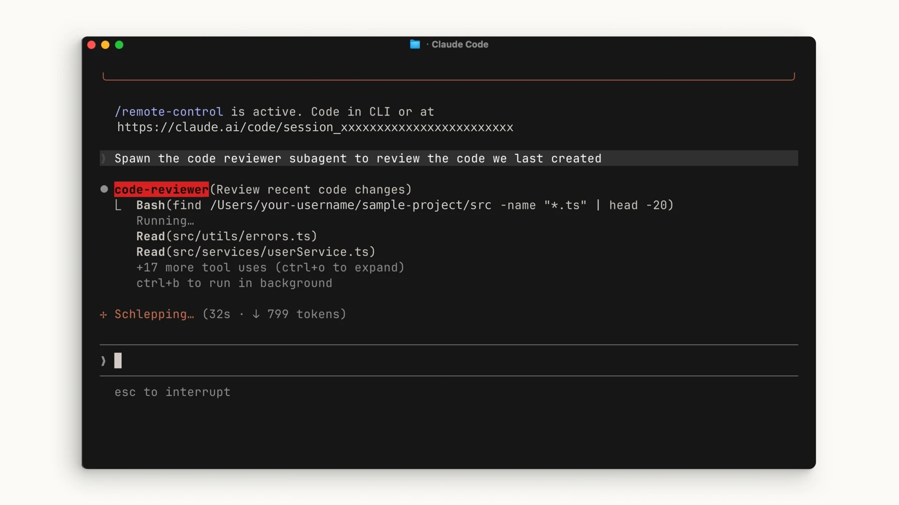

# Delegate to subagents

## Practice

Create a read-only reviewer for a bounded task. In current versions, ask Claude to write the agent file or create it yourself. The interactive `/agents` creation wizard was removed in v2.1.198; newer versions print file-creation guidance instead.

## 1. Define a project agent

Ask Claude Code:

> Create code-quality-reviewer in .claude/agents/. Give it only Read, Grep and Glob tools and inherit the session model. It should report concrete logic errors with file references and explanations, without editing files.

Review `.claude/agents/code-quality-reviewer.md`. A minimal example:

```markdown
---
name: code-quality-reviewer
description: Review project code for concrete logic errors without editing files.
tools: Read, Grep, Glob
model: inherit
---
Inspect the requested files. Report concrete logic errors with file references.
Explain the failure scenario and any uncertainty. Do not modify files.
```

`.claude/agents/` is project-scoped; `~/.claude/agents/` is personal and available across projects. If the agents directory was created after the session began and discovery fails, restart Claude Code.

## 2. Delegate and inspect the report

Supply the target files or diff in the request. With only the read tools above, the agent cannot run a shell command to retrieve a diff; provide that context explicitly.

```text
Ask the reviewer to inspect current changes for logic bugs and give a file path and explanation for each finding.
```

## Verify the result



Subagents incur model usage too. Compare the report with actual code and failure scenarios; a reviewer report alone does not prove correctness.

Check actual files and test output. If a command is unavailable, check your installed version and the official documentation.

[Claude Code — sub-agents](https://code.claude.com/docs/en/sub-agents)

[Official agent creation lesson](https://academy.claude.com/courses/introduction-to-subagents/creating-a-subagent) · [Illustrated reviewer example](https://academy.claude.com/courses/claude-code-101/the-explore-plan-code-commit-workflow)
