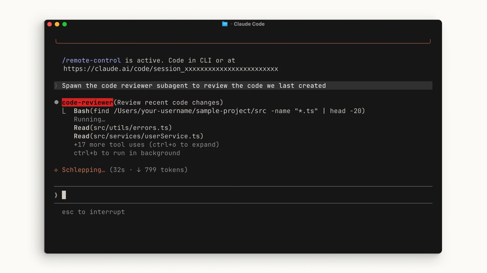

# واگذاری کار به Subagents

## تمرین

برای بازبینی یک کار محدود، ایجنتی با دسترسی فقط‌خواندنی بسازید. در نسخه‌های فعلی از Claude بخواهید فایل ایجنت را بنویسد یا فایل را خودتان ایجاد کنید. پنجرهٔ ساخت تعاملی `/agents` از نسخهٔ ۲٫۱٫۱۹۸ حذف شده است؛ آن فرمان در نسخه‌های جدید فقط راهنمای ساخت فایل را نشان می‌دهد.

## ۱. تعریف ایجنت در پروژه

این درخواست را در Claude Code بنویسید:

> یک ایجنت به نام code-quality-reviewer در .claude/agents/ بساز. فقط ابزارهای Read، Grep و Glob داشته باشد، مدل نشست اصلی را به ارث ببرد و بدون ویرایش فایل‌ها، ایرادهای منطقی را با مسیر فایل و دلیل گزارش کند.

فایل `.claude/agents/code-quality-reviewer.md` را بخوانید. نمونهٔ حداقلی:

```markdown
---
name: code-quality-reviewer
description: Review project code for concrete logic errors without editing files.
tools: Read, Grep, Glob
model: inherit
---
Inspect the requested files. Report concrete logic errors with file references.
Explain the failure scenario and any uncertainty. Do not modify files.
```

پوشهٔ `.claude/agents/` دامنهٔ پروژه دارد؛ پوشهٔ `~/.claude/agents/` برای استفادهٔ شخصی در چند پروژه است. اگر پوشهٔ agents پس از شروع نشست ساخته شده و ایجنت پیدا نمی‌شود، Claude Code را دوباره اجرا کنید.

## ۲. واگذاری و بررسی گزارش

محدودهٔ فایل‌ها یا diff موردنظر را همراه درخواست بدهید. با ابزارهای فقط‌خواندنی بالا، ایجنت فرمان shell برای گرفتن diff اجرا نمی‌کند؛ زمینهٔ لازم را در درخواست قرار دهید.

> از ایجنت بازبین بخواه فقط تغییرات فعلی را برای خطاهای منطقی بررسی کند و برای هر ایراد مسیر فایل و دلیل بدهد.



مدل ایجنت هم مصرف ایجاد می‌کند. نتیجه را با کد واقعی و سناریوی خطا بسنجید؛ گزارش ایجنت به‌تنهایی اثبات درستی تغییر نیست.

## بررسی نتیجه

نتیجه را با فایل واقعی و خروجی تست بررسی کنید. اگر فرمان شناخته نشد، نسخهٔ نصب‌شده و مستندات رسمی را بررسی کنید.

[Claude Code — sub-agents](https://code.claude.com/docs/en/sub-agents)

[درس رسمی ساخت ایجنت در Claude Academy](https://academy.claude.com/courses/introduction-to-subagents/creating-a-subagent) · [نمونهٔ تصویری اجرای بازبین](https://academy.claude.com/courses/claude-code-101/the-explore-plan-code-commit-workflow)
