# Claude Code: the complete CLI handbook

Claude Code is a command-line tool, not a separate windowed app: you run it inside a project folder, it works with that project's context, and everything is driven by commands and config files. This page holds every topic in one place; each section stands alone, so jump to what you need.

## 1. Working on a real project

Run `claude` in a practice project. First ask it to explain the project structure and test command, then hand it a concrete bug with a fix plan and approve changes only after review:

> Find the empty-input bug. Explain the cause and the plan first; after my approval, fix it and run the related test.

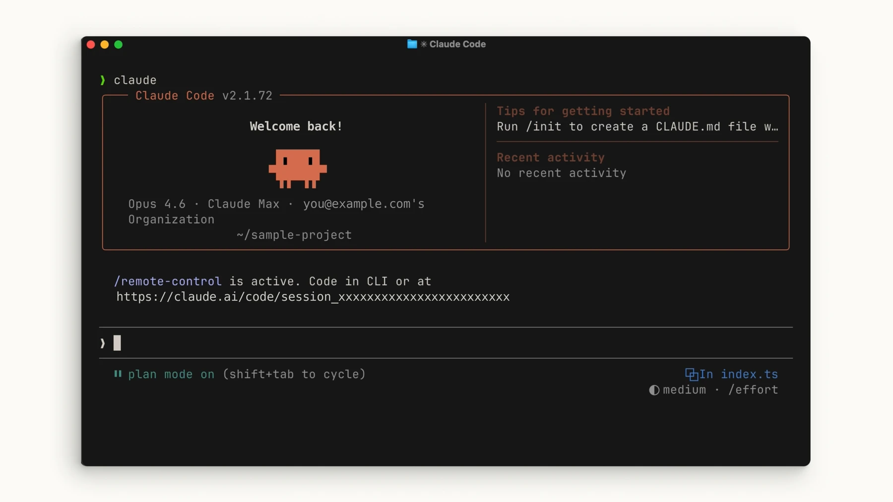


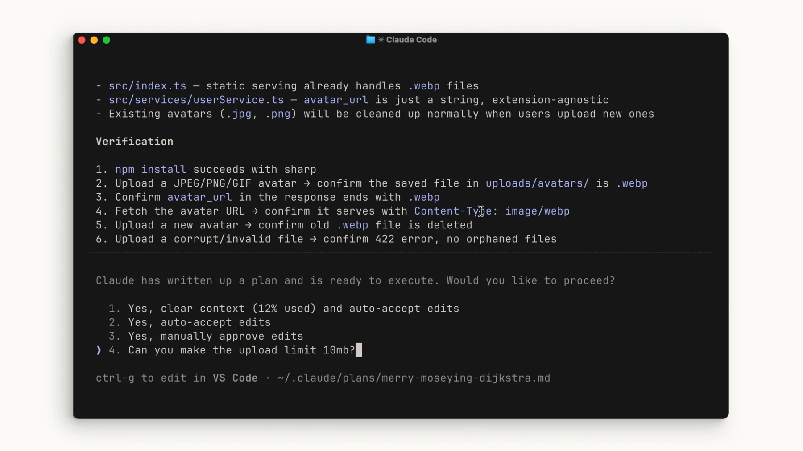

## 2. Permissions and Plan mode

Check permissions with `/permissions` and use Plan mode to understand the project and design changes. Before approving a command, read its path and effect; never trade review for a broad permission grant.

> Read only the relevant files and propose a change plan. Do not edit anything yet.

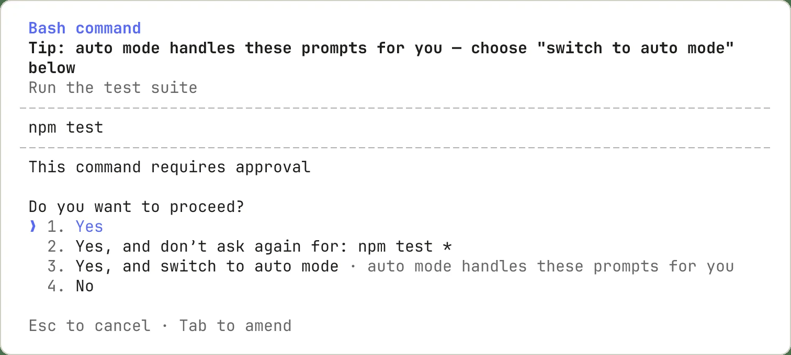

## 3. Project memory: CLAUDE.md

Write a short CLAUDE.md in the project root: the test command, essential rules and important paths. `/init` drafts one, but you must review it. `/memory` shows the loaded instructions. Auto memory is Claude's own note-keeping and is not the same as explicit CLAUDE.md rules; move long processes into skills.

```markdown
# Project instructions
- Run npm test after changing application logic.
- Keep UI strings in the existing translation files.
- Ask before adding a new dependency.
```

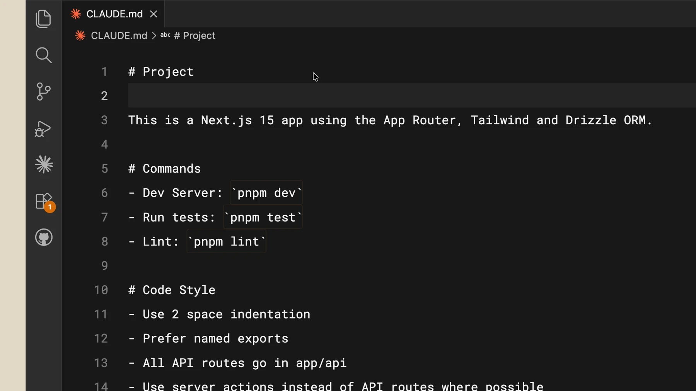


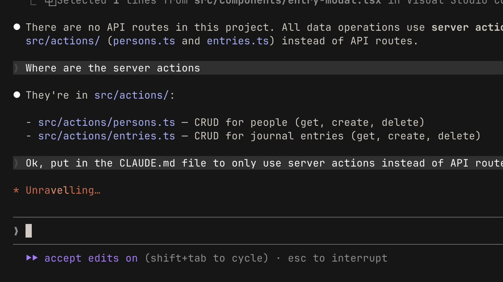

## 4. Skills

Create `.claude/skills/review-checklist/SKILL.md` with name/description frontmatter and the steps in the body. This skill runs only when you explicitly invoke it:

```markdown
---
name: review-checklist
description: Review changes against the requested behavior.
disable-model-invocation: true
---
Read the current diff. Compare it with the requested behavior.
List concrete logic errors with file references.
State which checks ran and which did not. Do not edit files.
```

Invoke it with `/review-checklist` and judge the report against its goal. If the skills folder was created after the session started, run `/reload-skills`. Skills run on the host model and tools; they do not provide an account or free model.

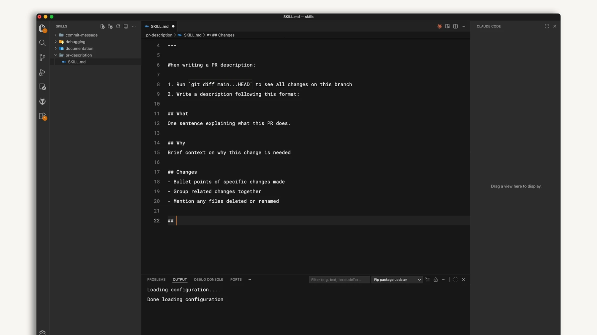


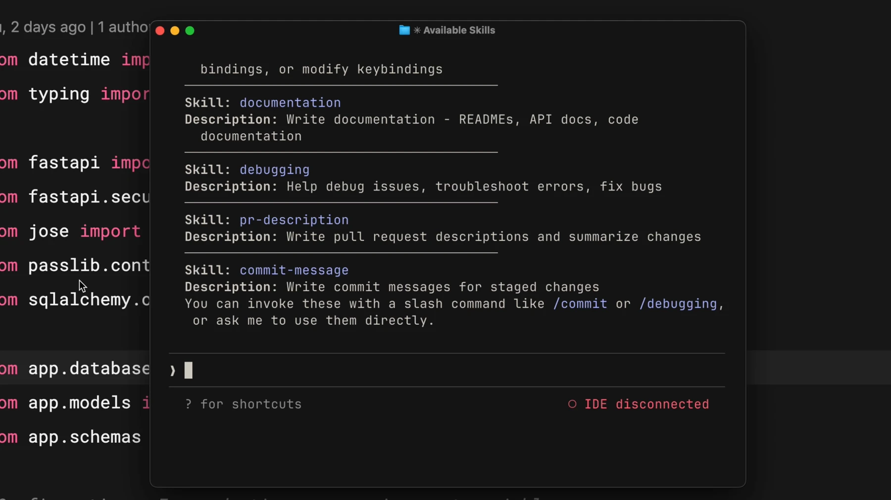

## 5. Connecting tools with MCP

Pick a server from a trusted source and match the install command with Claude's docs; check the connection with `/mcp` and start with read-only requests. Never embed a key or token in the request.

```powershell
claude mcp add --transport http linear-server https://mcp.linear.app/mcp
claude mcp list
```

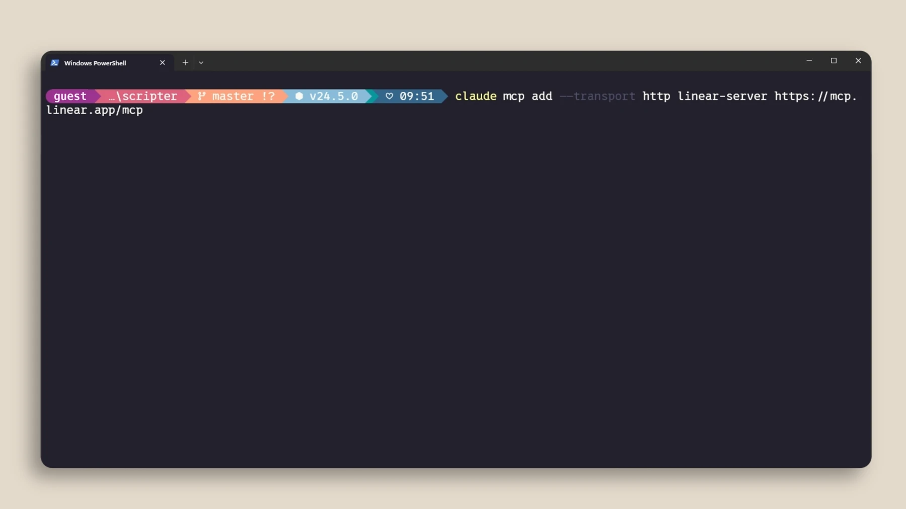

A live connection is not a licence to change all data; do not confuse `connected` with `needs authentication`.


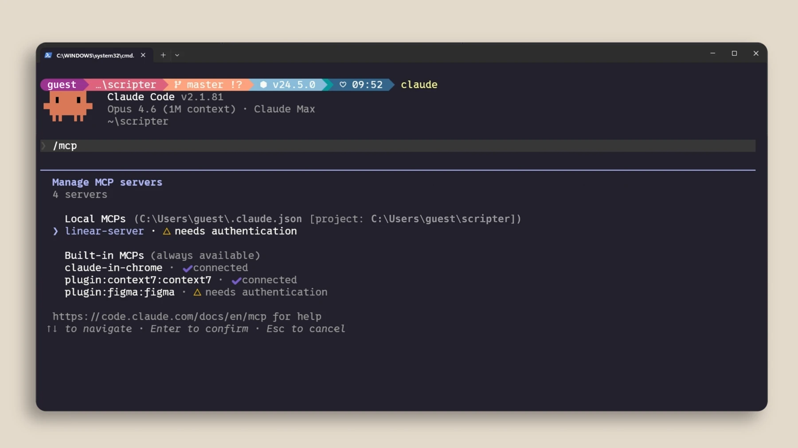


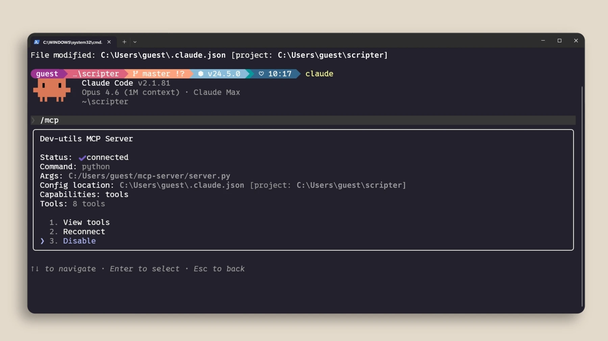

## 6. Delegating to subagents

For a bounded review task, build a read-only agent. `.claude/agents/` is project-scoped, `~/.claude/agents/` is personal across projects:

```markdown
---
name: code-quality-reviewer
description: Review project code for concrete logic errors without editing files.
tools: Read, Grep, Glob
model: inherit
---
Inspect the requested files. Report concrete logic errors with file references.
Explain the failure scenario and any uncertainty. Do not modify files.
```

The interactive `/agents` builder was removed in 2.1.198; newer versions only print file-writing guidance. Provide the file range or diff in the request — a read-only agent cannot run shell commands to fetch it. Agent models cost tokens, and an agent's report alone never proves a change is correct.

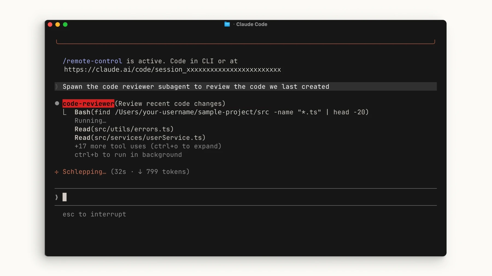

## 7. Resuming sessions and managing context

`claude --continue` resumes the last conversation, `claude --resume` opens the picker, and `/resume` works inside a session. Use `/context` to see usage and `/compact` to compress — name the decisions and unfinished items in the request. `/clear` empties the active conversation and is not a substitute for recording project decisions.


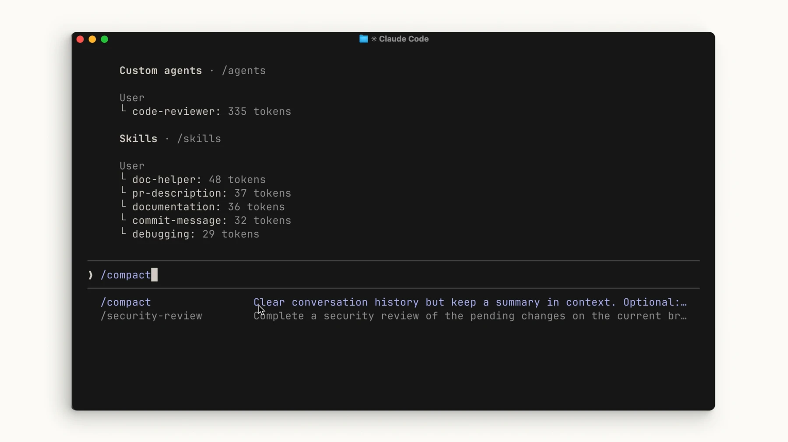

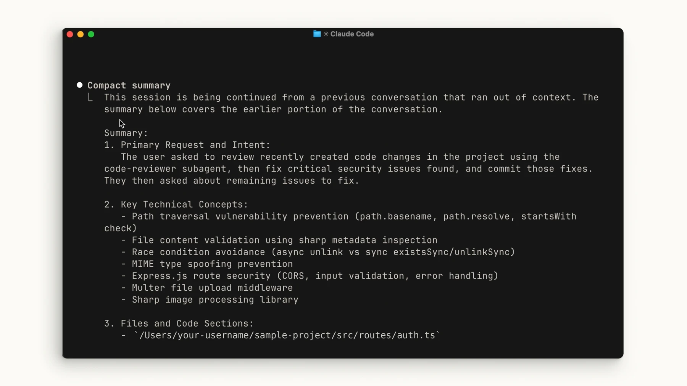

## 8. Working in VS Code

The official VS Code extension is the same engine behind a UI: select a few lines in an open file to reference exactly that range, and read the diff before accepting any edit — green means added text.

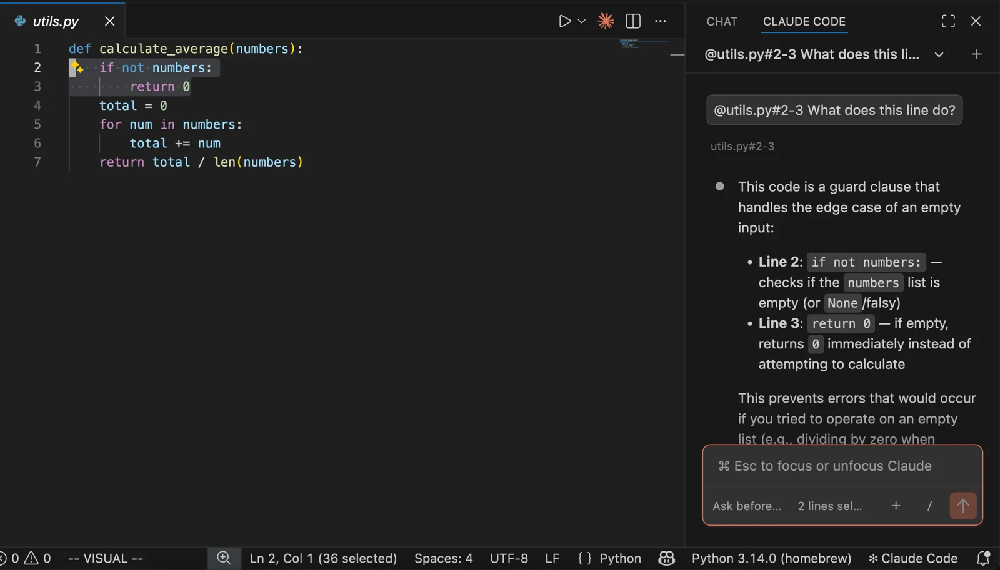

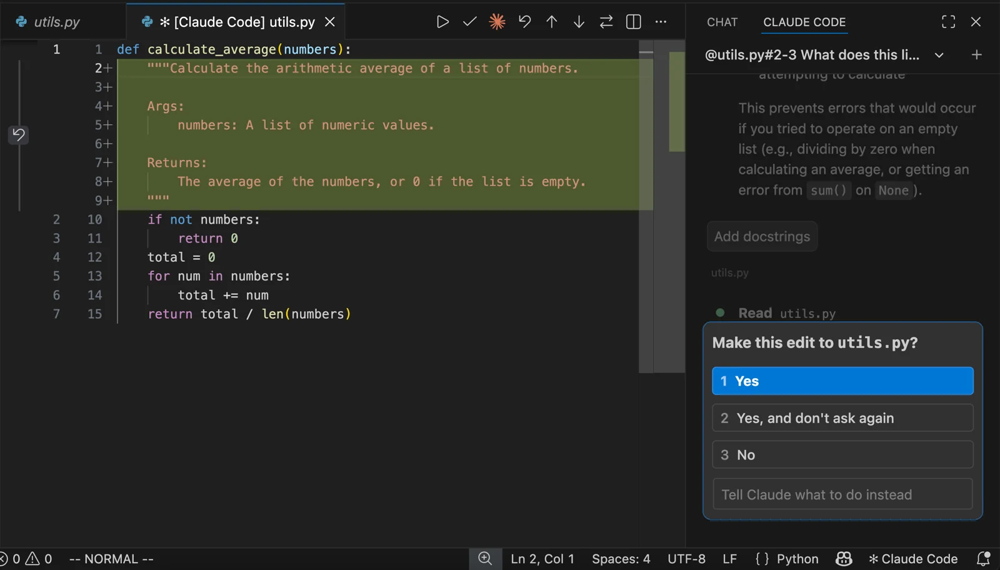

## 9. Plugins

A plugin bundles skills, agents, hooks and MCP connections; for one simple personal command, a standalone skill is enough. Open `/plugin`, review the source and contents (never assume a third-party repo is official), pick the install scope, and run plugin commands with the plugin-name prefix. Disable or remove from the same `/plugin` view.

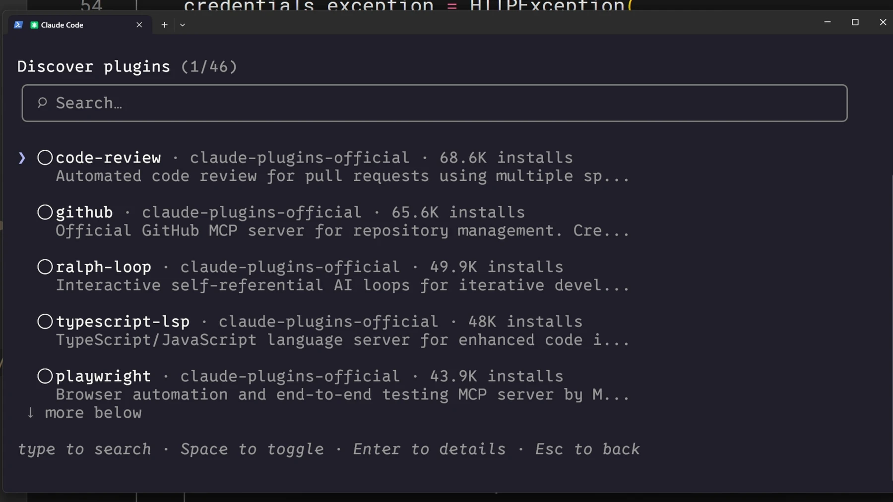

## Official sources

- [Claude Code — common-workflows](https://code.claude.com/docs/en/common-workflows) · [permissions](https://code.claude.com/docs/en/permissions) · [memory](https://code.claude.com/docs/en/memory) · [skills](https://code.claude.com/docs/en/skills) · [mcp](https://code.claude.com/docs/en/mcp) · [sub-agents](https://code.claude.com/docs/en/sub-agents) · [vs-code](https://code.claude.com/docs/en/vs-code) · [plugins](https://code.claude.com/docs/en/plugins)
- [Claude Academy — Claude Code 101](https://academy.claude.com/courses/claude-code-101/your-first-prompt) · [Agent Skills](https://academy.claude.com/courses/introduction-to-agent-skills/creating-your-first-skill) · [Subagents](https://academy.claude.com/courses/introduction-to-subagents/creating-a-subagent)
