# Claude Code: راهنمای کامل کار با CLI

Claude Code یک ابزار خط فرمان است، نه یک اپ با پنجرهٔ جدا: در پوشهٔ پروژه اجرا می‌شوید، با همان زمینهٔ پروژه کار می‌کند و همهٔ امکاناتش با فرمان و فایل تنظیم می‌شود. این صفحه همهٔ بخش‌ها را یکجا دارد؛ هر بخش مستقل است و می‌توانید فقط به همان نیاز بپرید.

## ۱. شروع کار عملی روی پروژه

در پوشهٔ یک پروژهٔ آزمایشی `claude` را اجرا کنید. ابتدا بخواهید ساختار پروژه و فرمان تست را توضیح دهد، بعد یک خطای مشخص را با برنامهٔ اصلاح بگیرید و پس از بررسی اجازهٔ تغییر بدهید:

> خطای ورودی خالی را پیدا کن. ابتدا علت و برنامه را توضیح بده؛ پس از تأیید، اصلاح کن و تست مرتبط را اجرا کن.

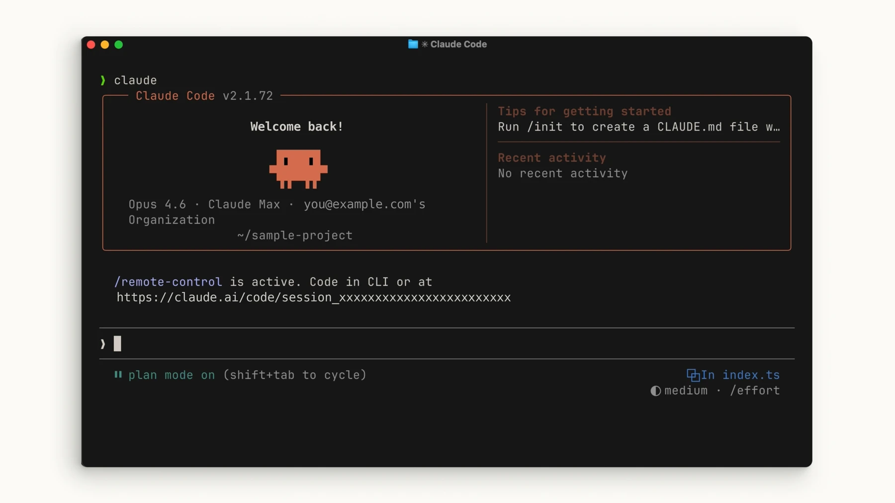


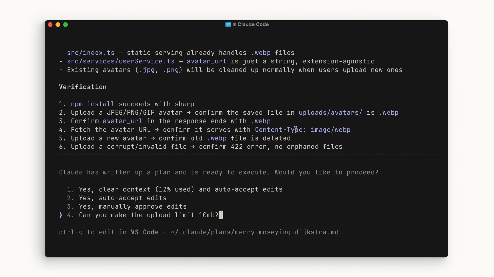

## ۲. مجوزها و حالت Plan

با `/permissions` مجوزها را بررسی کنید و برای شناخت پروژه و طراحی تغییر از حالت Plan استفاده کنید. پیش از تأیید یک فرمان، مسیر و اثر آن را بخوانید؛ مجوز گسترده را جایگزین بررسیِ درخواست نکنید.

> فقط فایل‌های مرتبط را بخوان و برنامهٔ تغییر را پیشنهاد بده. هنوز هیچ فایلی را ویرایش نکن.

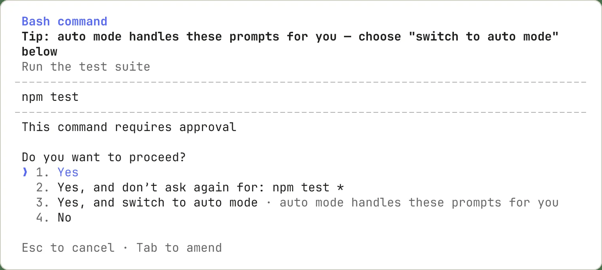

## ۳. حافظهٔ پروژه: CLAUDE.md

در ریشهٔ پروژه یک CLAUDE.md کوتاه بنویسید: فرمان تست، قواعد ضروری و مسیرهای مهم. `/init` پیش‌نویس می‌سازد اما بازبینی لازم دارد. با `/memory` دستورهای بارگذاری‌شده را ببینید. Auto memory یادداشت‌های خودکار Claude است و با قواعد صریح CLAUDE.md یکسان نیست؛ فرایندهای طولانی را به اسکیل منتقل کنید.

```markdown
# Project instructions
- Run npm test after changing application logic.
- Keep UI strings in the existing translation files.
- Ask before adding a new dependency.
```

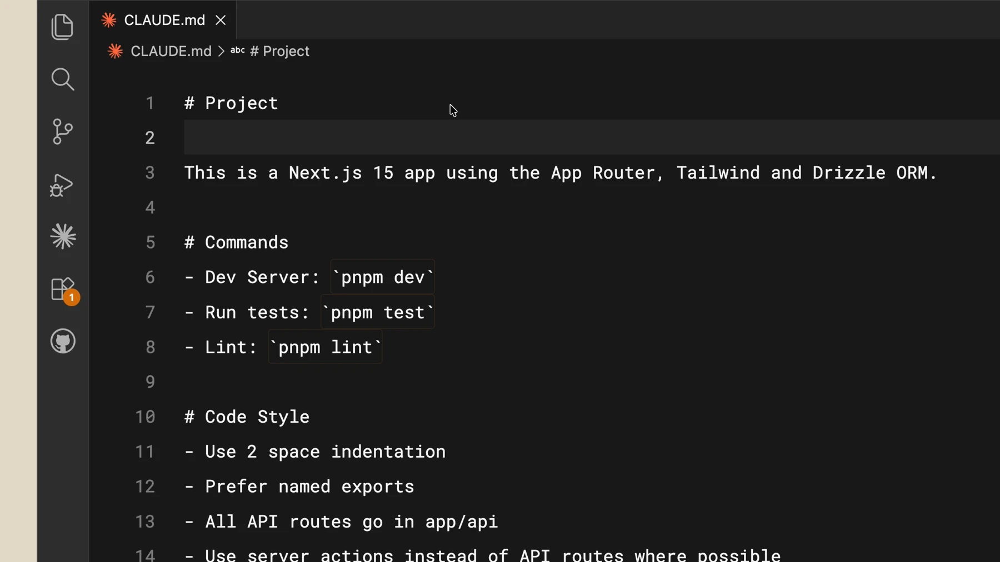


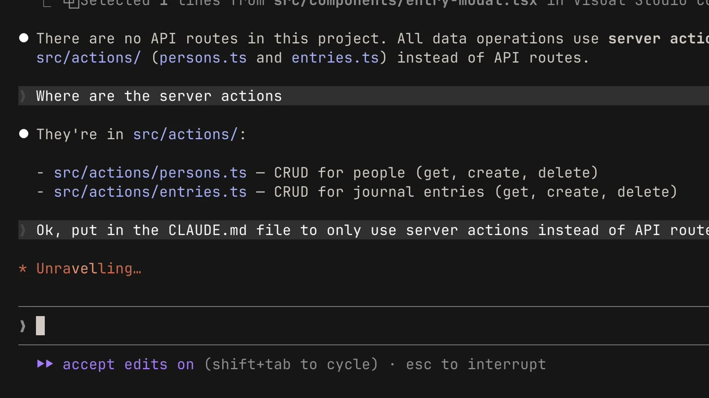

## ۴. اسکیل‌ها

یک فایل `.claude/skills/review-checklist/SKILL.md` با frontmatter نام و توضیح بسازید؛ در بدنه، مراحل کار را بنویسید. این اسکیل فقط با فراخوانی صریح شما اجرا می‌شود:

```markdown
---
name: review-checklist
description: Review changes against the requested behavior.
disable-model-invocation: true
---
Read the current diff. Compare it with the requested behavior.
List concrete logic errors with file references.
State which checks ran and which did not. Do not edit files.
```

با `/review-checklist` فراخوانی کنید و گزارش را با هدف بسنجید. اگر پوشهٔ skills بعد از شروع نشست ساخته شده، `/reload-skills` را اجرا کنید. اسکیل روی مدل و ابزارهای میزبان اجرا می‌شود؛ خودش حساب یا مدل رایگان فراهم نمی‌کند.

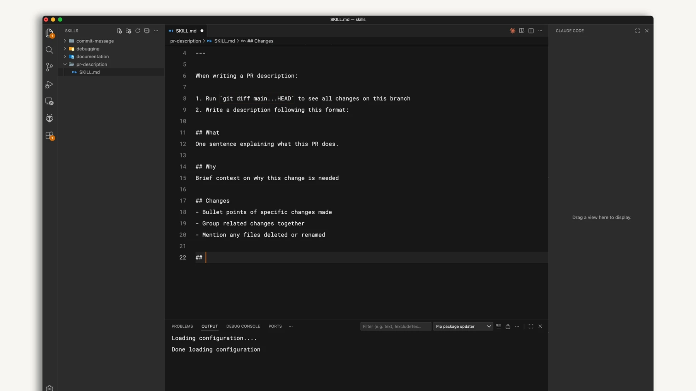


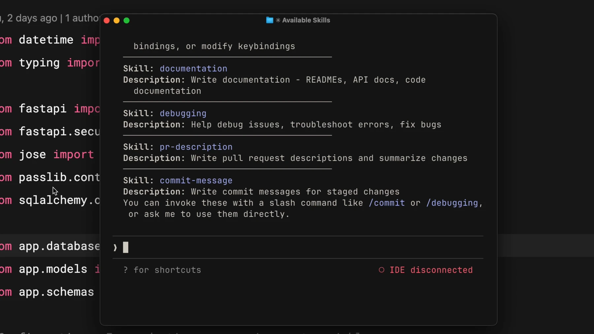

## ۵. اتصال ابزارها با MCP

سرور موردنیاز را از منبع معتبر انتخاب و دستور نصب را با مستندات Claude تطبیق دهید؛ سپس با `/mcp` وضعیت اتصال را ببینید و برای تمرین اول فقط درخواست فقط‌خواندنی بدهید. کلید یا توکن را داخل درخواست ننویسید.

```powershell
claude mcp add --transport http linear-server https://mcp.linear.app/mcp
claude mcp list
```

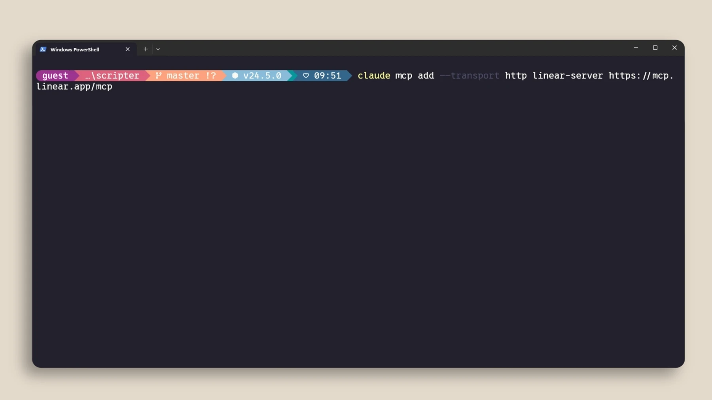

اتصالِ فعال به معنی مجوز تغییر همهٔ داده‌ها نیست؛ وضعیت `connected` را با `needs authentication` اشتباه نگیرید.


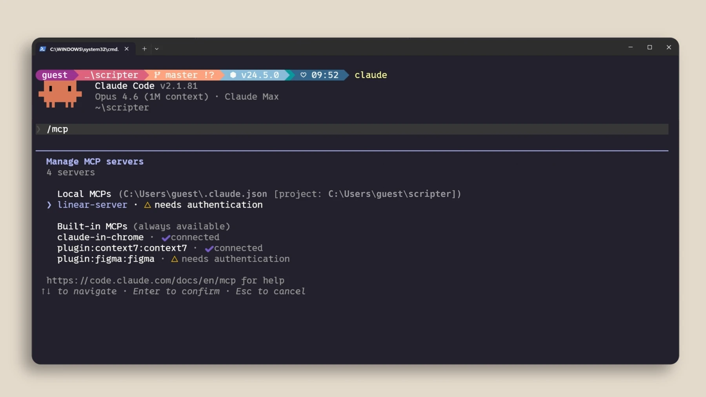


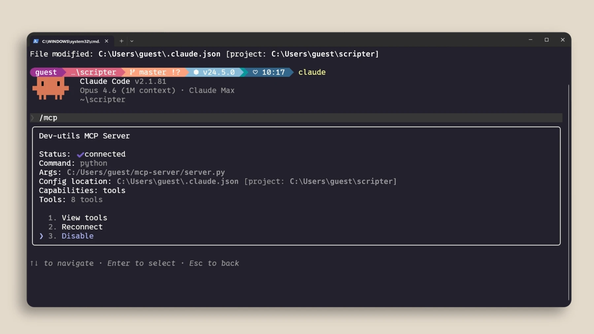

## ۶. واگذاری کار به ساب‌ایجنت

برای بازبینی یک کار محدود، ایجنتی با دسترسی فقط‌خواندنی بسازید. پوشهٔ `.claude/agents/` دامنهٔ پروژه دارد و `~/.claude/agents/` استفادهٔ شخصی در چند پروژه:

```markdown
---
name: code-quality-reviewer
description: Review project code for concrete logic errors without editing files.
tools: Read, Grep, Glob
model: inherit
---
Inspect the requested files. Report concrete logic errors with file references.
Explain the failure scenario and any uncertainty. Do not modify files.
```

پنجرهٔ ساخت تعاملی `/agents` از نسخهٔ ۲٫۱٫۱۹۸ حذف شده و در نسخه‌های جدید فقط راهنمای ساخت فایل می‌دهد. محدودهٔ فایل‌ها یا diff را همراه درخواست بدهید — ایجنتِ فقط‌خواندنی فرمان shell برای گرفتن diff اجرا نمی‌کند. مدل ایجنت هم مصرف دارد و گزارشش به‌تنهایی اثبات درستی تغییر نیست.

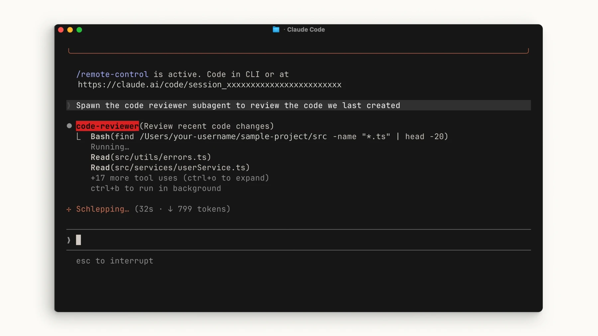

## ۷. ادامهٔ نشست و کنترل زمینه

`claude --continue` آخرین گفتگو را ادامه می‌دهد، `claude --resume` انتخاب‌گر گفتگو را باز می‌کند و داخل نشست هم `/resume` همین کار را می‌کند. با `/context` مصرف زمینه را ببینید و با `/compact` فشرده کنید؛ در درخواست فشرده‌سازی، تصمیم‌ها و موارد ناتمام را مشخص کنید. `/clear` گفتگوی فعال را خالی می‌کند و جایگزین ثبت تصمیم‌های پروژه نیست.


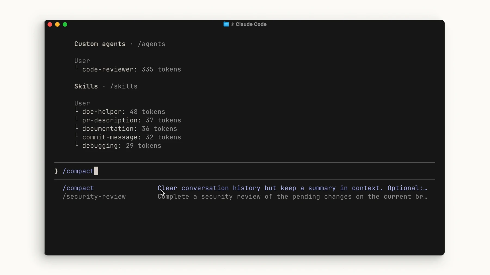

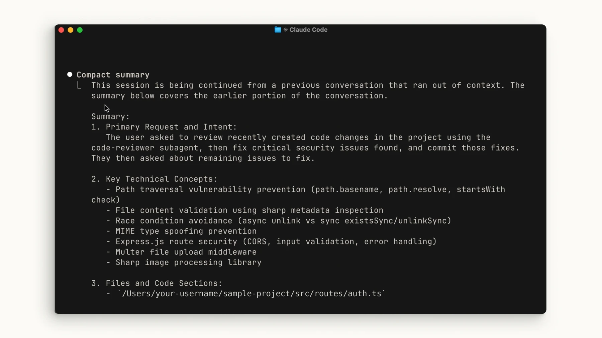

## ۸. کار در VS Code

افزونهٔ رسمی Claude Code برای VS Code رابط گرافیکی همان موتور است: با انتخاب چند خط در فایل باز، فقط همان محدوده را به Claude ارجاع دهید و پیش از پذیرش هر ویرایش، diff را بخوانید — بخش سبز متن اضافه‌شده است.

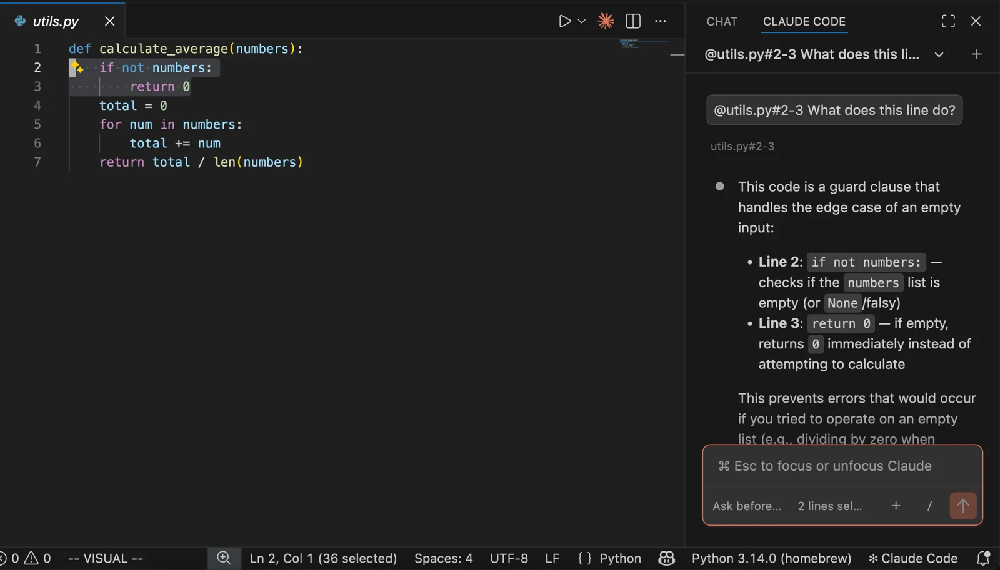

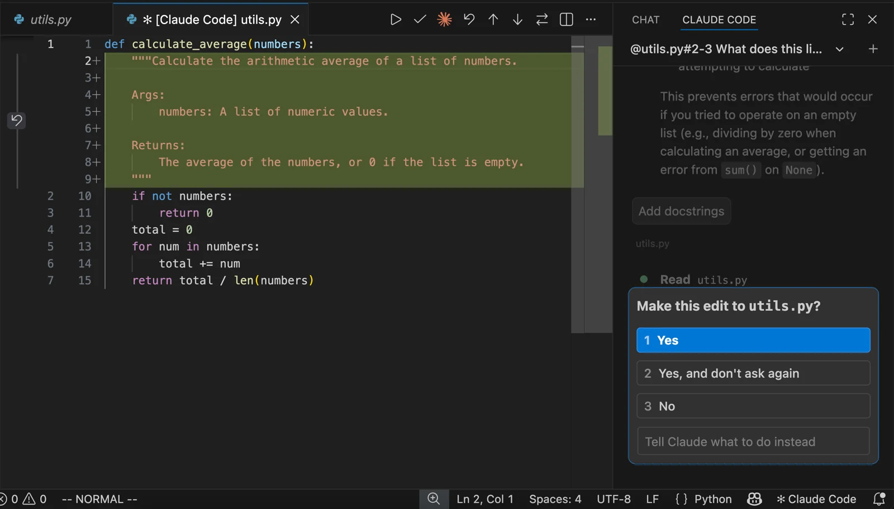

## ۹. افزونه‌ها

افزونه اسکیل‌ها، ایجنت‌ها، hooks و اتصال‌های MCP را یکجا بسته‌بندی می‌کند؛ برای یک دستور شخصی ساده، اسکیل مستقل کافی است. با `/plugin` فهرست را ببینید، منبع و محتوا را بررسی کنید (مخزن شخص ثالث را رسمی فرض نکنید)، دامنهٔ نصب را انتخاب کنید و پس از نصب فرمان‌ها را با پیشوند نام افزونه اجرا کنید. حذف و غیرفعال‌سازی هم از همان `/plugin` انجام می‌شود.

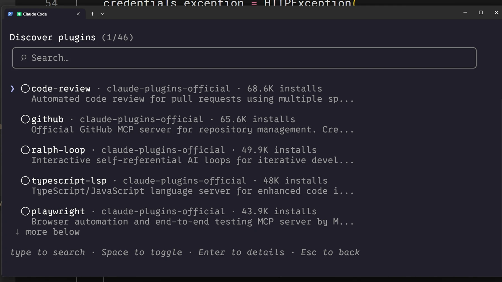

## منابع رسمی

- [Claude Code — common-workflows](https://code.claude.com/docs/en/common-workflows) · [permissions](https://code.claude.com/docs/en/permissions) · [memory](https://code.claude.com/docs/en/memory) · [skills](https://code.claude.com/docs/en/skills) · [mcp](https://code.claude.com/docs/en/mcp) · [sub-agents](https://code.claude.com/docs/en/sub-agents) · [vs-code](https://code.claude.com/docs/en/vs-code) · [plugins](https://code.claude.com/docs/en/plugins)
- [Claude Academy — Claude Code 101](https://academy.claude.com/courses/claude-code-101/your-first-prompt) · [Agent Skills](https://academy.claude.com/courses/introduction-to-agent-skills/creating-your-first-skill) · [Subagents](https://academy.claude.com/courses/introduction-to-subagents/creating-a-subagent)
