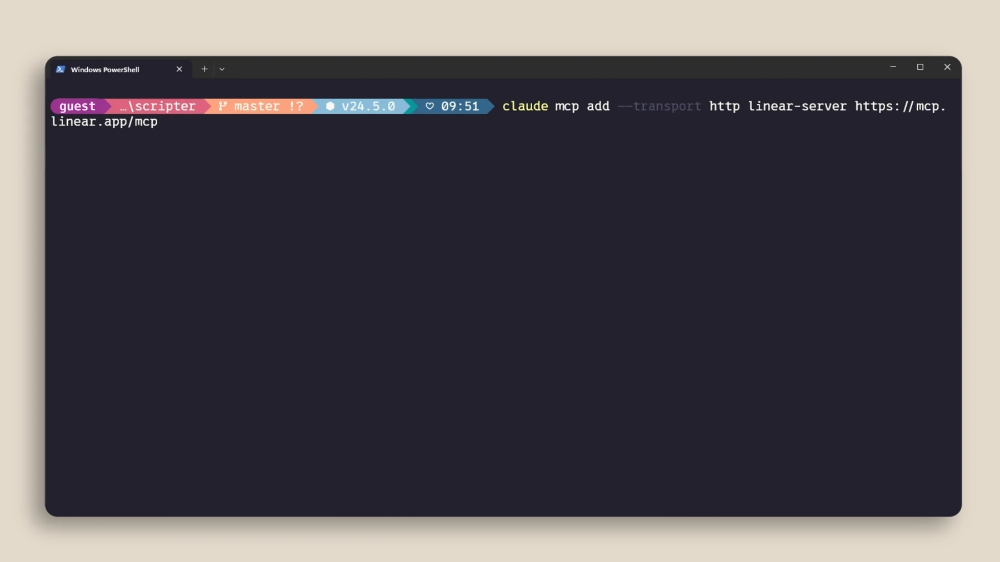
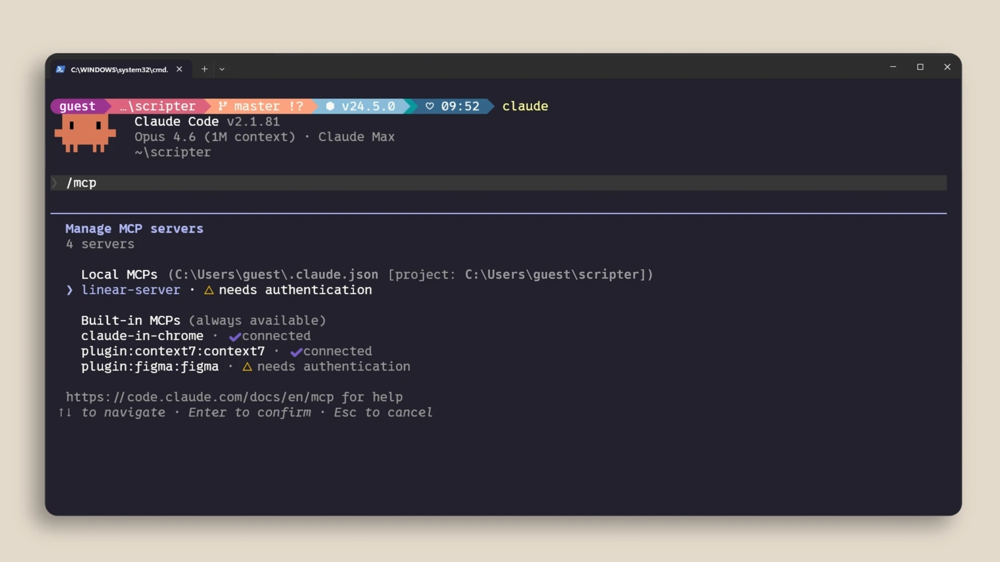
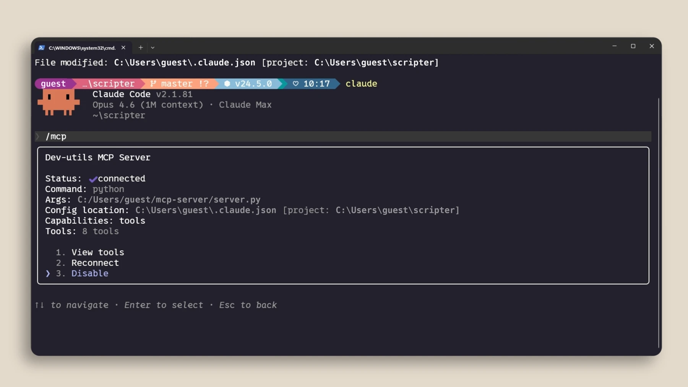

# Connect tools with MCP

## Practice

Choose a trusted server and check its installation instructions against Claude documentation. Inspect its status and tools with `/mcp`. Begin with a read-only request.

```text
Read and summarize existing information without changing records.
```

## Connection example



This official example registers Linear. Running it is optional and requires access to that service; complete sign-in through its official flow yourself.

```powershell
claude mcp add --transport http linear-server https://mcp.linear.app/mcp
claude mcp list
```

Check connection status with `/mcp`, then request only the issue list of a test project. Never put a key or token in a prompt. If tools are missing, inspect the URL, authentication and install scope. An active connection is not permission to change all connected data.

## Verify the result





Check actual files and test output. If a command is unavailable, check your installed version and the official documentation.

[Claude Code — mcp](https://code.claude.com/docs/en/mcp)

Official illustrated lessons:

- [Claude Academy](https://academy.claude.com/courses/claude-code-101/mcp)
