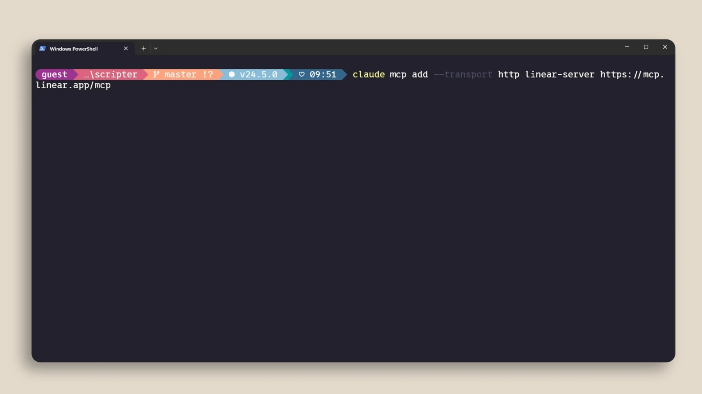
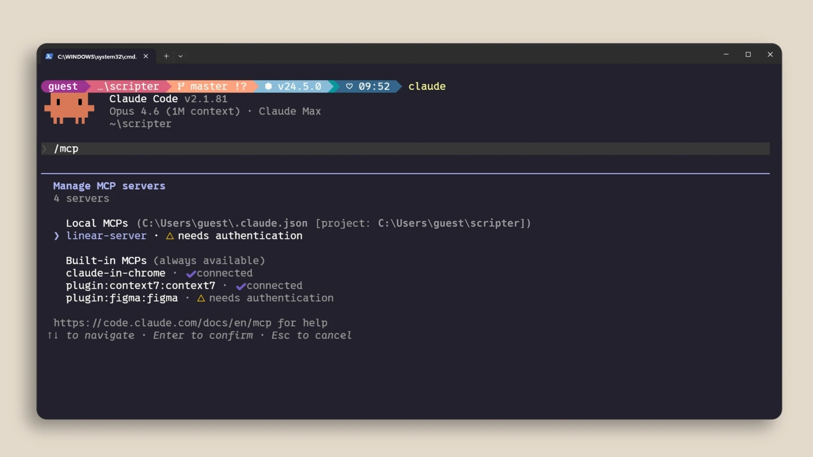
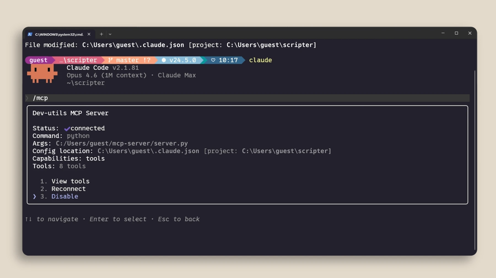

# اتصال ابزار با MCP

## تمرین

سرور موردنیاز را از منبع معتبر انتخاب کنید و دستور نصب همان سرور را با مستندات Claude تطبیق دهید. با `/mcp` وضعیت اتصال و ابزارها را بررسی کنید. برای تمرین ابتدا درخواست فقط‌خواندنی بدهید.

> فقط اطلاعات موجود را بخوان و خلاصه کن؛ هیچ رکوردی را تغییر نده.

## نمونهٔ اتصال



نمونهٔ رسمی زیر اتصال Linear را ثبت می‌کند. اجرای آن اختیاری و نیازمند دسترسی به همان سرویس است؛ ورود را خودتان از جریان رسمی انجام دهید.

```powershell
claude mcp add --transport http linear-server https://mcp.linear.app/mcp
claude mcp list
```

با `/mcp` وضعیت اتصال را ببینید و ابتدا فقط فهرست issueهای یک پروژهٔ آزمایشی را بخواهید. کلید یا توکن را داخل درخواست ننویسید. اگر ابزارها دیده نشدند، URL، وضعیت ورود و دامنهٔ نصب را بررسی کنید. اتصال فعال به معنی مجوز تغییر همهٔ داده‌ها نیست.

## بررسی نتیجه





نتیجه را با فایل واقعی و خروجی تست بررسی کنید. اگر فرمان شناخته نشد، نسخهٔ نصب‌شده و مستندات رسمی را بررسی کنید.

[Claude Code — mcp](https://code.claude.com/docs/en/mcp)

منابع تصویری و درس تکمیلی رسمی:

- [Claude Academy](https://academy.claude.com/courses/claude-code-101/mcp)
