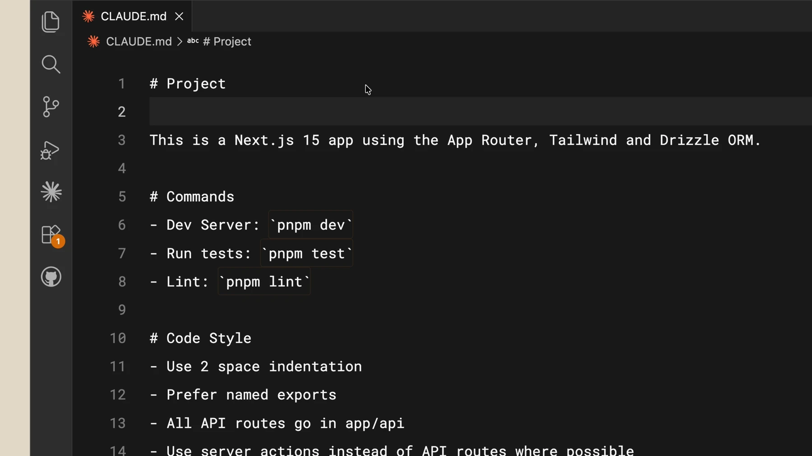
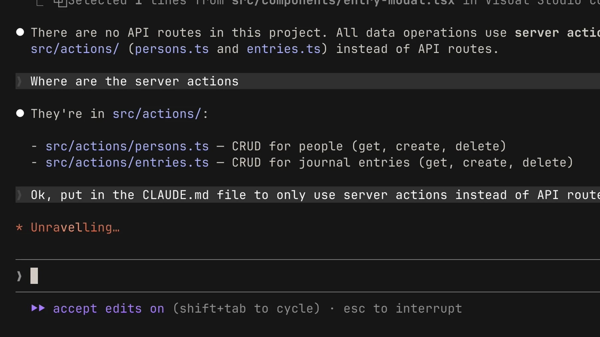

# Project instructions with CLAUDE.md

## Practice

Write a short CLAUDE.md at the project root with test commands, essential conventions and important paths. Instructions provide context; deterministic enforcement requires executable checks.

```text
Read CLAUDE.md and identify the rules and tests relevant to this change.
```

## Example project instructions



Create this file at the project root, replacing the test command with the actual project command. `/init` can also draft it, but review the result first.

```markdown
# Project instructions
- Run npm test after changing application logic.
- Keep UI strings in the existing translation files.
- Ask before adding a new dependency.
```

Inspect loaded instructions with `/memory`. Keep this file short and put longer procedures in skills. Auto memory contains Claude-maintained notes and is distinct from explicit CLAUDE.md rules.

## Verify the result



Check actual files and test output. If a command is unavailable, check your installed version and the official documentation.

[Claude Code — memory](https://code.claude.com/docs/en/memory)

Official illustrated lessons:

- [Claude Academy](https://academy.claude.com/courses/claude-code-101/the-claude-md-file)
