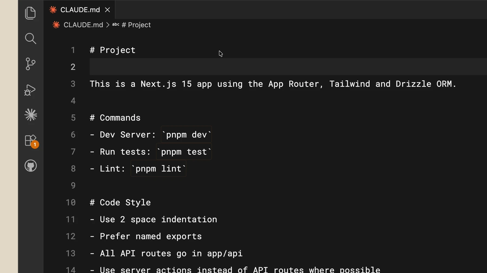
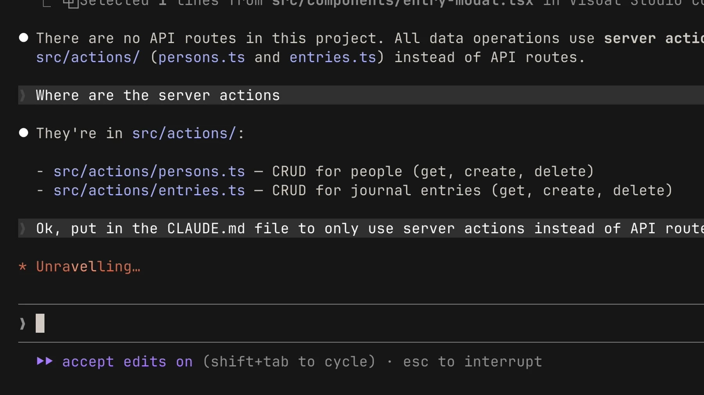

# دستورهای پروژه با CLAUDE.md

## تمرین

در ریشهٔ پروژه CLAUDE.md کوتاهی با فرمان تست، قواعد ضروری و مسیرهای مهم بنویسید. این متن زمینهٔ کاری مدل است؛ برای الزام قطعی اجرای تست به کنترل اجرایی نیاز دارید.

> CLAUDE.md را بخوان و بگو برای این تغییر چه قواعد و تست‌هایی لازم است.

## نمونهٔ دستورهای پروژه



در ریشهٔ پروژه فایل زیر را بسازید؛ فرمان تست را با فرمان واقعی پروژه جایگزین کنید. `/init` هم می‌تواند پیش‌نویس تهیه کند، اما باید آن را بازبینی کنید.

```markdown
# Project instructions
- Run npm test after changing application logic.
- Keep UI strings in the existing translation files.
- Ask before adding a new dependency.
```

با `/memory` دستورهای بارگذاری‌شده را ببینید. این فایل را کوتاه نگه دارید و فرایندهای طولانی را به اسکیل منتقل کنید. Auto memory یادداشت‌هایی است که Claude نگه می‌دارد و با قواعد صریح CLAUDE.md یکسان نیست.

## بررسی نتیجه



نتیجه را با فایل واقعی و خروجی تست بررسی کنید. اگر فرمان شناخته نشد، نسخهٔ نصب‌شده و مستندات رسمی را بررسی کنید.

[Claude Code — memory](https://code.claude.com/docs/en/memory)

منابع تصویری و درس تکمیلی رسمی:

- [Claude Academy](https://academy.claude.com/courses/claude-code-101/the-claude-md-file)
