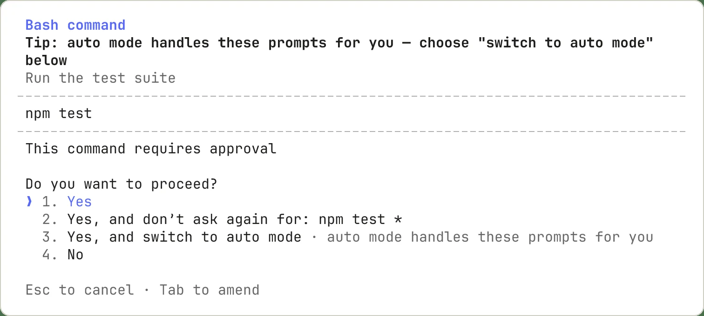

# Planning and permissions

## Practice

Inspect permissions with `/permissions`. Use Plan mode to explore and design a change. Read each command and its target before approving it.

```text
Read relevant files and propose a plan. Do not edit files yet.
```



## Verify the result

Check actual files and test output. If a command is unavailable, check your installed version and the official documentation.

[Claude Code — permissions](https://code.claude.com/docs/en/permissions)
