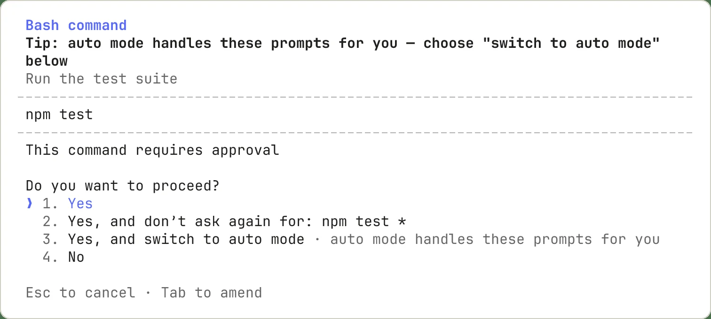

# برنامه‌ریزی و مجوزها

## تمرین

با `/permissions` مجوزها را بررسی کنید. برای شناخت پروژه و طراحی تغییر از حالت Plan استفاده کنید. پیش از تأیید یک فرمان، مسیر و اثر آن را بخوانید؛ مجوز گسترده را جایگزین بررسی درخواست نکنید.

> فقط فایل‌های مرتبط را بخوان و برنامهٔ تغییر را پیشنهاد بده. هنوز هیچ فایلی را ویرایش نکن.

## بررسی نتیجه

نتیجه را با فایل واقعی و خروجی تست بررسی کنید. اگر فرمان شناخته نشد، نسخهٔ نصب‌شده و مستندات رسمی را بررسی کنید.

[Claude Code — permissions](https://code.claude.com/docs/en/permissions)
