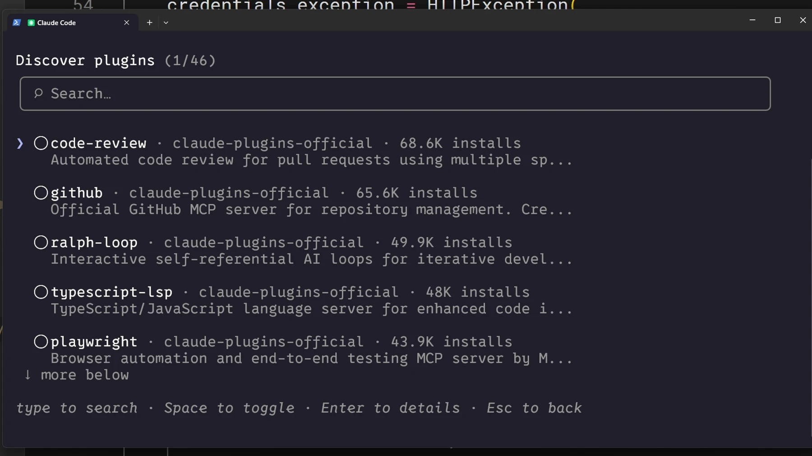

# Install and manage plugins

## When to use a plugin
A plugin can package skills, agents, hooks and MCP connections together. A standalone skill is enough for one simple personal procedure.

## Steps

1. Open `/plugin` and inspect available plugins.
2. Review the source, installation guide and contents; a third-party marketplace is not an official marketplace.
3. Choose the install scope: personal use or project settings shared with a team.
4. Invoke an installed skill with its full namespaced command; the plugin name is its prefix.

## Verify and remove
The capability should appear in the intended project and scope. Disable or remove it through `/plugin`, then verify that the capability is gone. Installation alone does not grant access to a connected account or service.

[Claude Code — plugins](https://code.claude.com/docs/en/plugins)

Official illustrated lessons:

- [Claude Academy](https://academy.claude.com/courses/introduction-to-agent-skills/sharing-skills)
