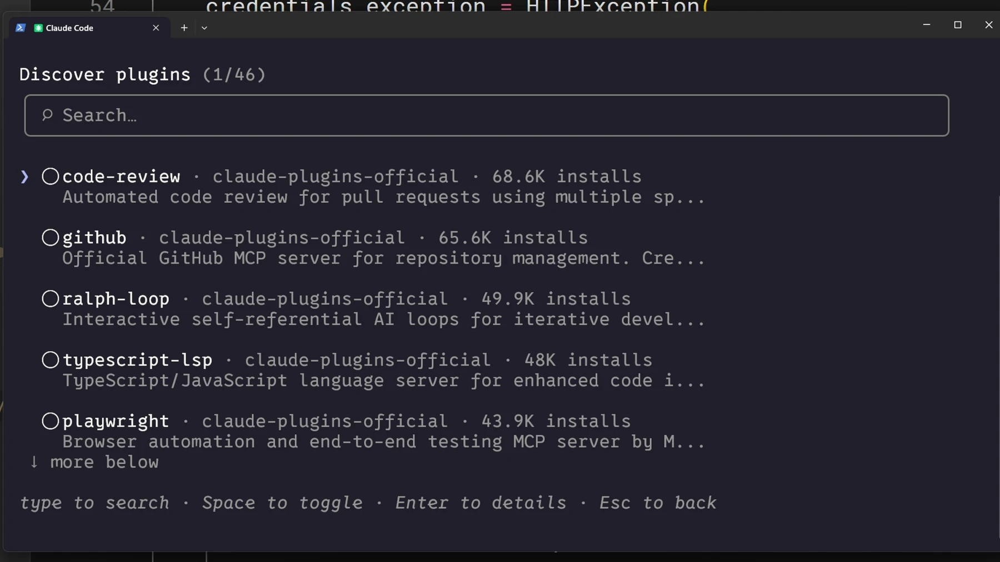

# نصب و مدیریت افزونه‌ها

## چه زمانی افزونه لازم است؟
افزونه می‌تواند اسکیل‌ها، ایجنت‌ها، hooks و اتصال‌های MCP را یکجا بسته‌بندی کند. برای یک دستور شخصی ساده، اسکیل مستقل کافی است.

## مراحل

۱. `/plugin` را باز کنید و فهرست افزونه‌های موجود را ببینید.
۲. منبع، راهنمای نصب و محتوای افزونه را بررسی کنید؛ مخزن شخص ثالث را رسمی فرض نکنید.
۳. دامنهٔ نصب را انتخاب کنید: شخصی برای استفادهٔ خودتان، یا پروژه برای اشتراک تنظیمات مرتبط با تیم.
۴. پس از نصب، فرمان اسکیل افزونه را با نام کامل آن اجرا کنید؛ نام افزونه پیشوند فرمان است.

## معیار پایان و حذف
قابلیت نصب‌شده باید در همان پروژه و دامنه قابل مشاهده باشد. در `/plugin` افزونه را غیرفعال یا حذف کنید و دوباره نبود قابلیت را بررسی کنید. صرف نصب به معنی دسترسی به حساب یا سرویس متصل نیست.

[Claude Code — plugins](https://code.claude.com/docs/en/plugins)

منابع تصویری و درس تکمیلی رسمی:

- [Claude Academy](https://academy.claude.com/courses/introduction-to-agent-skills/sharing-skills)
