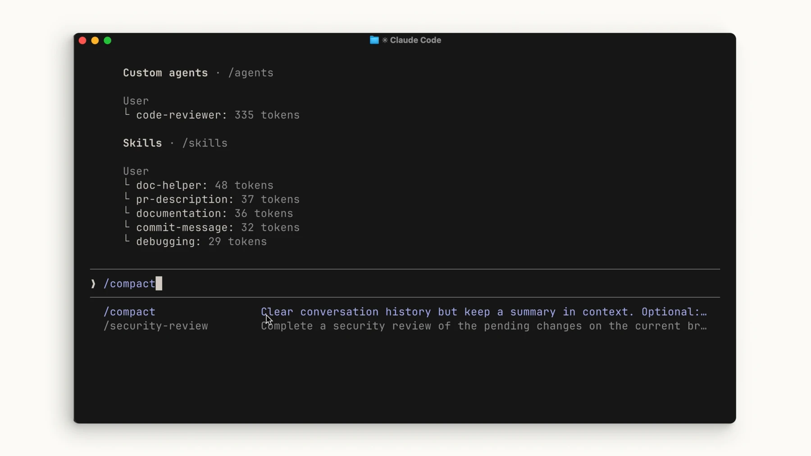
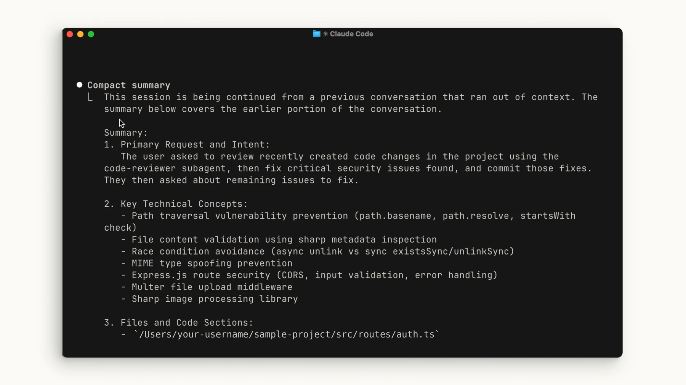

# Resume sessions and manage context

## Goal and prerequisites
Continue a multi-step task in the same project. Before leaving, ask for a summary of completed and pending work.

## Resume a session
Run `claude --continue` in the project to continue the most recent conversation. Use `claude --resume` to choose a conversation, or `/resume` within a session. Check the project and session date before continuing.

## Manage context



Inspect context usage with `/context` and compress it with `/compact`. Tell Claude which decisions and pending work to preserve. `/clear` clears the active conversation; it does not replace recording project decisions.

```text
Write a handoff: goal, changed files, tests actually run, remaining errors, and the next step.
```

## Verify and troubleshoot



The resumed conversation should contain your earlier request. If it does not, choose again with `/resume`. After compaction, compare important decisions with the project files.

[Claude Code — common-workflows](https://code.claude.com/docs/en/common-workflows)

Official illustrated lessons:

- [Claude Academy](https://academy.claude.com/courses/claude-code-101/context-management)
