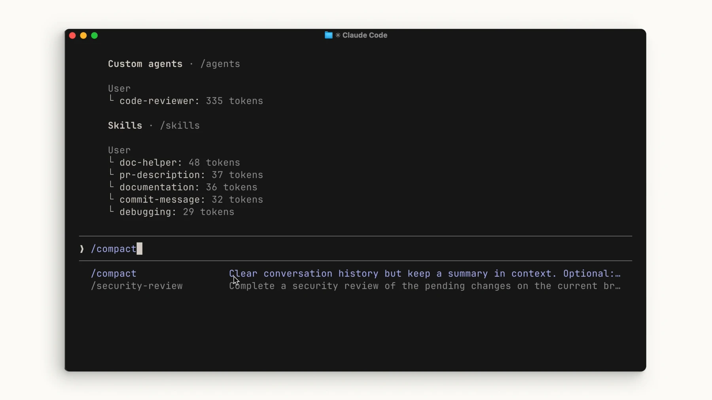
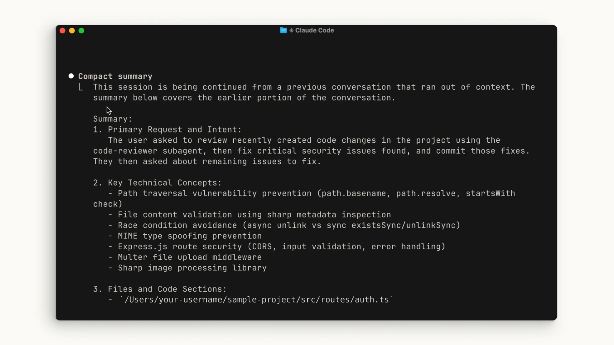

# ادامهٔ گفتگو و مدیریت زمینه

## هدف و پیش‌نیاز
یک کار چندمرحله‌ای را در همان پروژه ادامه دهید. پیش از خروج، خلاصهٔ کار و موارد ناتمام را بخواهید.

## ادامهٔ نشست
در پوشهٔ پروژه `claude --continue` آخرین گفتگو را ادامه می‌دهد. برای انتخاب گفتگو `claude --resume` را اجرا کنید؛ داخل نشست هم `/resume` انتخاب‌گر گفتگو را باز می‌کند. قبل از ادامه، نام پروژه و تاریخ نشست را بررسی کنید.

## کنترل زمینه

برای دیدن مصرف زمینه `/context` و برای فشرده‌سازی `/compact` را استفاده کنید. در درخواست فشرده‌سازی، تصمیم‌ها و موارد ناتمام را مشخص کنید. `/clear` گفتگوی فعال را خالی می‌کند؛ جایگزین ثبت تصمیم‌های پروژه نیست.

> خلاصه‌ای برای ادامهٔ کار بنویس: هدف، فایل‌های تغییرکرده، تست‌های واقعاً اجراشده، خطاهای باقی‌مانده و قدم بعد.

## معیار پایان و رفع مشکل

گفتگوی موردنظر باید شامل درخواست قبلی باشد. اگر نشست دیگری باز شد، با `/resume` دوباره انتخاب کنید. پس از فشرده‌سازی، تصمیم‌های مهم را با فایل‌های پروژه تطبیق دهید.

[Claude Code — common-workflows](https://code.claude.com/docs/en/common-workflows)

منابع تصویری و درس تکمیلی رسمی:

- [Claude Academy](https://academy.claude.com/courses/claude-code-101/context-management)
