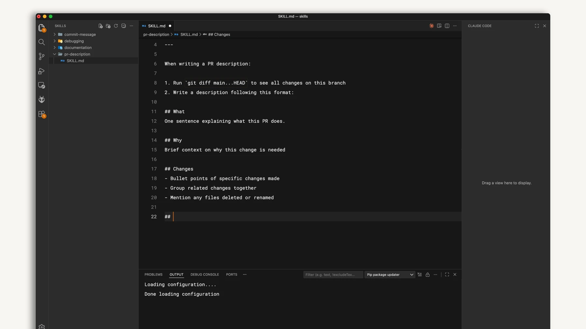
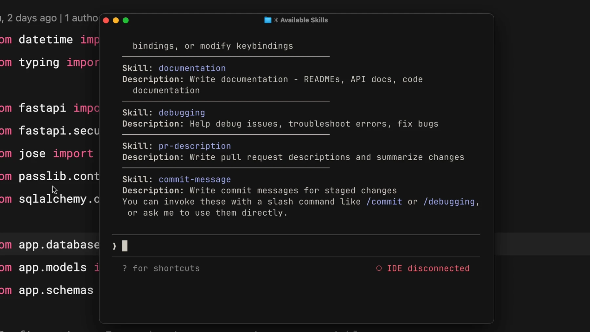

# Create and use skills

## Practice

Create `.claude/skills/review-checklist/SKILL.md` with name and description frontmatter and review steps in the body. Invoke `/review-checklist` and inspect the result.

```text
/review-checklist
```

## Write the skill file



Save this example in the file introduced above. It runs only when you explicitly invoke it:

```markdown
---
name: review-checklist
description: Review changes against the requested behavior.
disable-model-invocation: true
---
Read the current diff. Compare it with the requested behavior.
List concrete logic errors with file references.
State which checks ran and which did not. Do not edit files.
```

Run `/review-checklist` again. Its report should reference actual changes in this project. If discovery fails, check `.claude/skills/review-checklist/SKILL.md`, file spelling and frontmatter. Skills use the host's model and tools; they do not supply an account or free model access.

## Verify the result

If you created the top-level skills directory for the first time after this session began, run `/reload-skills`; repeat it after later changes in that directory during the same session. The displayed name and description should match your file.



Check actual files and test output. If a command is unavailable, check your installed version and the official documentation.

[Claude Code — skills](https://code.claude.com/docs/en/skills)

Official illustrated lessons:

- [Claude Academy](https://academy.claude.com/courses/introduction-to-agent-skills/creating-your-first-skill)
