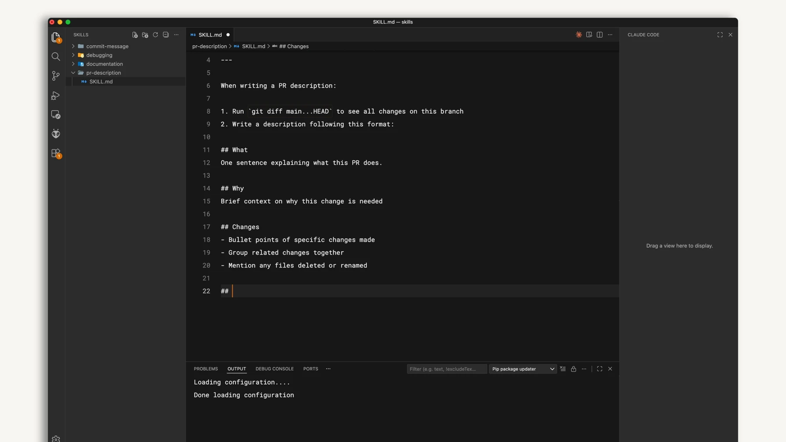
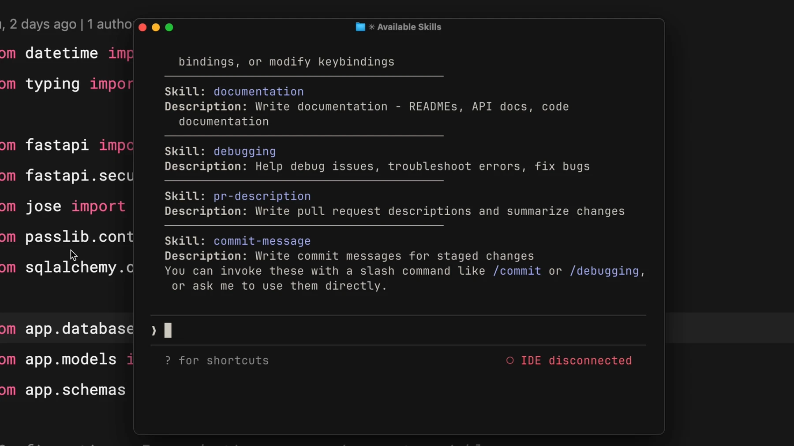

# ساخت و استفاده از Skills

## تمرین

یک فایل `.claude/skills/review-checklist/SKILL.md` بسازید؛ در frontmatter نام و توضیح و در بدنه مراحل بازبینی را بنویسید. با `/review-checklist` آن را فراخوانی کنید و خروجی را با هدف اسکیل بسنجید.

```text
/review-checklist
```

## ساخت فایل اسکیل



در فایل معرفی‌شده این نمونه را بنویسید. این اسکیل فقط با فراخوانی صریح شما اجرا می‌شود:

```markdown
---
name: review-checklist
description: Review changes against the requested behavior.
disable-model-invocation: true
---
Read the current diff. Compare it with the requested behavior.
List concrete logic errors with file references.
State which checks ran and which did not. Do not edit files.
```

دوباره `/review-checklist` را اجرا کنید. گزارش باید دربارهٔ تغییرات واقعی همین پروژه باشد. اگر فرمان دیده نشد، مسیر `.claude/skills/review-checklist/SKILL.md`، املای نام فایل و frontmatter را بررسی کنید. اسکیل روی مدل و ابزارهای میزبان اجرا می‌شود؛ خودش حساب یا مدل رایگان فراهم نمی‌کند.

## بررسی نتیجه

اگر پوشهٔ skills را بعد از شروع نشست برای نخستین بار ساخته‌اید، `/reload-skills` را اجرا کنید؛ در همان نشست پس از تغییرهای بعدی آن پوشه هم این فرمان را تکرار کنید. نام و توضیح نمایش‌داده‌شده باید با فایل شما یکسان باشد.



نتیجه را با فایل واقعی و خروجی تست بررسی کنید. اگر فرمان شناخته نشد، نسخهٔ نصب‌شده و مستندات رسمی را بررسی کنید.

[Claude Code — skills](https://code.claude.com/docs/en/skills)

منابع تصویری و درس تکمیلی رسمی:

- [Claude Academy](https://academy.claude.com/courses/introduction-to-agent-skills/creating-your-first-skill)
