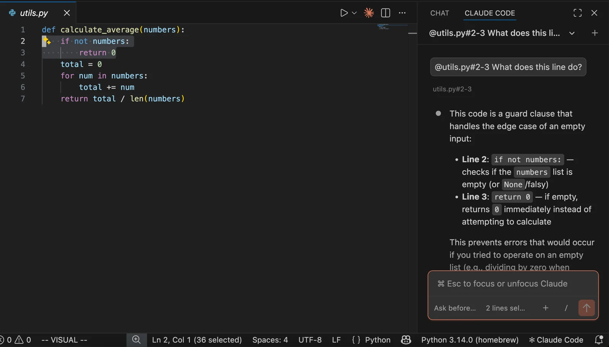
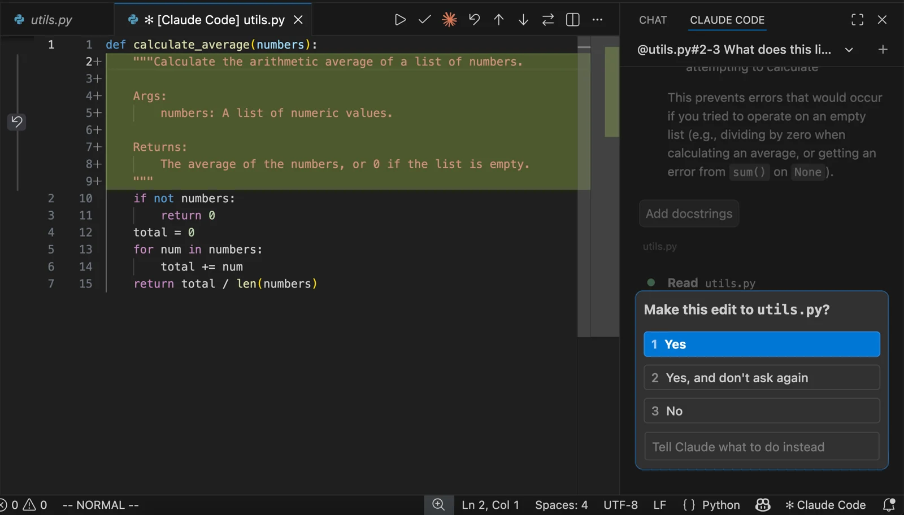

# Reference code and review edits in VS Code

## Environment
This lesson uses the official Claude Code extension in VS Code; these screenshots do not show the CLI. Install the extension using the official guide and open a disposable project.

## Reference specific code
Open a file and select relevant lines. Ask about those lines in the Claude panel. Check the file name and line range before sending.

## Review proposed edits
Request a small change, such as a function docstring. Read the diff before accepting: green marks added text. Answer the edit permission prompt in the right panel after inspection.

## Acceptance
Accept only the requested change, then run relevant checks. These official examples show macOS; check keyboard shortcuts for your Windows version.

[Claude Code — vs-code](https://code.claude.com/docs/en/vs-code)
