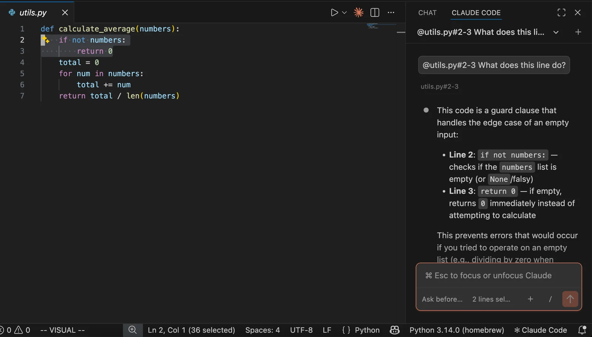
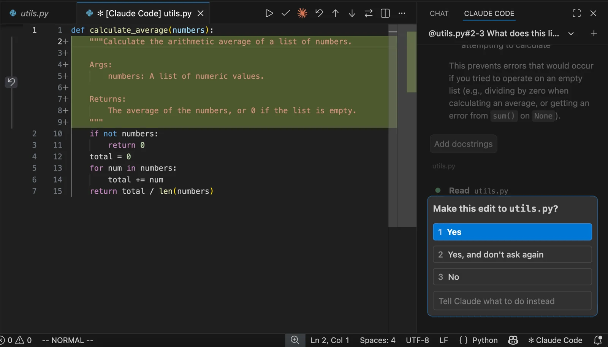

# ارجاع به کد و بررسی تغییر در VS Code

## محیط این درس
این درس مربوط به افزونهٔ رسمی Claude Code در VS Code است؛ تصویرهای آن رابط CLI نیستند. افزونه را از راهنمای رسمی نصب و پروژهٔ آزمایشی را باز کنید.

## ارجاع به یک بخش مشخص
یک فایل را باز و چند خط مرتبط را انتخاب کنید. در پنل Claude دربارهٔ همان خطوط سؤال کنید؛ نام فایل و محدودهٔ خطوط را قبل از ارسال بررسی کنید.

## بازبینی پیشنهاد ویرایش
یک تغییر کوچک مانند افزودن توضیح تابع بخواهید. پیش از پذیرش، diff را بخوانید: بخش سبز متن اضافه‌شده است. پرسش مجوز در پنل سمت راست را پس از بررسی پاسخ دهید.

## معیار پایان
فقط تغییر خواسته‌شده را بپذیرید و تست مرتبط را اجرا کنید. تصویرها نمونهٔ رسمی macOS هستند؛ کلید میان‌بر را از راهنمای نسخهٔ ویندوز خود بررسی کنید.

[Claude Code — vs-code](https://code.claude.com/docs/en/vs-code)
