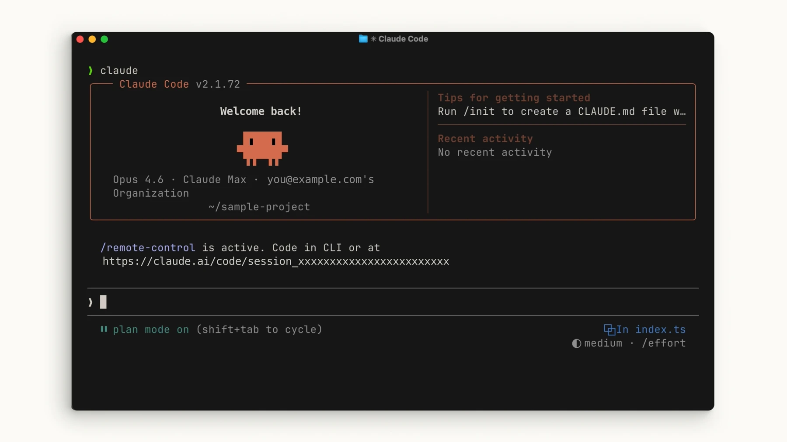
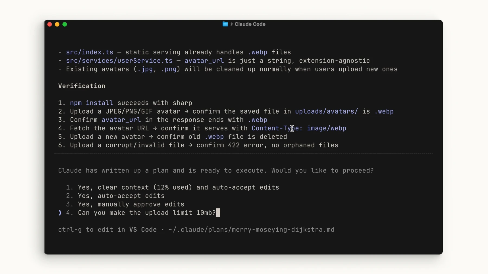

# Work on a project

## Practice



Run `claude` in a disposable project. Ask for its structure and test command. Describe one small bug, request a plan, review it, then allow edits.

```text
Find the empty-input bug. Explain the cause and plan first; after approval, fix it and run the relevant test.
```

## Verify the result



Check actual files and test output. If a command is unavailable, check your installed version and the official documentation.

[Claude Code — common-workflows](https://code.claude.com/docs/en/common-workflows)

Official illustrated lessons:

- [Claude Academy](https://academy.claude.com/courses/claude-code-101/your-first-prompt)
- [Claude Academy](https://academy.claude.com/courses/claude-code-101/the-explore-plan-code-commit-workflow)
