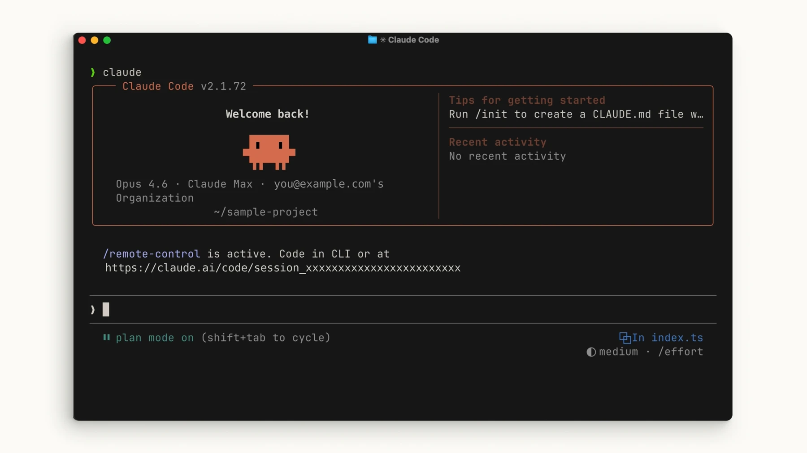
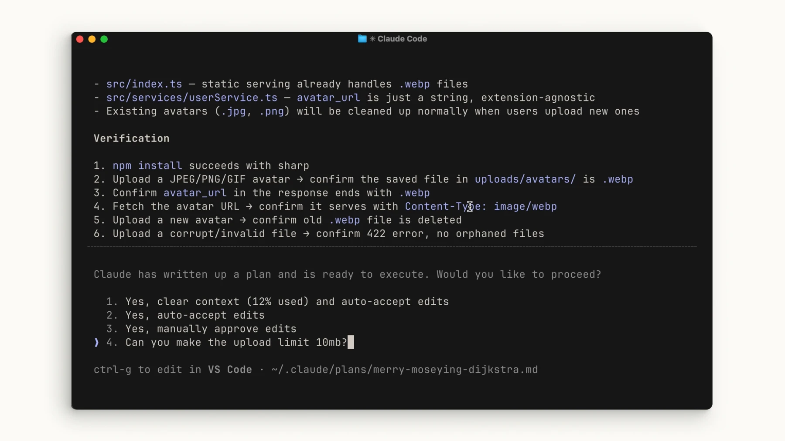

# کار عملی روی پروژه

## تمرین

در پوشهٔ یک پروژهٔ آزمایشی `claude` را اجرا کنید. ابتدا بخواهید ساختار پروژه و فرمان تست را توضیح دهد. سپس یک خطای کوچک مشخص کنید، برنامهٔ اصلاح را بخواهید و پس از بررسی اجازهٔ تغییر بدهید.

> خطای ورودی خالی را پیدا کن. ابتدا علت و برنامه را توضیح بده؛ پس از تأیید، اصلاح کن و تست مرتبط را اجرا کن.

## بررسی نتیجه

نتیجه را با فایل واقعی و خروجی تست بررسی کنید. اگر فرمان شناخته نشد، نسخهٔ نصب‌شده و مستندات رسمی را بررسی کنید.

[Claude Code — common-workflows](https://code.claude.com/docs/en/common-workflows)

منابع تصویری و درس تکمیلی رسمی:

- [Claude Academy](https://academy.claude.com/courses/claude-code-101/your-first-prompt)
- [Claude Academy](https://academy.claude.com/courses/claude-code-101/the-explore-plan-code-commit-workflow)
