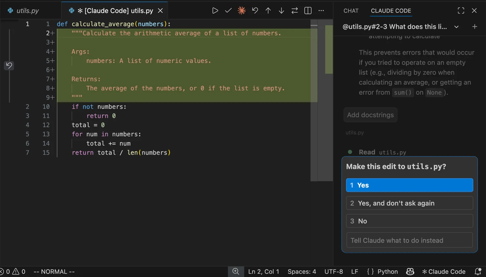

# Clean code with a coding agent

Clean code makes the behavior and its assumptions easy to find. Name functions after what they do, keep validation near the inputs, and separate business rules from UI and network calls. Extract repeated rules when the duplication is real and the shared function has a clear job.

## Give the agent a verifiable request

> In the budget exercise, keep the existing behavior. Give the amount parser a clear name and put it at the input boundary. Keep calculations independent from form rendering. Reuse the existing validation and tests. Show the diff and run tests for valid, blank, negative and boundary inputs.

Review each changed file. Ask why a new dependency or abstraction is needed. Check readable names, consistent error messages, and whether an existing caller still works. Run the same tests before and after. If a behavior change is actually desired, describe it separately and add an example that demonstrates it.

