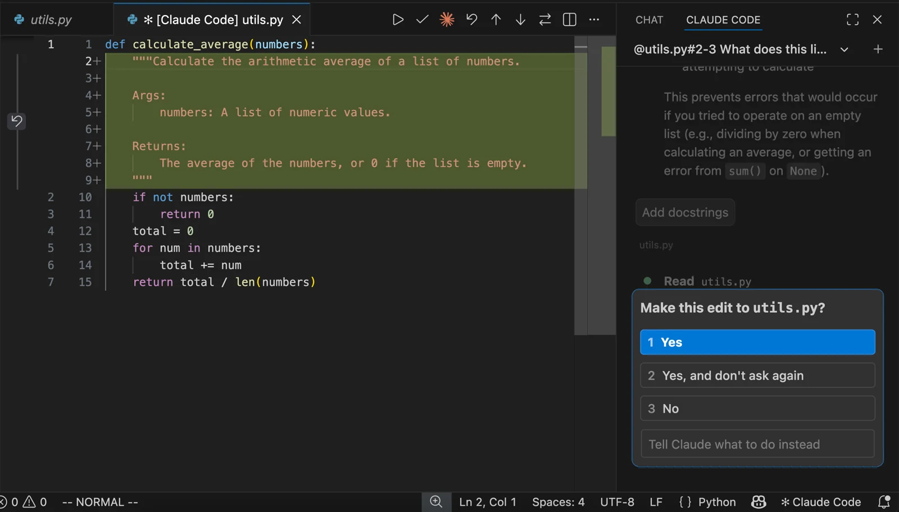

# کد تمیز با کمک دستیار

در کد تمیز، پیدا کردن رفتار و فرض‌هایش آسان است. نام تابع باید کاری را که انجام می‌دهد روشن کند. اعتبارسنجی را نزدیک ورودی بگذارید و قواعد محاسبه را از رابط و شبکه جدا کنید. قاعدهٔ تکراری را وقتی مشترک کنید که واقعاً یک کار مشخص انجام می‌دهد.

## درخواست قابل بررسی بنویسید

> در تمرین بودجه، رفتار فعلی را حفظ کن. بخش تبدیل مبلغ را با یک نام روشن کنار ورودی قرار بده. محاسبه را از نمایش فرم جدا نگه دار. از اعتبارسنجی و آزمون‌های موجود استفاده کن. تغییرات را نشان بده و ورودی معتبر، خالی، منفی و مرزی را آزمایش کن.

تغییر هر فایل را بخوانید. دلیل وابستگی یا لایهٔ تازه را بپرسید. نام‌ها، پیام خطا و کارکرد استفاده‌کنندگان فعلی را بررسی کنید. قبل و بعد، همان آزمون‌ها را اجرا کنید. اگر قرار است رفتار عوض شود، آن را جداگانه توضیح دهید و نمونهٔ قابل‌سنجش بدهید.

