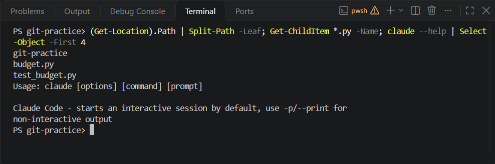

# Working with CLI tools
Open a terminal in a practice project. Run `Get-Location` to confirm the folder and `Get-ChildItem` to see its files. A CLI command usually has a program name, options such as `--help`, and arguments such as a file path. Quote paths containing spaces. In PowerShell, check a native program’s exit status with `$LASTEXITCODE` immediately after the command. An error message and an exit code tell you different things: read both.

## Practice with a coding agent
Use Claude Code as the example. Run `claude --help` in the shell, then run `claude` from the practice directory to start the interactive session. Give instructions inside that session. Ask it to list the relevant files and explain an existing function before allowing edits. Review each proposed file write or shell command. Exit the session to return to PowerShell and run `git diff` there to inspect changes.

Repeat the routine with another CLI: find its help, verify its working directory, distinguish shell commands from chat instructions, try one small task, and check its output. The Claude Code handbook explains the app’s particular permission and session controls.
