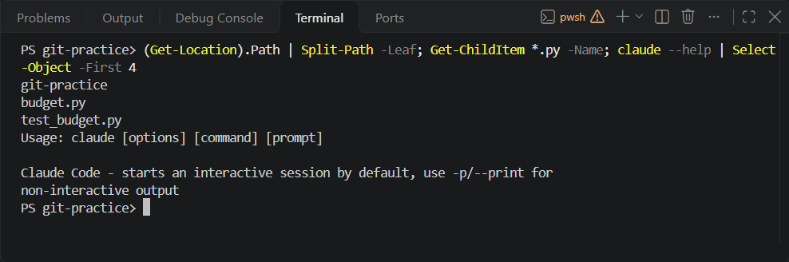

# کار با ابزارهای خط فرمان
ترمینال را در پوشهٔ یک پروژهٔ تمرینی باز کنید. با `Get-Location` پوشهٔ جاری را ببینید و با `Get-ChildItem` فایل‌هایش را فهرست کنید. یک دستور معمولاً نام برنامه، گزینه‌ای مثل `--help` و آرگومانی مثل مسیر فایل دارد. مسیر دارای فاصله را داخل گیومه بگذارید. در پاورشل، بلافاصله بعد از اجرای برنامه با `$LASTEXITCODE` وضعیت خروج را ببینید. متن خطا و کد خروج هر کدام اطلاعات متفاوتی می‌دهند.

## تمرین با یک دستیار
Claude Code مثال این درس است. در پوسته ابتدا `claude --help` را بزنید و بعد از همان پوشه با `claude` جلسهٔ تعاملی را شروع کنید. درخواست‌ها را در جلسه بنویسید. از دستیار بخواهید فایل‌های مرتبط را پیدا کند و یک تابع را بدون ویرایش توضیح دهد. هر تغییر فایل یا فرمان پیشنهادی را بررسی کنید. از جلسه خارج شوید و در پاورشل با `git diff` تغییرات را ببینید.

برای هر CLI دیگر هم همین روال را تکرار کنید: راهنما را باز کنید، پوشه را بررسی کنید، فرمان پوسته را از درخواست داخل جلسه تشخیص دهید و یک کار کوچک را امتحان کنید. جزئیات مجوزها و نشست‌ها در راهنمای کامل Claude Code آمده‌اند.
