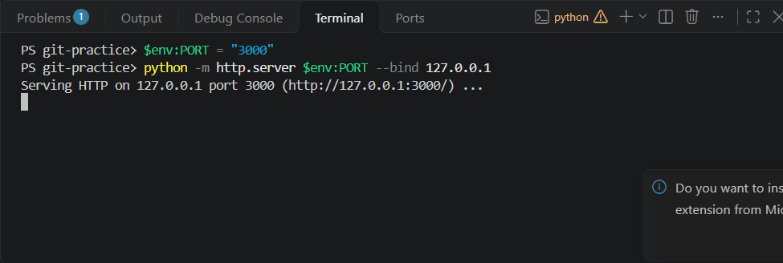

# Configuration, environment variables and deployment

Start with a small project that runs locally. List what changes by environment, such as the port, service URL and database connection. Read those settings at startup and validate them with clear errors. Document expected names in `.env.example` using dummy values such as `PORT=3000`. Keep the real local `.env` out of Git. Only use it if the project loads it.

Try it in the practice folder that contains the first project's `index.html`. In PowerShell, set the port and start a local preview:

```powershell
$env:PORT = "3000"
python -m http.server $env:PORT --bind 127.0.0.1
```



Open `http://127.0.0.1:3000` in Edge and add a task. Press Ctrl+C in PowerShell when finished. This exercise serves static files from your practice folder on your own machine.

## Rehearse a deployment
1. Run the project locally with development settings. Try startup with a missing required setting and check the error.
2. Run tests and build from a known commit. Write down the build command, start command and any migrations.
3. Set environment values and secrets in the deployment service. Server-side keys belong on the server. Frontend values included in the built browser bundle are public.
4. Deploy to a preview environment. Check startup logs, open the app and exercise its main flow. Check logs for missing configuration without logging secret values.
5. Record the deployed version and how to return to the previous build. If a database change is involved, rehearse the rollback or recovery separately.

Ask the agent to list which values go into the build, which are read at runtime, and how you can verify each one. Review the list against the actual code before deploying.
