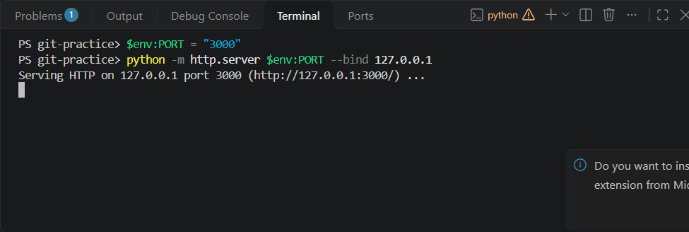

# کانفیگ، متغیرهای محیطی و دیپلوی

از پروژه‌ای شروع کنید که روی سیستم خودتان اجرا می‌شود. تنظیماتی را که بین محیط‌ها فرق دارند فهرست کنید، مثل پورت، نشانی سرویس و اتصال پایگاه داده. برنامه باید این مقادیر را موقع شروع بخواند و اگر مقدار ضروری کم بود، خطای روشن بدهد. نام متغیرها را با مقدار نمونه مثل `PORT=3000` در `.env.example` ثبت کنید. فایل واقعی `.env` را وارد Git نکنید. این فایل فقط وقتی اثر دارد که پروژه آن را بخواند.

در همان پوشهٔ تمرینی که فایل `index.html` پروژهٔ اول را دارد، این دستورها را در PowerShell اجرا کنید تا پیش‌نمایش محلی باز شود.

```powershell
$env:PORT = "3000"
python -m http.server $env:PORT --bind 127.0.0.1
```



نشانی `http://127.0.0.1:3000` را در Edge باز کنید و یک کار به فهرست اضافه کنید. در پایان در PowerShell کلیدهای Ctrl+C را بزنید. این تمرین فایل‌های ثابت پوشهٔ تمرینی را روی دستگاه خودتان ارائه می‌کند.

## یک دیپلوی تمرینی انجام دهید
1. برنامه را با تنظیمات توسعه اجرا کنید. یک متغیر ضروری را موقتاً بردارید و پیام خطا را بررسی کنید.
2. آزمون بگیرید و از یک کامیت مشخص نسخه بسازید. فرمان ساخت، فرمان اجرا و مهاجرت پایگاه داده را ثبت کنید.
3. مقادیر محیط و اسرار را در سرویس انتشار تنظیم کنید. کلید سمت سرور باید در سرور بماند. مقداری که در بستهٔ مرورگر قرار بگیرد عمومی است.
4. ابتدا در محیط پیش‌نمایش منتشر کنید. گزارش آغاز به کار را بخوانید، صفحه را باز کنید و مسیر اصلی کاربر را امتحان کنید. مقدار واقعی اسرار را در گزارش چاپ نکنید.
5. نسخهٔ منتشرشده و راه بازگشت به بستهٔ قبلی را ثبت کنید. اگر ساختار پایگاه داده تغییر کرده، بازیابی آن را هم جداگانه تمرین کنید.

از دستیار بخواهید بگوید هر مقدار هنگام ساخت خوانده می‌شود یا هنگام اجرا و چطور می‌شود درستی آن را بررسی کرد. فهرست را پیش از دیپلوی با کد تطبیق دهید.
