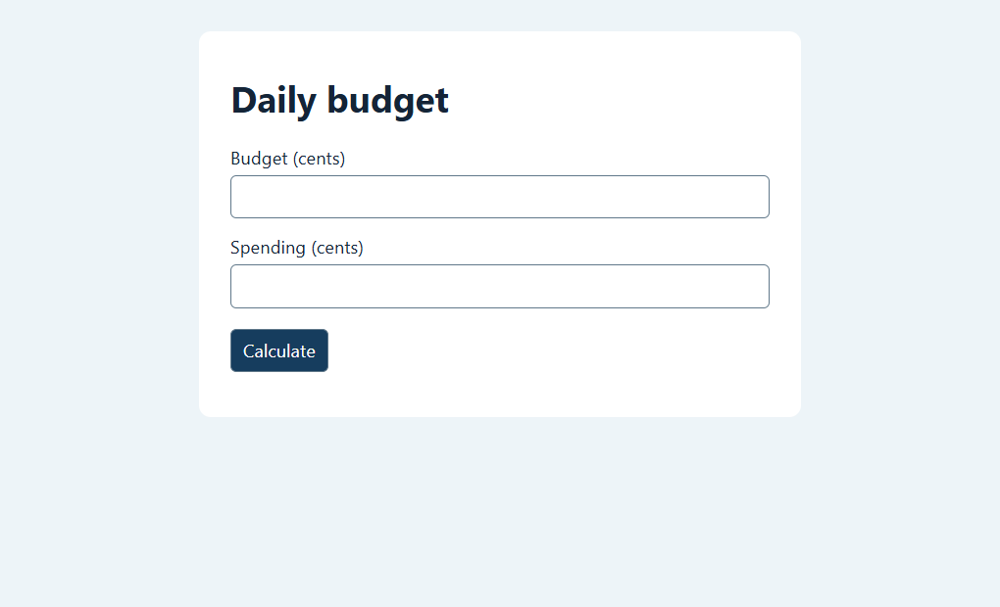
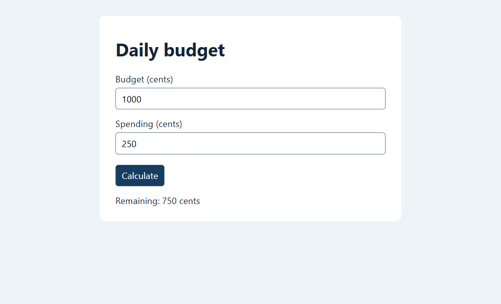
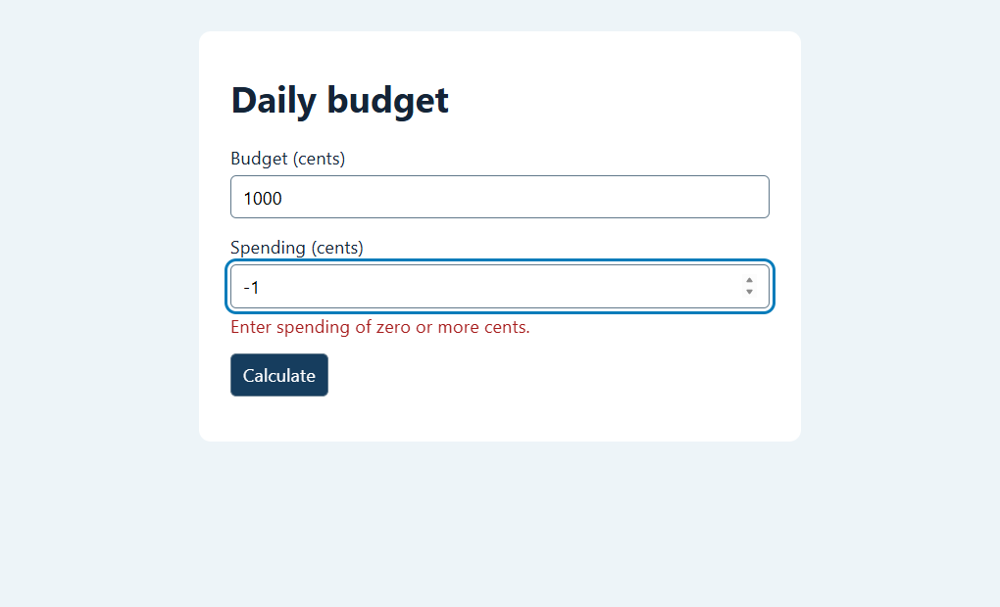

# Interface design fundamentals

Sketch a budget form with two labeled inputs, one Calculate button, and a space for the result. Put the labels next to their fields and mark the currency or unit. Make the main action easy to find.

1. **Design the states.** Draw the initial screen, a valid result, and a failed submission. When spending is negative, explain the problem beside that field and keep the values the user entered.

   

   

2. **Check reading order.** Read the screen top to bottom. The headings and labels should make sense even without the colors or icons.
3. **Check interaction.** Use Tab to reach each control in a predictable order and make sure focus is visible. Try a narrow window and long translated labels. If the interface is Persian, check that labels follow the page direction and code examples remain left-to-right.

Give the sketch and three scenarios to the coding agent. Compare its result with the sketch, then write down one improvement you can verify in the browser.
