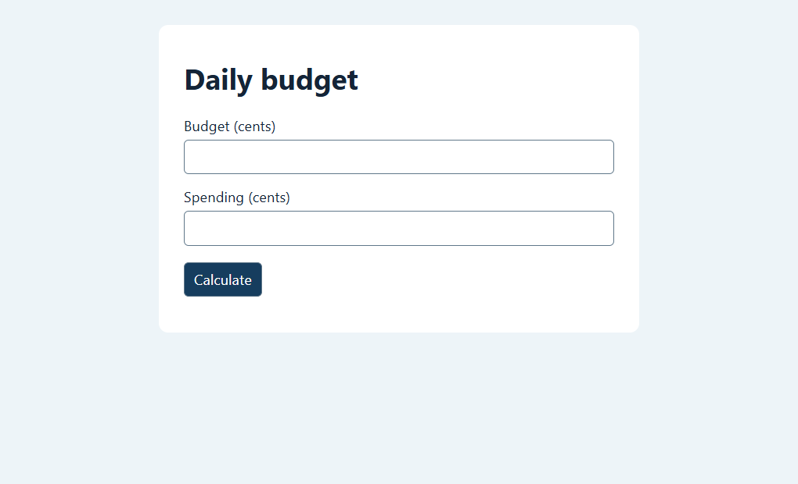
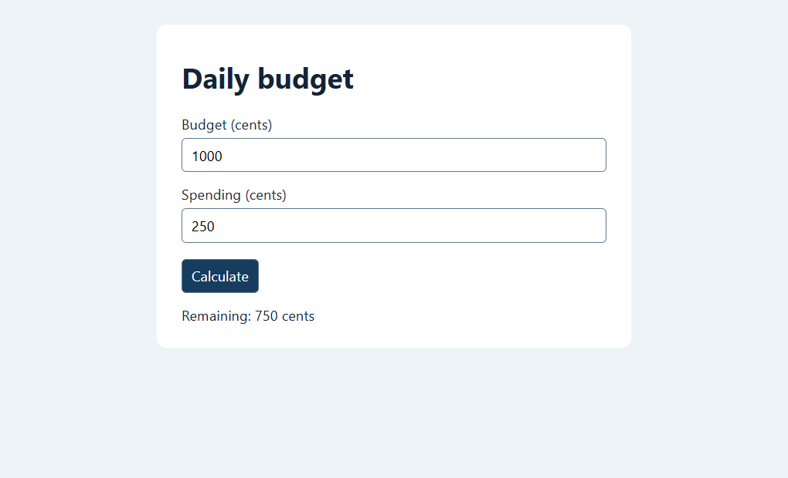
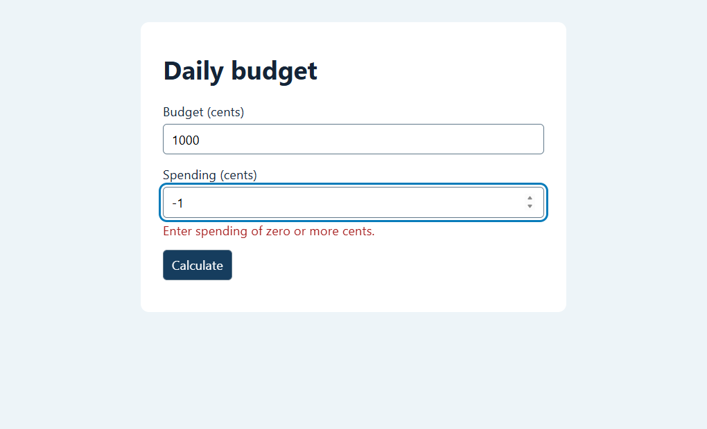

# اصول طراحی رابط

طرح یک فرم بودجه را بکشید که دو ورودی با برچسب، یک دکمهٔ «محاسبه» و جایی برای نتیجه دارد. برچسب و واحد پول را کنار فیلد بگذارید تا کاربر بداند چه چیزی وارد کند. دکمهٔ اصلی باید به‌راحتی پیدا شود.

1. **وضعیت‌های فرم را طراحی کنید.** نمای اولیه، نتیجهٔ معتبر و خطا را بکشید. وقتی هزینه منفی است، علت خطا را کنار همان فیلد بنویسید و ورودی‌های کاربر را حفظ کنید.

   

   

2. **ترتیب خواندن را بررسی کنید.** صفحه را از بالا به پایین بخوانید. عنوان‌ها و برچسب‌ها باید حتی بدون رنگ و آیکن قابل‌فهم باشند.
3. **تعامل را امتحان کنید.** با Tab به همهٔ کنترل‌ها برسید و مطمئن شوید نشانگر تمرکز دیده می‌شود. پنجرهٔ باریک و برچسب‌های بلند را امتحان کنید. در رابط فارسی، جهت برچسب‌ها را بررسی کنید و نمونهٔ کد را چپ‌به‌راست نگه دارید.

طرح و این سه سناریو را به دستیار برنامه‌نویسی بدهید. نتیجه را با طرح مقایسه کنید و یک بهبود بنویسید که بتوانید در مرورگر بررسی‌اش کنید.
