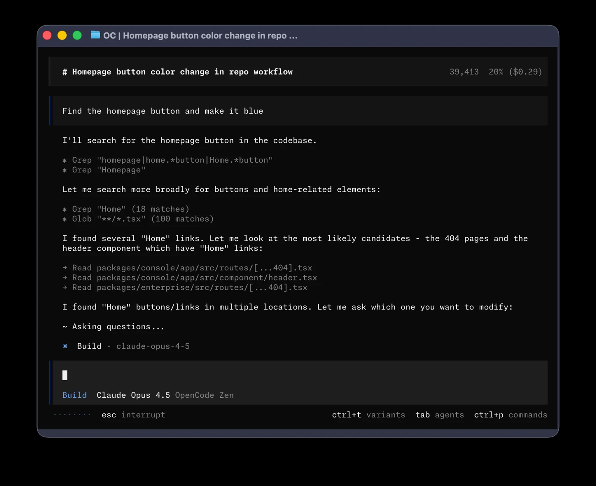

# Working with desktop coding apps

Use OpenCode Desktop and the task-list folder from [your first project](/learning/first-project) to practice a workflow you can transfer to other coding apps. If you want to bring your own model or API key, see [Connect an external model with an API](/learning/external-model-api).

1. **Open a project.** Select the practice folder you want the assistant to work in. Confirm it can see the expected files.
2. **Check the connection.** Select an available model and send one small question. If it fails, check the provider and account in the app’s own settings.

   

3. **Give context.** Point to a specific file and describe the behavior you expect. First ask for a plan and the files it would change.
4. **Review the change.** Approve a small edit, inspect the diff and run the project yourself. If there is no integrated diff, use Git in the terminal.
5. **Recover and continue.** If the result is wrong, describe the failing example and ask for a targeted fix. Check that previous behavior still works. Keep the change only after review.

   

Exercise: find the code that displays a completed task, ask for a clearer label, then verify adding and completing a task still work. See the [OpenCode product guide](/learning/opencode?view=reference) for installation and app-specific controls.
