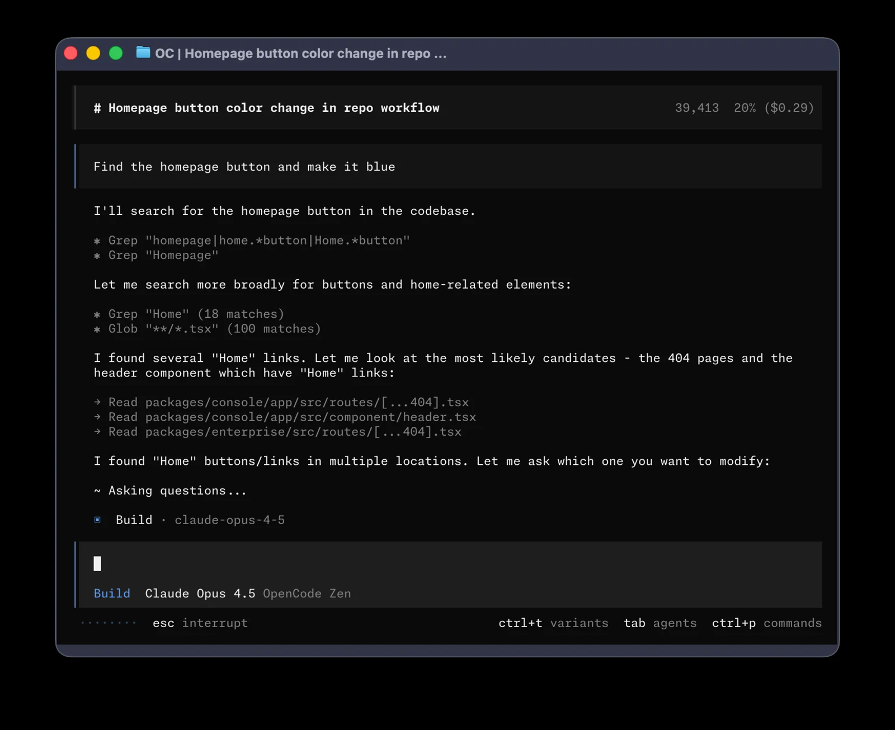

# کار با اپ‌های کدنویسی

پوشهٔ فهرست کارها از [اولین پروژه](/learning/first-project) را در OpenCode Desktop باز کنید و روشی را تمرین کنید که در اپ‌های دیگر هم به کار می‌آید. برای استفاده از مدل یا کلید خودتان، درس [اتصال مدل بیرونی با API](/learning/external-model-api) را ببینید.

1. **پروژه را باز کنید.** پوشهٔ تمرینی را انتخاب کنید و مطمئن شوید دستیار همان فایل‌هایی را می‌بیند که انتظار دارید.
2. **اتصال را بررسی کنید.** یک مدل در دسترس انتخاب کنید و یک سؤال کوتاه بپرسید. اگر پاسخ نیامد، حساب و ارائه‌دهنده را در تنظیمات خود اپ بررسی کنید.

   

3. **زمینه بدهید.** به یک فایل مشخص اشاره کنید و رفتار مورد انتظار را توضیح دهید. اول طرح و فهرست فایل‌هایی را بخواهید که ممکن است تغییر کنند.
4. **تغییر را بررسی کنید.** یک ویرایش کوچک را بپذیرید، تفاوت فایل‌ها را بخوانید و پروژه را خودتان اجرا کنید. اگر اپ نمای تغییرات ندارد، از Git در ترمینال استفاده کنید.
5. **اشکال را برطرف کنید.** اگر نتیجه غلط بود، همان نمونهٔ خراب را توضیح دهید و اصلاح محدود بخواهید. دوباره رفتارهای قبلی را هم امتحان کنید.

   

تمرین: کدی را پیدا کنید که کار انجام‌شده را نشان می‌دهد، برچسب روشن‌تری بخواهید و مطمئن شوید افزودن و انجام‌دادن کار هنوز درست است. جزئیات نصب و کنترل‌های اپ در [راهنمای OpenCode](/learning/opencode?view=reference) آمده‌اند.
