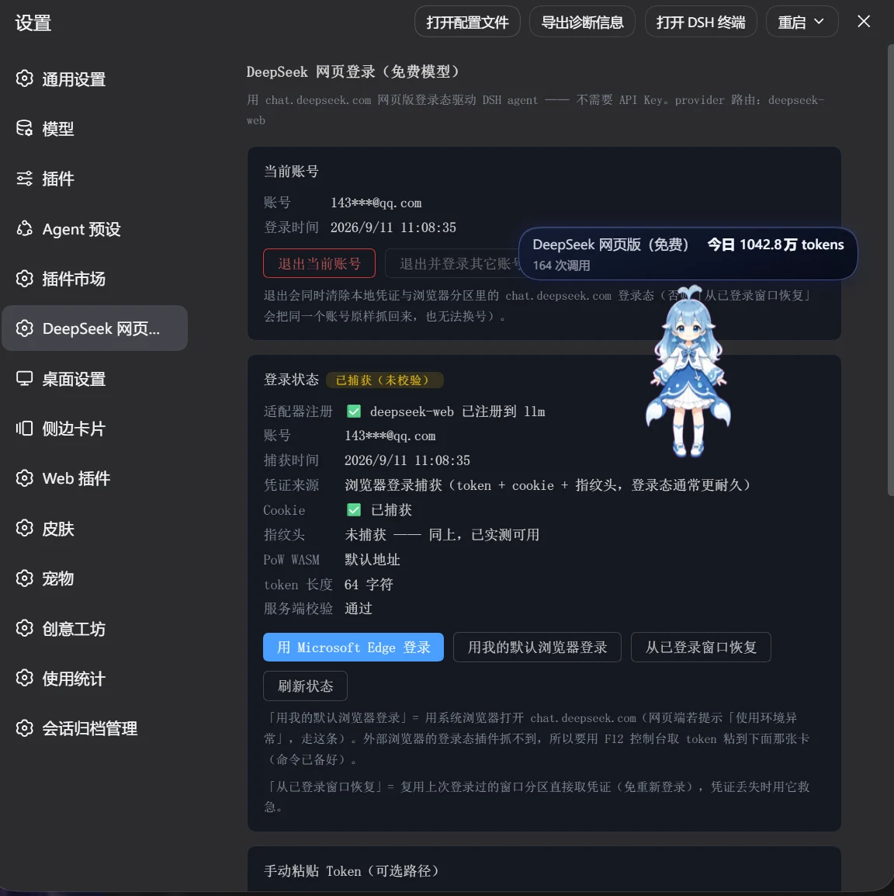
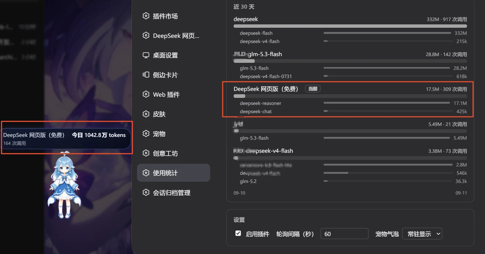

# DeepSeek 网页登录（免费模型） — ورود وب دیپ‌سیک

Intermediate: connect a DeepSeek Web account to DeepSeek Harness using unofficial dsh-deepseek-web-login. Web allowance does not mean unlimited free API. Documentation checked; local installation/login untested.

## Install

Use a compatible release tgz following the README, or the documented Git command: dsh plugin --profile desktop add github:cv-superding/dsh-deepseek-web-login Then restart Harness.

## Use

Open Settings → DeepSeek 网页登录 → 浏览器窗口登录; sign in at chat.deepseek.com. In the model picker choose DeepSeek 网页版（免费） → 快速模式 and test a short message.

## Getting started

See [Install and manage skills](/learning/skill-basics) for host compatibility, prerequisites, removal, and troubleshooting.

## Login and usage screens

