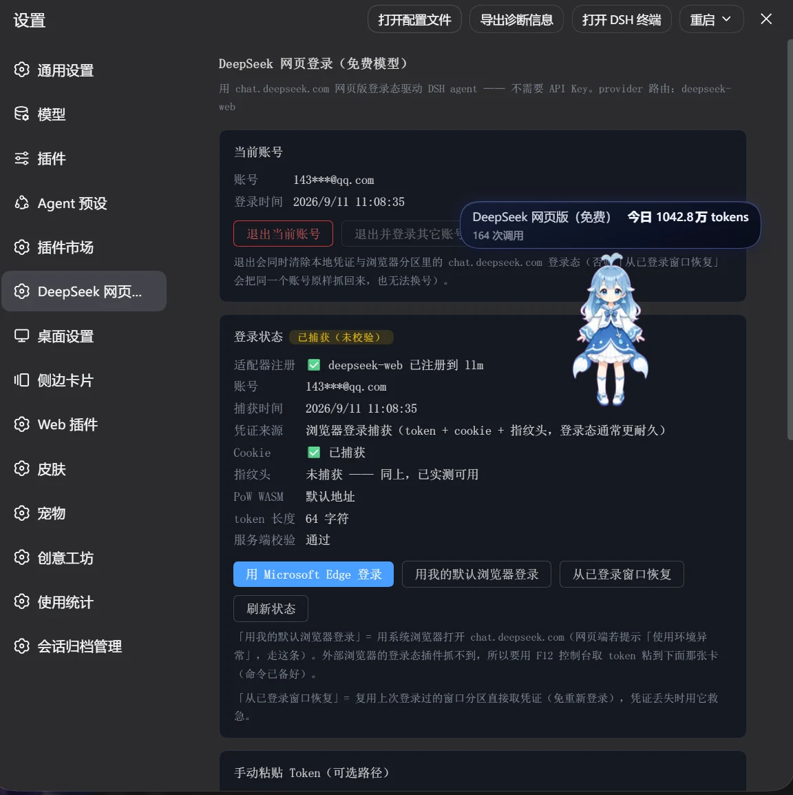
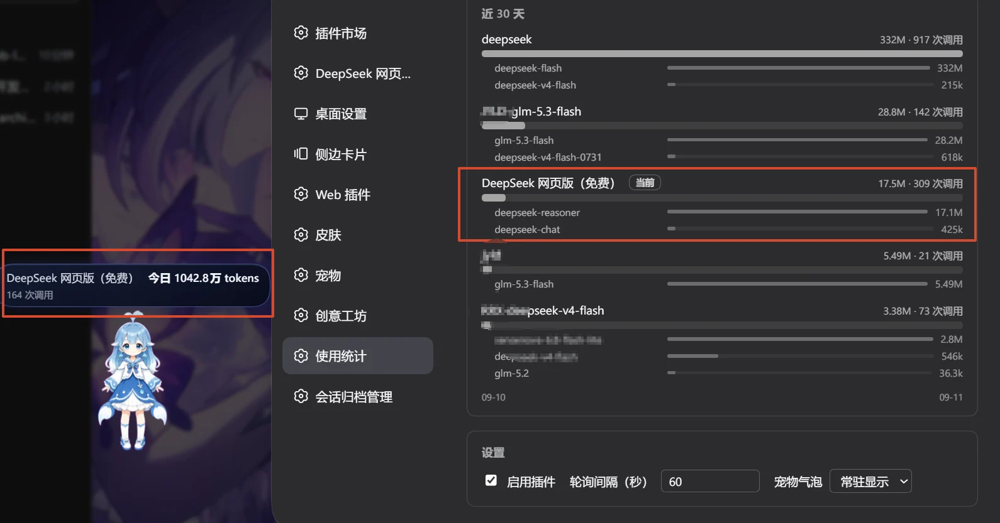

# DeepSeek 网页登录（免费模型） — ورود وب دیپ‌سیک

آموزش تکمیلی: اتصال حساب وب DeepSeek به DeepSeek Harness با افزونهٔ غیررسمی dsh-deepseek-web-login. سهمیهٔ وب، API رایگان نامحدود نیست. بررسی مستندات انجام شده؛ نصب و ورود محلی آزموده نشده است.

## نصب

از صفحهٔ Releases مخزن، بستهٔ tgz سازگار را بگیرید و طبق README نصب کنید. روش Git مستندشده در ترمینال: dsh plugin --profile desktop add github:cv-superding/dsh-deepseek-web-login سپس Harness را دوباره باز کنید.

## استفاده

Settings → DeepSeek 网页登录 → 浏览器窗口登录 را باز کنید و وارد chat.deepseek.com شوید. سپس در انتخاب‌گر مدل، DeepSeek 网页版（免费） و 快速模式 را انتخاب و یک پیام کوتاه آزمایش کنید.

## راهنمای پایه

سازگاری میزبان، پیش‌نیازها، حذف و رفع مشکل را در آموزش [نصب و مدیریت اسکیل‌ها](/learning/skill-basics) ببینید.

## تصویر مراحل ورود و بررسی مصرف

