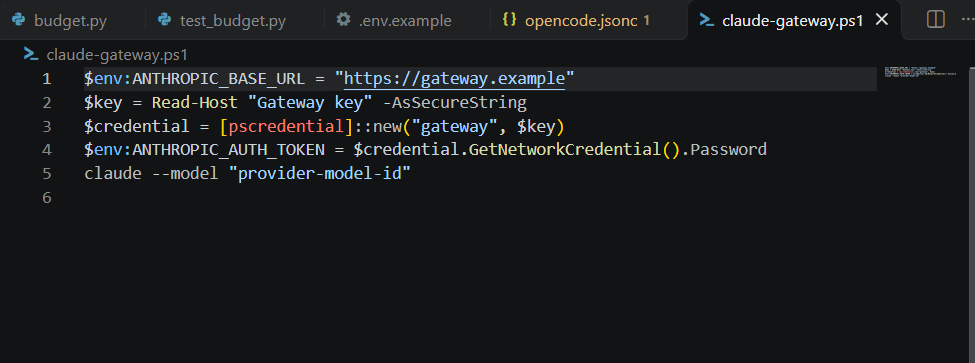
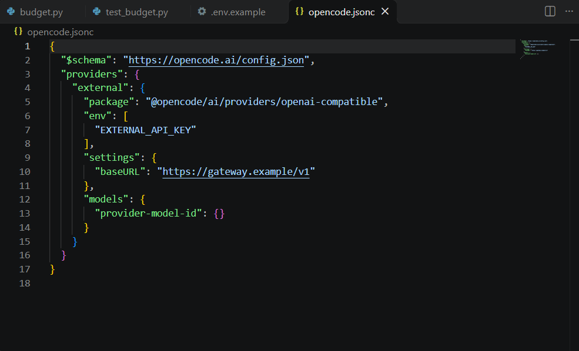

# Connect an external model to Claude Code or OpenCode

Collect three values from the provider: the base URL for the right API protocol, a key or token, and the exact model ID. Check the provider’s pricing and whether the model supports tool calls. A successful chat reply alone does not establish that file or terminal tools work.

## Claude Code CLI: use an Anthropic Messages gateway

Choose a provider or gateway that accepts Anthropic Messages requests at `/v1/messages`. In a fresh PowerShell window, open your practice project and run the example below with your provider’s values. Use the documented base URL, without appending `/v1/messages`.

```powershell
$env:ANTHROPIC_BASE_URL = "https://gateway.example"
$key = Read-Host "Gateway key" -AsSecureString
$credential = [pscredential]::new("gateway", $key)
$env:ANTHROPIC_AUTH_TOKEN = $credential.GetNetworkCredential().Password
claude --model "provider-model-id"
```

This example sends a Bearer token. If the provider instead requires `x-api-key`, use `ANTHROPIC_API_KEY` in place of `ANTHROPIC_AUTH_TOKEN`. Configure only the credential the gateway expects. In Claude Code, use `/status` to check the gateway and credential source. Check the model with `/model`. If the provider exposes only OpenAI Chat Completions, choose OpenCode or a trusted gateway that translates Anthropic Messages.

For a real provider example, follow [OpenRouter’s Claude Code setup](https://openrouter.ai/docs/guides/coding-agents/claude-code-integration). Its Claude Code base URL is `https://openrouter.ai/api`. Follow its credential-conflict instructions if you already use Anthropic credentials. The steps here apply to Claude Code CLI.



## OpenCode: connect a listed provider or configure a custom endpoint

- **Listed provider, such as OpenRouter.** Run `/connect`, choose the provider, enter the key in OpenCode’s prompt, then choose a model with `/models`. In Desktop, use the provider connection and model selector.
- **Custom Chat Completions endpoint.** Merge the following block into the project’s OpenCode configuration. Use the provider’s base URL, typically ending in `/v1`, and its exact model ID. Start with the syntax documented for your installed version.

Current provider configuration (`opencode.jsonc`):

```json
{
  "$schema": "https://opencode.ai/config.json",
  "providers": {
    "external": {
      "package": "@opencode/ai/providers/openai-compatible",
      "env": ["EXTERNAL_API_KEY"],
      "settings": { "baseURL": "https://gateway.example/v1" },
      "models": { "provider-model-id": {} }
    }
  }
}
```

For OpenCode versions using the earlier `provider` / `npm` syntax (`opencode.json`):

```json
{
  "$schema": "https://opencode.ai/config.json",
  "provider": {
    "external": {
      "npm": "@ai-sdk/openai-compatible",
      "options": {
        "baseURL": "https://gateway.example/v1",
        "apiKey": "{env:EXTERNAL_API_KEY}"
      },
      "models": { "provider-model-id": { "name": "External model" } }
    }
  }
}
```

Set the key in the process that starts OpenCode. Example for the CLI:

```powershell
$key = Read-Host "Provider API key" -AsSecureString
$env:EXTERNAL_API_KEY = ([pscredential]::new("provider", $key)).GetNetworkCredential().Password
opencode
```

Open `/models` or Desktop’s model selector and choose the model under `external`. A desktop instance already running may need to be fully closed and started from an environment that supplies the key.




## Verify before using it on a project

1. Ask one short, read-only question in a disposable project. Confirm the selected model and check usage in the provider’s dashboard if available.
2. Ask the agent to read a test file. Review the permission prompt and confirm it can return a result from the file. Then try a small edit and inspect the diff. This checks capabilities that a plain chat reply does not.
3. If it fails, check the status: `401` means check the key and header; `403` means check account or model access; `404` means check URL and model ID; `429` means check quota or rate limits. When chat works but a tool call fails, check the provider’s tool-calling and streaming support.
4. Keep real keys out of project config, Git, screenshots and prompts. Close the example PowerShell window when done. VibeHub’s API notebook can help look up and test a connection. Apply the configuration in the coding tool itself for these examples.

[Claude Code gateway documentation](https://code.claude.com/docs/en/llm-gateway-connect) · [OpenCode provider documentation](https://opencode.ai/docs/providers) · [Earlier OpenCode configuration examples](https://github.com/anomalyco/opencode/blob/dev/packages/web/src/content/docs/providers.mdx)
