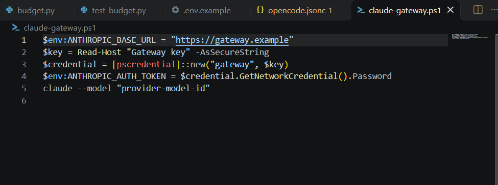
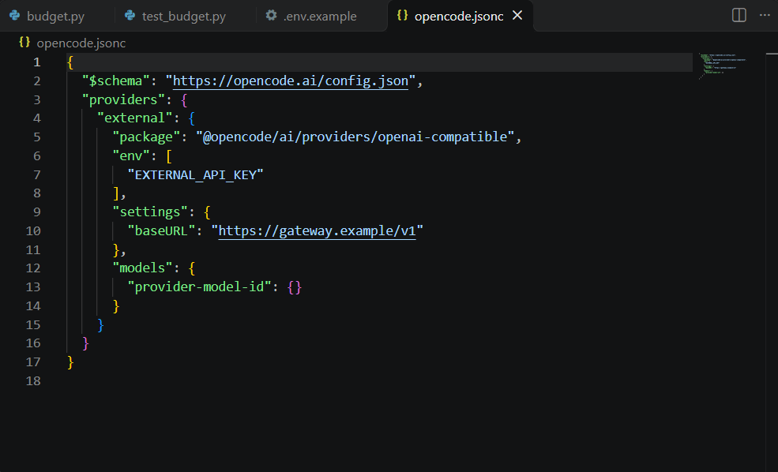

# اتصال مدل بیرونی به Claude Code یا OpenCode

از ارائه‌دهنده سه چیز بگیرید: نشانی پایهٔ پروتکل درست، کلید یا توکن، و شناسهٔ دقیق مدل. قیمت و پشتیبانی مدل از فراخوانی ابزارها را هم بررسی کنید. یک پاسخ موفق در چت فقط نشان می‌دهد که مدل جواب می‌دهد؛ کارکرد ابزار فایل و ترمینال را جداگانه بسنجید.

## Claude Code CLI با درگاه Anthropic Messages

درگاه باید درخواست Anthropic Messages را در مسیر `/v1/messages` بپذیرد. پاورشل تازه‌ای در پوشهٔ پروژهٔ تمرینی باز کنید و در نمونهٔ زیر نشانی و شناسهٔ نمونه را با مقادیر واقعی جایگزین کنید. از نشانی پایهٔ اعلام‌شدهٔ ارائه‌دهنده استفاده کنید و `/v1/messages` را به انتهای آن اضافه نکنید.

```powershell
$env:ANTHROPIC_BASE_URL = "https://gateway.example"
$key = Read-Host "Gateway key" -AsSecureString
$credential = [pscredential]::new("gateway", $key)
$env:ANTHROPIC_AUTH_TOKEN = $credential.GetNetworkCredential().Password
claude --model "provider-model-id"
```

این نمونه توکن را با هدر Bearer می‌فرستد. اگر سرویس به‌جای آن هدر `x-api-key` می‌خواهد، از `ANTHROPIC_API_KEY` به‌جای `ANTHROPIC_AUTH_TOKEN` استفاده کنید. فقط همان متغیری را تنظیم کنید که درگاه می‌خواهد. داخل Claude Code با `/status` نشانی درگاه و منبع مجوز را بررسی کنید و با `/model` انتخاب مدل را ببینید. اگر سرویس فقط OpenAI Chat Completions دارد، از OpenCode یا درگاه معتبری استفاده کنید که درخواست Anthropic Messages را تبدیل می‌کند.

برای نمونهٔ واقعی، [راهنمای OpenRouter برای Claude Code](https://openrouter.ai/docs/guides/coding-agents/claude-code-integration) را ببینید. نشانی پایهٔ آن برای Claude Code برابر `https://openrouter.ai/api` است. اگر قبلاً با حساب یا کلید Anthropic وارد شده‌اید، بخش رفع تداخل مجوز همان راهنما را بخوانید. این مراحل مربوط به نسخهٔ خط فرمان Claude Code است.



## OpenCode با ارائه‌دهندهٔ آماده یا نشانی سفارشی

- **ارائه‌دهندهٔ داخل فهرست، مثل OpenRouter.** با `/connect` سرویس را انتخاب کنید و کلید را در ورودی خود OpenCode بدهید. سپس با `/models` مدل را انتخاب کنید. در نسخهٔ دسکتاپ از اتصال ارائه‌دهنده و انتخاب‌گر مدل استفاده کنید.
- **نشانی سفارشی Chat Completions.** نمونهٔ زیر را با تنظیمات موجود پروژه ادغام کنید. نشانی پایه معمولاً به `/v1` ختم می‌شود. شناسهٔ مدل را دقیقاً مطابق مستندات سرویس بنویسید و قالب متناسب با نسخهٔ نصب‌شده را انتخاب کنید.

قالب فعلی ارائه‌دهنده در `opencode.jsonc`:

```json
{
  "$schema": "https://opencode.ai/config.json",
  "providers": {
    "external": {
      "package": "@opencode/ai/providers/openai-compatible",
      "env": ["EXTERNAL_API_KEY"],
      "settings": { "baseURL": "https://gateway.example/v1" },
      "models": { "provider-model-id": {} }
    }
  }
}
```

قالب نسخه‌هایی که از ساختار قبلی `provider` و `npm` در `opencode.json` استفاده می‌کنند:

```json
{
  "$schema": "https://opencode.ai/config.json",
  "provider": {
    "external": {
      "npm": "@ai-sdk/openai-compatible",
      "options": {
        "baseURL": "https://gateway.example/v1",
        "apiKey": "{env:EXTERNAL_API_KEY}"
      },
      "models": { "provider-model-id": { "name": "External model" } }
    }
  }
}
```

کلید باید در محیط فرایندی موجود باشد که OpenCode را اجرا می‌کند. نمونهٔ CLI در پاورشل:

```powershell
$key = Read-Host "Provider API key" -AsSecureString
$env:EXTERNAL_API_KEY = ([pscredential]::new("provider", $key)).GetNetworkCredential().Password
opencode
```

از `/models` یا انتخاب‌گر نسخهٔ دسکتاپ، مدل زیر ارائه‌دهندهٔ `external` را بردارید. اگر دسکتاپ از قبل باز بوده، ممکن است لازم باشد آن را کامل ببندید و از محیطی اجرا کنید که کلید را در اختیارش می‌گذارد.




## اتصال را قبل از کار روی پروژه بسنجید

۱. در پوشهٔ تمرینی یک سؤال کوتاه و فقط خواندنی بپرسید. مدل انتخابی را تأیید کنید و اگر ارائه‌دهنده گزارش مصرف دارد، آن را ببینید.
۲. از دستیار بخواهید یک فایل آزمون را بخواند. درخواست مجوز و نتیجهٔ خواندن فایل را بررسی کنید. سپس یک ویرایش کوچک انجام دهید و تغییرات را بخوانید. پاسخ چت به‌تنهایی این قابلیت‌ها را بررسی نمی‌کند.
۳. در خطای `401` کلید و هدر را بررسی کنید. در `403` دسترسی حساب یا مدل، در `404` نشانی و شناسهٔ مدل، و در `429` سهمیه یا محدودیت درخواست را بررسی کنید. اگر چت کار می‌کند ولی فراخوانی ابزار خطا دارد، پشتیبانی سرویس از ابزار و پاسخ جریانی را ببینید.
۴. کلید واقعی را در تنظیمات پروژه، Git، تصویر یا متن چت وارد نکنید. در پایان پنجرهٔ پاورشل نمونه را ببندید. دفترچهٔ API وایب‌هاب برای پیدا کردن و آزمودن اتصال به کار می‌آید. برای این مثال‌ها، اتصال را در خود ابزار کدنویسی اعمال کنید.

[مستندات درگاه Claude Code](https://code.claude.com/docs/en/llm-gateway-connect) · [مستندات ارائه‌دهنده‌های OpenCode](https://opencode.ai/docs/providers) · [نمونه‌های قالب قدیمی OpenCode](https://github.com/anomalyco/opencode/blob/dev/packages/web/src/content/docs/providers.mdx)
