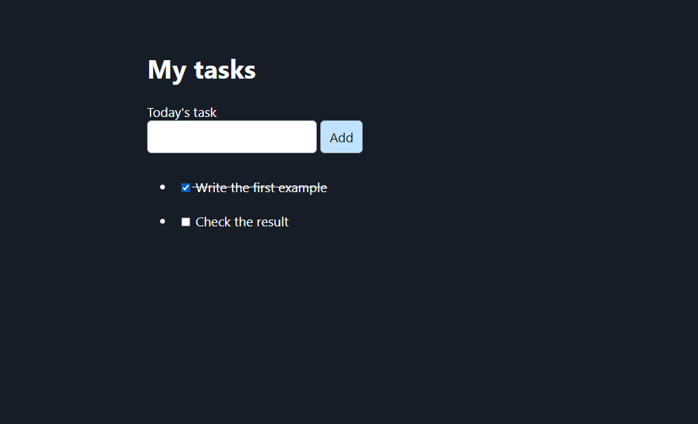

Workshop lesson · Suggested time: 45–60 minutes with practice

By the end you can create a small project, describe what you want to the assistant, and see the result in a browser.

## The vibe coding loop

Describe one small outcome, give the assistant a concrete example, review the files it changes and try the result yourself. Use what you observe to decide the next change. For this project, success means you can add a task and mark it done. You decide what the feature should do and whether the result is ready.

## Get ready

You need no Git or GitHub account for this lesson; an installed coding app with a healthy connection is enough. If you have not tested the model connection yet, open that app's guide in VibeHub first and run the connection test.

Create a practice folder; stay away from real projects:

```powershell
mkdir first-vibe
```

Use **Open Folder** in the app to open `first-vibe`. If the app has a Recent projects section in VibeHub, you can also use Choose project folder there.


## Describe what you want

The assistant does better from a precise description. A good request has three parts: what, for whom, with what constraints. Try this example verbatim:

```text
Build a single-file HTML page called "My tasks": a list of today's tasks,
an add button, and a strike-through for done items. Dark theme,
no external libraries.
```

Ask for what you want; do not drop things you have. If the assistant assumes something you do not want, correct it right there and continue.

## See the result in a browser

The assistant should create `index.html`. Open it in a browser:

```powershell
start index.html
```

Workshop checkpoint: the page opens, tasks are added, done items strike through. If something fails, this is your first debugging exercise: tell the assistant exactly what happened and what you expected; paste the full error text, not a summary.



## Do not trust the assistant — verify

Before moving on, check three things yourself:

- New files exist only inside `first-vibe`, nowhere else.
- The assistant's explanation matches what it actually did; no unexplained added or deleted files.
- No API key or personal data appears in any file.

In the workshop, the facilitator deliberately breaks one small change so you can find it together. Alone, you can do the same: change a line on purpose, see what happens, and ask the assistant to restore it.

## Try it yourself

Add one small feature of your own: a remaining-tasks counter or a different color for finished tasks. Write the feature as a one-liner for yourself first, then give it to the assistant. The result in the browser must match your one-liner.
