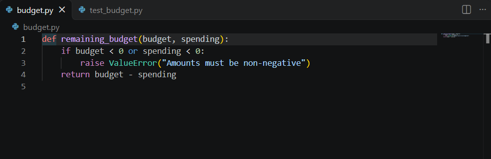

# Programming fundamentals

Build a small function that returns the amount left in a daily budget. Write down its inputs (budget and spending), output (money left), and rule (negative inputs are invalid). Work in whole cents to avoid rounding issues.

```python
def remaining_budget(budget, spending):
    if budget < 0 or spending < 0:
        raise ValueError("Amounts must be non-negative")
    return budget - spending
```



- **Values and types.** Numbers represent amounts. Text from a form must be parsed and checked before it reaches this function.
- **Conditions and errors.** The condition rejects invalid data. A negative result, by contrast, represents overspending.
- **Functions and loops.** Keep the rule in a function. For a list of expenses, use `sum(expenses)` and call the function once.
- **Design.** Keep the calculation separate from the screen that displays it. Use a clear function name and handle invalid input at the boundary.

Try budgets and spending of `(1000, 250)`, `(1000, 1000)`, `(1000, 1200)` and `(1000, -1)`. Explain each result before running the code. In the next project, ask the coding agent to work from these examples and inspect the changes it proposes.
