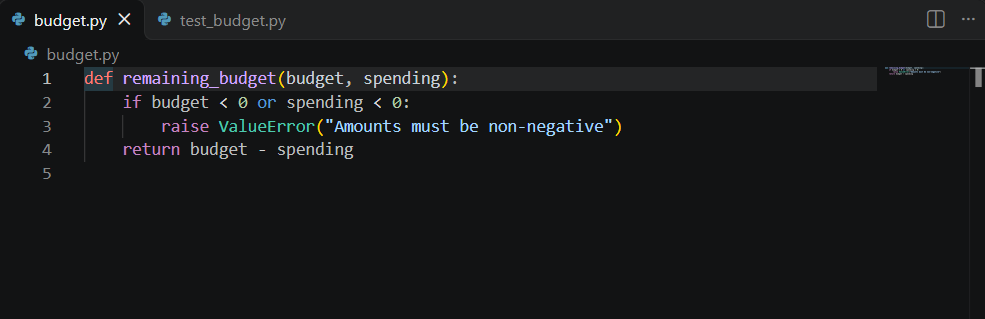

# اصول برنامه‌نویسی

تابعی بسازید که ماندهٔ بودجهٔ روزانه را برگرداند. ورودی‌ها بودجه و هزینه‌اند، خروجی مانده است و مبلغ منفی در ورودی مجاز نیست. مبلغ‌ها را به کوچک‌ترین واحد پول و به شکل عدد صحیح وارد کنید.

```python
def remaining_budget(budget, spending):
    if budget < 0 or spending < 0:
        raise ValueError("Amounts must be non-negative")
    return budget - spending
```



- **مقدار و نوع داده.** متن واردشده در فرم را پیش از ارسال به تابع به عدد تبدیل کنید و اعتبارش را بسنجید.
- **شرط و خطا.** شرط، ورودی نامعتبر را رد می‌کند. ماندهٔ منفی یعنی هزینه از بودجه بیشتر شده است.
- **تابع و تکرار.** قاعده را در تابع نگه دارید. برای فهرست هزینه‌ها ابتدا از `sum(expenses)` استفاده کنید.
- **طراحی کد.** محاسبه را از نمایش نتیجه جدا کنید. برای تابع نام روشنی بگذارید و ورودی را همان جایی بررسی کنید که وارد برنامه می‌شود.

چهار نمونهٔ `(1000, 250)`، `(1000, 1000)`، `(1000, 1200)` و `(1000, -1)` را امتحان کنید. پیش از اجرا نتیجه را پیش‌بینی کنید. در پروژهٔ بعدی همین نمونه‌ها را به دستیار بدهید و تغییرات پیشنهادی‌اش را بخوانید.
