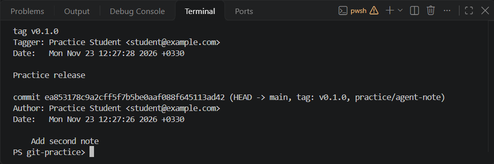

# Versioning and releases

A commit records a change. A Git tag points to the commit you release. The release notes tell users what changed and which build to download.

If the project follows Semantic Versioning and has a stable public interface, increase the patch for compatible fixes, minor for compatible features, and major for breaking changes. A project below 1.0 may still be changing its interface. A suffix such as `-beta.1` marks a prerelease.

**Practice in your exercise repository.** Review the diff and run the tests. Update version references together. Commit, use `git tag -a v0.1.0 -m "Budget exercise"` to mark that commit, and inspect it with `git show v0.1.0`. Build from the tagged commit. Write release notes with the changes users can see, the tests you ran, and any known limits. Install the resulting build and check the version and the feature before treating it as ready.

