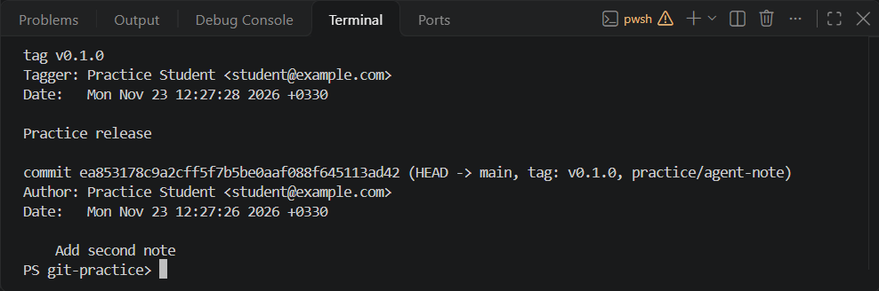

# نسخه‌گذاری و انتشار

کامیت یک تغییر را ثبت می‌کند. تگ گیت به کامیتی اشاره می‌کند که از آن نسخه می‌سازید. یادداشت انتشار می‌گوید چه چیزی تغییر کرده و کاربر کدام فایل را باید بگیرد.

اگر پروژه نسخه‌گذاری معنایی و رابط عمومی پایدار دارد، برای رفع خطای سازگار عدد سوم، برای قابلیت سازگار عدد دوم و برای تغییر ناسازگار عدد اول را بالا ببرید. پیش از نسخهٔ ۱٫۰ ممکن است رابط هنوز در حال تغییر باشد. پسوندی مثل `-beta.1` نسخهٔ آزمایشی را مشخص می‌کند.

**تمرین در مخزن آموزشی.** تغییرات را بخوانید، آزمون بگیرید و شماره‌های نسخه را با هم به‌روز کنید. پس از کامیت، با `git tag -a v0.1.0 -m "Budget exercise"` روی همان کامیت تگ بزنید و آن را با `git show v0.1.0` بررسی کنید. بسته را از کامیت تگ‌شده بسازید. در یادداشت انتشار، تغییرات قابل‌مشاهده، آزمون‌های اجراشده و محدودیت‌ها را ثبت کنید. در پایان شمارهٔ نسخه و قابلیت را در بستهٔ نصب‌شده بررسی کنید.

