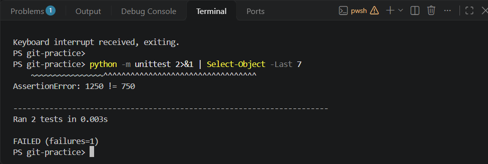
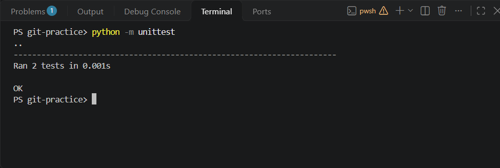

# Testing and debugging

Use the budget function from Programming fundamentals. Put it in `budget.py` and save this test as `test_budget.py`.

```python
import unittest
from budget import remaining_budget

class BudgetTests(unittest.TestCase):
    def test_examples(self):
        self.assertEqual(remaining_budget(1000, 250), 750)
        self.assertEqual(remaining_budget(1000, 1000), 0)
        self.assertEqual(remaining_budget(1000, 1200), -200)

    def test_invalid_spending(self):
        with self.assertRaises(ValueError):
            remaining_budget(1000, -1)
```

Run `python -m unittest`. Temporarily change subtraction to addition and confirm the tests fail, then restore the function and run again. For a real bug, capture the input that triggered it, write an assertion for the expected result, reproduce the failure, fix the cause and rerun. For a UI feature, also try the task through the screen the user actually uses.




