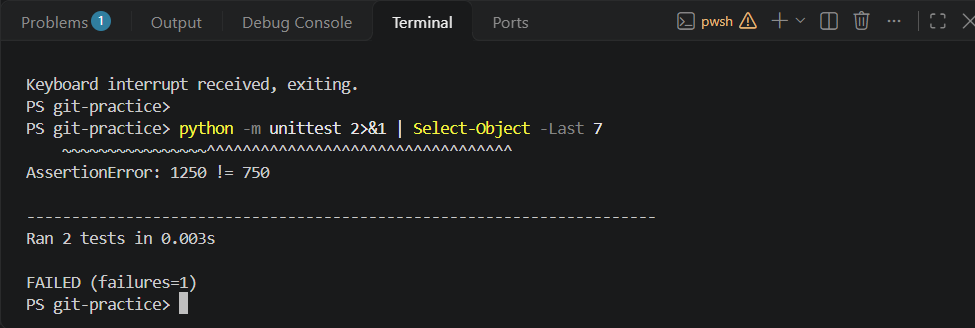
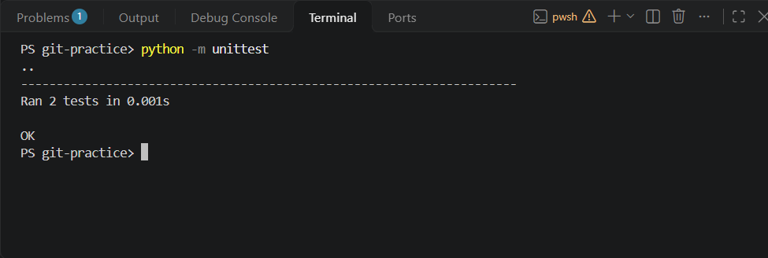

# آزمون و رفع خطا

تابع درس «اصول برنامه‌نویسی» را در `budget.py` و این آزمون را در `test_budget.py` ذخیره کنید.

```python
import unittest
from budget import remaining_budget

class BudgetTests(unittest.TestCase):
    def test_examples(self):
        self.assertEqual(remaining_budget(1000, 250), 750)
        self.assertEqual(remaining_budget(1000, 1000), 0)
        self.assertEqual(remaining_budget(1000, 1200), -200)

    def test_invalid_spending(self):
        with self.assertRaises(ValueError):
            remaining_budget(1000, -1)
```

با `python -m unittest` آزمون‌ها را اجرا کنید. برای تمرین، تفریق را موقتاً به جمع تغییر دهید و شکست آزمون را ببینید. بعد تابع را برگردانید و دوباره آزمون بگیرید. برای خطای واقعی، ابتدا ورودی مشکل‌ساز و نتیجهٔ مورد انتظار را ثبت کنید، خطا را بازتولید کنید، علت را برطرف کنید و آزمون را دوباره اجرا کنید. برای رابط کاربری، همین رفتار را از صفحه‌ای که کاربر با آن کار می‌کند هم بررسی کنید.




