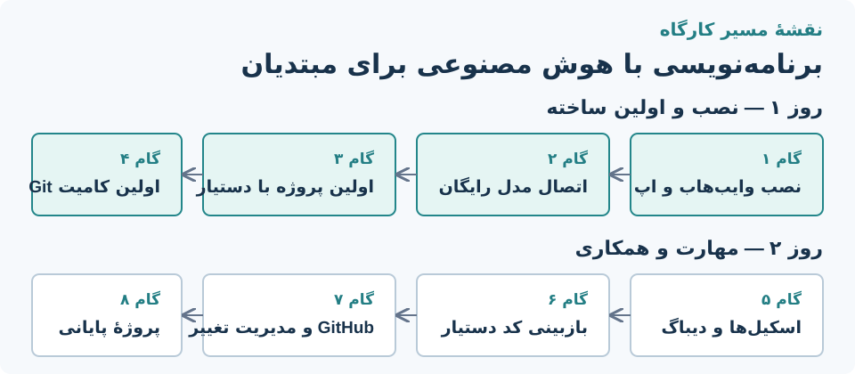

# برنامهٔ کارگاه دودومهٔ «برنامه‌نویسی با هوش مصنوعی برای مبتدیان»

این سند کیت مدرس است: هدف، پیش‌نیاز، آماده‌سازی، جدول سرفصل با پیوند به درس‌های داخل اپ، تمرین‌ها، سناریوهای خرابی رایج و روال ریست ماشین. محتوای درس‌ها در کتابخانهٔ یادگیری وایب‌هاب است و از فید محتوا تازه می‌شود؛ مدرس پیش از کارگاه نسخهٔ آفلاین را روی ماشین‌ها آزمایش می‌کند.

## هدف و مخاطب

مخاطب، مبتدی است: کامپیوتر را بلد است، برنامه‌نویسی بلد نیست یا تازه شروع کرده. در پایان کارگاه شرکت‌کننده باید بتواند به‌تنهایی یک اپ کدنویسی هوش مصنوعی را روی پروژه‌ای کوچک اجرا کند، یک خروجی ساده بسازد، تغییرش را با Git ثبت کند و کد دستیار را بازبینی کند. جاه‌طلبی روز اول «ساخت یک وب‌سایت کامل» نیست؛ «اولین تغییر درست ثبت‌شده» است.

موفقیت کارگاه یعنی: هر شرکت‌کننده در پایان روز دوم یک پروژهٔ کوچک کامیتی‌شده روی گیت‌هاب خودش دارد و می‌تواند توضیح دهد هر گام چه کرد.

## پیش‌نیازها

- هر شرکت‌کننده: ویندوز ۱۰/۱۱ با دسترسی مدیر، حداقل ۸ گیگ رم، ۱۰ گیگ فضای آزاد.
- اینترنت برای نصب؛ اجرای درس‌ها به اینترنت وابسته نیست (کتابخانهٔ آفلاین می‌شود).
- یک اپ کدنویسی هوش مصنوعی: پیش‌فرض کارگاه Qoder یا ZCode با اعتبار روزانهٔ رایگان؛ اگر سیاست کلاس اجازه دهد Ollama محلی جایگزین آفلاین است.
- حساب گیت‌هاب برای هر شرکت‌کننده (ساختنش در درس روز دوم تمرین است، ولی مدرس قبل از کارگاه وجودش را چک می‌کند).
- ویندوز باید فونت فارسی و چیدمان RTL درست داشته باشد؛ این بخش با درس [فارسی‌نویسی و راه‌اندازی RTL](/learning/rtl-setup) پوشش داده می‌شود.

## آماده‌سازی مدرس (آخرین روز قبل)

- [ ] نصب‌کنندهٔ `VibeHub-Setup.exe` آخرین انتشار پایدار را روی یک فلش یا شبکهٔ محلی بگذار؛ به اینترنت سالن وابسته نباش.
- [ ] یک ماشین نمونه را از تصویر تمیز طی کن: نصب وایب‌هاب، نصب اپ، اسکن، اتصال، اجرای درس روز ۱.
- [ ] یک پروایدر رایگان را برای همهٔ ماشین‌ها انتخاب و آزمایش کن و همان را به‌عنوان «مسیر پیش‌فرض کلاس» اعلام کن؛ در دفترچهٔ API اتصالش را نمونه بزن.
- [ ] در تنظیمات وایب‌هاب فید محتوا را تازه کن تا درس‌ها آفلاین هم باز شوند.
- [ ] فونت Vazirmatn و حالت RTL ترمینال را روی ماشین نمونه ست کن.
- [ ] حساب گیت‌هاب خودت و یک مخزن تمرینی برای دموی زنده.
- [ ] نسخهٔ چاپی چک‌لیست «باید ببینید» هر گام برای توزیع.

## جدول روز اول — نصب، اتصال، اولین ساخته

| زمان | گام | درس داخل اپ | «باید ببینید» |
|---|---|---|---|
| ۰۹:۰۰ | آشنا، هدف، نصب وایب‌هاب | [شروع با VibeHub](/learning/getting-started) | صفحهٔ برنامه‌ها اپ نصب‌شده را نشان می‌دهد |
| ۱۰:۳۰ | نصب اپ کدنویسی + اسکن مجدد | [شروع با VibeHub](/learning/getting-started) | کارت اپ با بج «نصب‌شده» |
| ۱۱:۰۰ | فارسی‌نویسی و RTL (کوتاه، فقط اپ کلاس) | [فارسی‌نویسی و راه‌اندازی RTL](/learning/rtl-setup) | یک پنجرهٔ راست‌چین از اپ انتخابی |
| ۱۱:۴۵ | اتصال مدل رایگان در دفترچهٔ API | راهنمای همان اپ (تب راهنما) | تست اتصال با نتیجهٔ موفق |
| ۱۳:۳۰ | اولین پروژه با دستیار | [اولین پروژه با دستیار](/learning/first-project) | یک صفحهٔ HTML واقعی که در مرورگر باز می‌شود |
| ۱۵:۰۰ | ثبت اولین تغییر با Git | [اولین تغییرت را با Git ثبت کن](/learning/git-first-commit?category=git) | `git log --oneline` دو کامیت نشان می‌دهد |
| ۱۶:۰۰ | جمع‌بندی و پرسش | — | — |

## جدول روز دوم — مهارت، دیباگ، همکاری

| زمان | گام | درس داخل اپ | «باید ببینید» |
|---|---|---|---|
| ۰۹:۰۰ | مرور روز اول و رفع گیرها | — | همه ماشین‌ها سالم |
| ۰۹:۳۰ | نصب و مدیریت اسکیل‌ها | [نصب و مدیریت اسکیل‌ها](/learning/skill-basics) | یک اسکیل فعال در نشست دستیار |
| ۱۰:۳۰ | دیباگ با کمک دستیار | [دیباگ با کمک دستیار](/learning/debugging-with-agent) | یک خطای عمدی پیدا و رفع شده |
| ۱۱:۳۰ | بازبینی کد دستیار | [بازبینی کد با ایجنت](/learning/code-review) | یک تفاوت که شرکت‌کننده خودش رد یا اصلاح کرده |
| ۱۳:۳۰ | تغییرات ایجنت و GitHub | [تغییرات ایجنت و GitHub را مدیریت کن](/learning/git-agent-github?category=git) | یک کامیت واقعی روی مخزن گیت‌هاب خودش |
| ۱۵:۰۰ | پروژهٔ پایانی و ارائهٔ کوتاه | [تمرین کن و منبع مناسب را پیدا کن](/learning/git-practice-resources?category=git) | مخزن با حداقل سه کامیت، ارائهٔ ۲ دقیقه‌ای |
| ۱۶:۳۰ | مسیر ادامه، منابع، پرسش | — | — |

برای پروژهٔ پایانی سه گزینهٔ هم‌سطح پیشنهاد کن: کارت ویزیت شخصی، صفحهٔ معرفی یک کتاب، یا تایمر پومودورو. همه با HTML/CSS/JS ساده شدنی‌اند و از درس‌های روز اول عبور می‌کنند.

## قاعده‌های طلایی کلاس

- هر فرمانی که مدرس می‌زند، روی پروژکتور هم نشان بده و بگذار همه همان را بزنند؛ هیچ گامی «در خانه انجام دهید» نیست.
- خطاها را پنهان نکن: اولین خطای زندهٔ کلاس بهترین لحظهٔ آموزش دیباگ است.
- کد دستیار را هیچ‌وقت بدون خواندن پذیرش نکن — این جمله را هر روز حداقل دو بار بگو.
- تایم‌باکس هر گام را رعایت کن؛ گیرهای فردی به استراحت یا بعد از کلاس موکول شود.

## سناریوهای خرابی رایج

| نشانه | علت رایج | رفع سریع |
|---|---|---|
| اپ در اسکن وایب‌هاب دیده نمی‌شود | نصب بعد از آخرین اسکن، یا مسیر سفارشی | «بررسی دوباره» را بزن؛ مسیر سفارشی را در صفحهٔ اپ وارد کن |
| تست اتصال شکست می‌خورد | کلید ناقص، سهمیهٔ تمام‌شده، فیلترینگ | کلید را دوباره بچسبان؛ پروایدر جایگزین کلاس را ست کن |
| متن فارسی در ترمینال به‌هم ریخته است | فونت یا UTF-8 نشده | درس RTL، بخش «حروف بی‌وستهٔ فارسی در PowerShell» |
| `git` شناخته نمی‌شود | نصب Git بعد از باز بودن ترمینال | ترمینال را ببند و دوباره باز کن؛ `git --version` |
| درس‌ها داخل اپ باز نمی‌شوند | فید تازه نشده | دکمهٔ تازه‌سازی محتوا؛ نسخهٔ گیت‌هاب درس را از جدول‌های بالا باز کن |
| اعتبار روزانهٔ اپ تمام شده | سقف رایگان | اپ دوم کلاس (پیشنهاد روز اول) یا پروایدر جایگزین |

## روال ریست ماشین (بین دو روز یا دو نوبت)

- [ ] در وایب‌هاب: حذف پروژه‌های اخیر و اتصال‌های نمونهٔ دموی مدرس.
- [ ] پوشه‌های `git-practice` و پروژه‌های تمرینی شرکت‌کنندگان قبلی را پاک کن.
- [ ] تنظیمات اپ کدنویسی به حالت اول: خروج از حساب یا حذف پروفایل تمرینی.
- [ ] بررسی فید محتوا و به‌روزرسانی درس‌ها؛ یک بار باز کردن صفحهٔ یادگیری.
- [ ] `git config --global user.name/email` ماشین‌های عمومی را به «Workshop Machine» برگردان.

این روال را مدرس یا کمک‌مدرس اجرا می‌کند؛ برای کلاس‌های بزرگ همین چک‌لیست را به یک اسکریپت PowerShell تبدیل کن و خروجی‌اش را قبل از هر نوبت یک‌بار اجرا کن.

## پیوند محتوا

سرفصل‌ها به شناسه‌های پایدار فید یادگیری ارجاع می‌دهند؛ اگر عنوان درس‌ها تغییر کند این سند سالم می‌ماند. درس‌های «اولین پروژه با دستیار» و «دیباگ با کمک دستیار» ویژهٔ همین کارگاه به `content/learning` اضافه شده‌اند و بقیهٔ درس‌ها پیش از این موجود بودند. ویرایش محتوا طبق [راهنمای انتشار آموزش‌ها](../../content/learning/README.md) انجام می‌شود.
