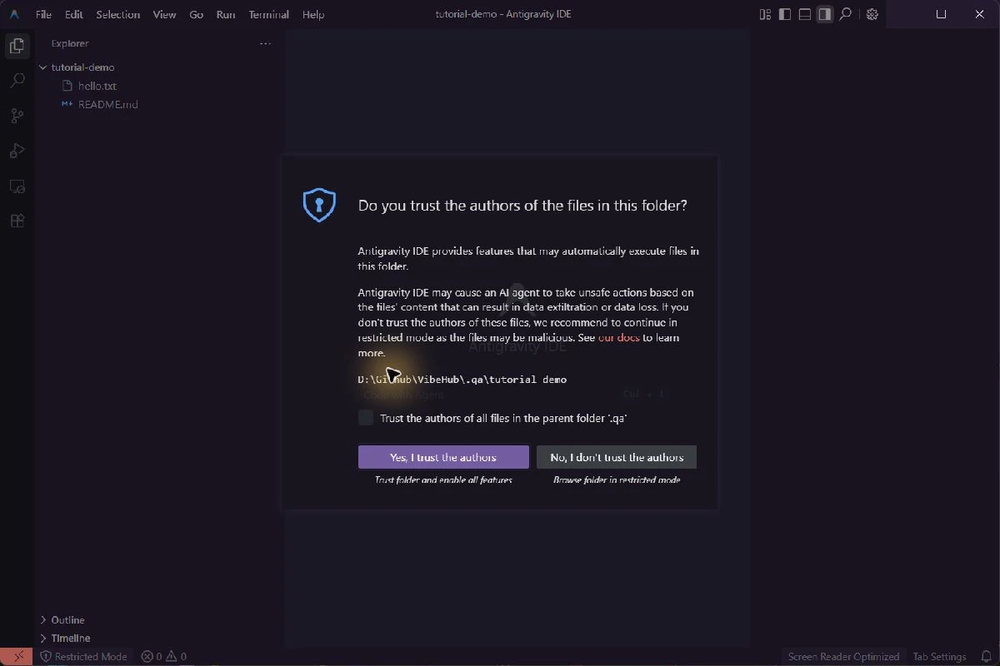

# Antigravity IDE

## IDE, App and CLI are different surfaces
This entry launches the **standalone Antigravity IDE code editor**, not Antigravity App or the `agy` CLI. Installing or signing into one does not prove another surface's agent works. VibeHub checks Antigravity IDE.exe and the IDE product metadata. A dedicated RTL adapter is not verified.

## Install and launch
In the [official getting-started guide](https://antigravity.google/docs/getting-started/), choose **For IDEs**, then **standalone Antigravity IDE**. Do not choose the separate Antigravity App installer. Install the Windows IDE from the [official download page](https://antigravity.google/download), then refresh VibeHub.

The usual path is `%LOCALAPPDATA%\Programs\Antigravity IDE\Antigravity IDE.exe`. Use Choose app executable for a custom installation. Its resources/app/product.json must be present as part of a healthy IDE installation. Select a project folder in the Launch tab.

## Iran: network routing and account eligibility
Iran is absent from [Google's availability list](https://antigravity.google/docs/faq). A proxy can fix transport failures without making an account eligible. Associated country, age and account type also affect access. If Google recorded an incorrect account country, the FAQ links to an official correction request; do not submit false information.

On 2026-11-04, **Antigravity CLI 1.5.0** download returned 403 directly but succeeded through an HTTP proxy. Google sign-in completed, but a model request failed with:

```text
Your current account is not eligible for Antigravity,
because it is not currently available in your location.
```

This is CLI account-eligibility evidence, not a successful IDE agent test from Iran. Do not treat this message as only a port or DNS issue.

## Configure the network
Create an HTTP proxy profile in VibeHub using your connection tool's HTTP or Mixed port, then select it for Antigravity IDE in Connections. Settings reach the next launch. Close existing IDE windows yourself first: a new window may reuse an existing process that does not receive the new environment.

For a manual PowerShell test, replace the example port with your actual listener:

```powershell
$env:HTTP_PROXY = 'http://127.0.0.1:10808'
$env:HTTPS_PROXY = $env:HTTP_PROXY
$env:NO_PROXY = 'localhost,127.0.0.1,::1'
& "$env:LOCALAPPDATA\Programs\Antigravity IDE\Antigravity IDE.exe"
```

The sign-in browser also needs working routing. VibeHub's proxy test does not establish routing for every agent request or account eligibility. Do not disable TLS verification. For eligibility errors, consult [Google's account FAQ](https://antigravity.google/docs/faq).

## Use another API in the editor
An arbitrary API replacement for the **native Antigravity IDE agent** has not been verified here. Do not assume a Radeon key can replace Google sign-in. A separate route is an API-capable extension such as **Cline**, or Claude Code in the integrated terminal. These are separate assistants and do not alter Google's native service or quota.

[Cline's installation guide](https://docs.cline.bot/getting-started/installing-cline) lists Antigravity support. Install the official Cline extension through Extensions. In **Cline's own settings**, choose OpenAI Compatible and configure:

- Base URL: `https://developer.amd.com.cn/radeon/api/v1`
- Model ID: a current service ID, for example `Qwen3.8-Flash-Next`
- API Key: your Radeon key in the extension's secure configuration

The [Token Factory documentation](https://amd-aim.github.io/radeon-cloud-docs/guides/token-factory/) describes its OpenAI-compatible API. This Cline/IDE combination has not been live-tested here; try a short request in a disposable test folder first. Selecting an API reference in VibeHub does not configure the extension automatically.

## Claude Code in the IDE terminal
Open the integrated terminal and follow the Radeon setup in the [Claude Code CLI guide](/app/claude-code?tab=guide), then run `claude --model Qwen3.8-Flash-Next`. The editor remains Antigravity IDE, while the assistant is Claude CLI connected to Radeon. Standalone CLI text and Read-tool tests succeeded; the IDE's integrated terminal was not independently tested.

## Diagnose the relevant layer
Missing installation: check the IDE path and product metadata. Browser sign-in succeeds but the app stalls: inspect callback handling and app routing. Location or eligibility error: inspect account eligibility. Extension API error: check its base URL, model ID, key, quota and selected protocol in the extension itself.


## Open a folder and inspect the trust prompt

Create a fresh folder with README.md and hello.txt, then use Open Folder. Check its name and files in Explorer. The image below is a real Windows Antigravity IDE capture using this tutorial's disposable folder.



Make your own trust decision based on the folder contents; granting trust to the entire parent folder is unnecessary for this exercise. This image demonstrates opening the folder and displaying the prompt, not successful account, model or agent access. The agent panel failed to initialize during this local run; distinguish that failure from the editor opening.
