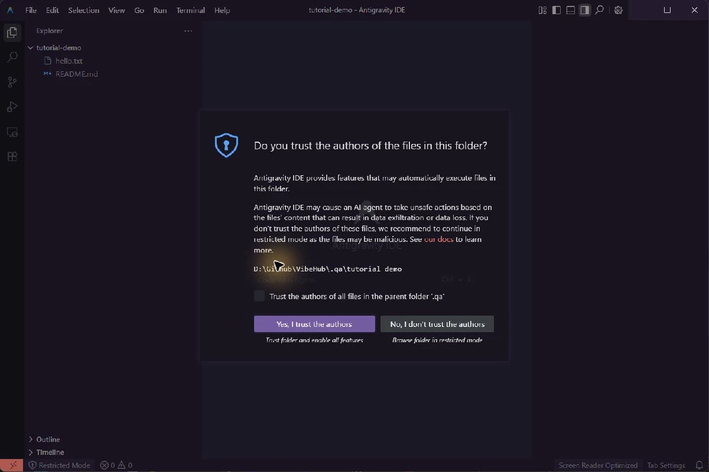

# Antigravity IDE

## IDE را با App اشتباه نگیرید
این ورودی **ویرایشگر Antigravity IDE** است، نه Antigravity App و نه CLI با فرمان `agy`. نصب و ورود هر کدام، موفقیت ایجنت دیگری را ثابت نمی‌کند. VibeHub برای این ورودی `Antigravity IDE.exe` و مشخصات محصول IDE را بررسی می‌کند؛ RTL اختصاصی تأیید نشده است.

## نصب و اجرا
در [راهنمای رسمی شروع](https://antigravity.google/docs/getting-started/) بخش **For IDEs** و سپس **standalone Antigravity IDE** را انتخاب کنید؛ فایل Antigravity App را به جای آن نگیرید. از [صفحهٔ دانلود رسمی](https://antigravity.google/download) نسخهٔ ویندوز IDE را نصب کنید و VibeHub را تازه‌سازی کنید.

مسیر متداول نصب `%LOCALAPPDATA%\Programs\Antigravity IDE\Antigravity IDE.exe` است. اگر نصب سفارشی دارید، «انتخاب فایل اجرایی» را بزنید و فایل همین محصول را معرفی کنید. پوشهٔ `resources/app/product.json` باید کنار نصب سالم موجود باشد. برای پروژه، در تب اجرا پوشهٔ دلخواه را انتخاب کنید.

## اتصال از ایران: شبکه و حساب دو مرحله‌اند
ایران در [فهرست جغرافیایی گوگل](https://antigravity.google/docs/faq) نیست. پروکسی می‌تواند خطای شبکه را رفع کند، اما واجد شرایط شدن حساب را تضمین نمی‌کند. کشور مرتبط با حساب، سن و نوع حساب هم در ورود اثر دارند. اگر گوگل کشور حساب را اشتباه ثبت کرده، همان FAQ مسیر رسمی درخواست اصلاح را معرفی کرده است؛ اطلاعات نادرست وارد نکنید.

در آزمون ۴ نوامبر ۲۰۲۶ روی **Antigravity CLI 1.5.0**، دانلود مستقیم 403 داد و با پروکسی HTTP موفق شد. ورود گوگل انجام شد، اما درخواست مدل با این خطا رد شد:

```text
Your current account is not eligible for Antigravity,
because it is not currently available in your location.
```

این شاهد محدودیت حساب در CLI است؛ اجرای موفق ایجنت IDE از ایران در این آزمون ثابت نشده است. اگر همین پیام را می‌بینید، آن را صرفاً مشکل پورت یا DNS تلقی نکنید.

## راه‌اندازی پروکسی
در VibeHub یک پروفایل HTTP با پورت HTTP یا Mixed ابزار اتصال خود بسازید و در تب اتصال برای Antigravity IDE انتخاب کنید. پروفایل هنگام اجرای بعدی به IDE داده می‌شود. همهٔ پنجره‌های IDE را خودتان ببندید و دوباره اجرا کنید؛ ممکن است پنجرهٔ جدید فقط به فرایند ازقبل‌باز وصل شود و محیط جدید را نگیرد.

برای آزمون دستی از PowerShell می‌توانید از این الگو استفاده کنید؛ پورت را با مقدار واقعی جایگزین کنید:

```powershell
$env:HTTP_PROXY = 'http://127.0.0.1:10808'
$env:HTTPS_PROXY = $env:HTTP_PROXY
$env:NO_PROXY = 'localhost,127.0.0.1,::1'
& "$env:LOCALAPPDATA\Programs\Antigravity IDE\Antigravity IDE.exe"
```

مرورگر ورود هم باید مسیر شبکهٔ مناسبی داشته باشد. آزمون پروکسی VibeHub، عبور همهٔ ترافیک ایجنت یا پذیرش حساب را تأیید نمی‌کند. بررسی TLS را خاموش نکنید. اگر خطا دربارهٔ واجد شرایط بودن است، [راهنمای حساب گوگل](https://antigravity.google/docs/faq) را بررسی کنید.

## استفاده از API دیگر در خود ویرایشگر
در این راهنما، تنظیم دلخواه API برای **ایجنت بومی Antigravity IDE** تأیید نشده است. کلید Radeon را نمی‌توان با فرض سازگاری جای حساب گوگل گذاشت. راه جداگانه این است که در IDE از افزونه‌ای با پشتیبانی API دلخواه، مثل **Cline**، یا از Claude Code در ترمینال داخلی استفاده کنید. این‌ها دستیار جدا هستند و سهمیه یا سرویس بومی گوگل را تغییر نمی‌دهند.

[راهنمای نصب Cline](https://docs.cline.bot/getting-started/installing-cline) پشتیبانی از Antigravity را فهرست می‌کند. در Extensions افزونهٔ رسمی Cline را نصب کنید. داخل تنظیمات **خود Cline**، ارائه‌دهندهٔ OpenAI Compatible را انتخاب کنید و این مقادیر را وارد کنید:

- Base URL: `https://developer.amd.com.cn/radeon/api/v1`
- Model ID: شناسهٔ فعلی سرویس، مثلاً `Qwen3.8-Flash-Next`
- API Key: کلید Radeon خودتان، در محل امن تنظیمات افزونه

[مستندات Token Factory](https://amd-aim.github.io/radeon-cloud-docs/guides/token-factory/) قالب OpenAI-compatible را توضیح می‌دهد. اتصال این ترکیب Cline/IDE در این بررسی زنده آزمایش نشده است؛ ابتدا یک درخواست کوتاه و یک پوشهٔ آزمایشی را امتحان کنید. انتخاب اتصال API در VibeHub آن را خودکار داخل افزونه نمی‌نویسد.

## Claude Code در ترمینال IDE
ترمینال داخلی IDE را باز کنید، مسیر راه‌اندازی Radeon در [راهنمای Claude Code CLI](/app/claude-code?tab=guide) را دنبال کنید و `claude --model Qwen3.8-Flash-Next` را اجرا کنید. در این حالت خود ویرایشگر IDE است ولی دستیار شما Claude CLI متصل به Radeon است. پاسخ متنی و ابزار Read در CLI مستقل آزمایش شده‌اند؛ ترمینال داخلی IDE جداگانه تأیید نشده است.

## خطاها را جدا بررسی کنید
نصب پیدا نمی‌شود: مسیر IDE و فایل مشخصات محصول را بررسی کنید. ورود در مرورگر موفق است ولی برنامه جلو نمی‌رود: مسیر بازگشت ورود و اتصال خود برنامه را بررسی کنید. خطای location یا eligibility: وضعیت حساب را بررسی کنید. خطای API در افزونه: نشانی، شناسهٔ مدل، کلید، سهمیه و قالب انتخابی را در خود افزونه بررسی کنید.


## بازکردن پوشه و پیام اعتماد

برای تمرین، یک پوشهٔ تازه با README.md و hello.txt بسازید و با Open Folder باز کنید. پس از بازشدن، نام پوشه و فایل‌ها را در Explorer بررسی کنید. تصویر زیر از اجرای واقعی Antigravity IDE در ویندوز و پوشهٔ آزمایشی همین آموزش ثبت شده است.



انتخاب اعتماد را خودتان بر اساس محتوای پوشه انجام دهید؛ لازم نیست پوشهٔ والد را به‌طور کلی مجاز کنید. این تصویر بازشدن پوشه و نمایش پیام را نشان می‌دهد و شاهد موفقیت حساب، مدل یا ایجنت نیست. پنل ایجنت در این اجرای محلی موفق به راه‌اندازی نشد؛ آن خطا را با بازشدن ویرایشگر یکی نگیرید.
