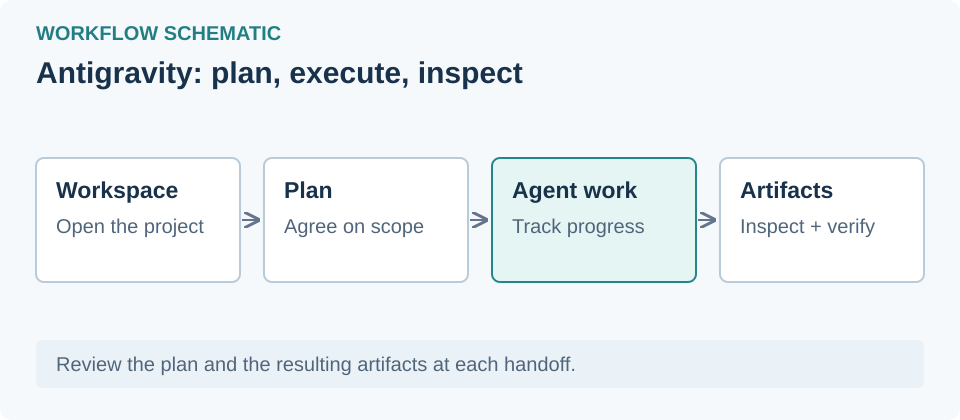

# Antigravity

## Access from Iran and regional restrictions

Iran is absent from the geographic list in [Antigravity's official FAQ](https://antigravity.google/docs/faq), checked November 1, 2026. Network restrictions may require a connectivity workaround or proxy; Google account eligibility and associated region also matter. Changing IP does not establish regional support. Connectivity and login from Iran remain untested.

## Overview
Standalone Antigravity app with normal launch, proxy settings and experimental chat RTL.

## Install
Install the Windows app from the [official website](https://antigravity.google/), then refresh the app list.

## Launch and proxy
The selected profile is requested on the next launch. Close an existing app yourself first. Routing all app traffic through the proxy is not verified.

## Plugins and skills
Open Plugins and skills in Guides for installation steps and compatibility information.

## Experimental RTL
Normal mode is the default. Choose RTL for the chat adapter; live rendering in the installed app remains unverified. This adapter targets the standalone app, not Antigravity IDE.

## Set up RTL from VibeHub

After installing the app, return to VibeHub or choose Check again. Choose Set up RTL on its tile to create a Start Menu shortcut and select RTL for the next launch. Setup uses bundled files and does not start or close the app. [Full setup and recovery instructions](https://github.com/ahmadkhanloo/VibeHub/blob/main/docs/tutorials/rtl-setup.en.md).
