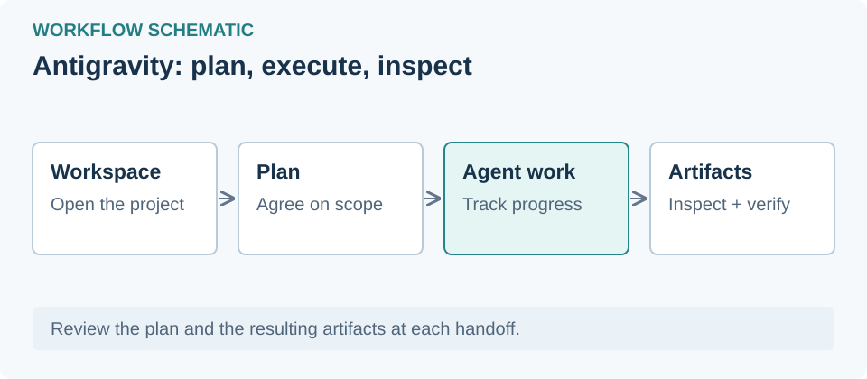

# Antigravity

## دسترسی از ایران و محدودیت منطقه‌ای

ایران در فهرست جغرافیایی [پرسش‌های متداول رسمی Antigravity](https://antigravity.google/docs/faq) نیست؛ بررسی در ۱ نوامبر ۲۰۲۶. برای رفع محدودیت اتصال ممکن است به ابزار عبور از محدودیت شبکه یا پروکسی نیاز باشد؛ حساب و منطقهٔ مرتبط با Google هم در دسترسی اثر دارند. تغییر IP به‌تنهایی پشتیبانی منطقه‌ای ایجاد نمی‌کند. اتصال و ورود واقعی از ایران آزموده نشده است.

## معرفی
اپ مستقل Antigravity با اجرای عادی، پروکسی و راست‌چین آزمایشی؛ جدا از Antigravity IDE.

## نصب
از [وب‌سایت رسمی](https://antigravity.google/) نسخه ویندوز را نصب کنید؛ سپس فهرست اپ‌ها را تازه‌سازی کنید.

## اجرا و پروکسی
پروفایل انتخابی هنگام اجرای بعدی به برنامه داده می‌شود. برنامه باز را ابتدا خودتان ببندید. عبور تمام ترافیک اپ تضمین نشده است.

## افزونه و اسکیل
مراحل مشترک سازگاری، نصب و حذف در [راهنمای پایهٔ اسکیل‌ها](/learning/skill-basics) آمده است؛ محدودیت‌های همین برنامه را در منبع هر افزونه بررسی کنید.

## راست‌چین آزمایشی
حالت عادی پیش‌فرض است. می‌توانید RTL را برای چت انتخاب کنید؛ نمایش زنده در اپ نصب‌شده هنوز تأیید نشده است. این قابلیت برای Antigravity IDE نیست.

## راه‌اندازی مشترک RTL

مراحل نصب، اجرا و رفع خطای مشترک برنامه‌های پشتیبانی‌شده در [راهنمای فارسی‌نویسی و RTL](/learning/rtl-setup) آمده است. نمایش زندهٔ Antigravity همچنان تأیید نشده است.
