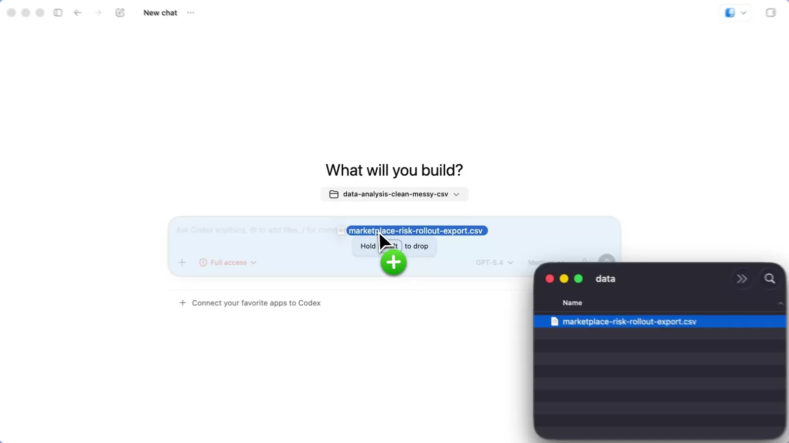

# ChatGPT / Codex

## Access from Iran and regional restrictions

Iran is absent from [ChatGPT's supported countries](https://help.openai.com/en/articles/7947663-chatgpt-supported-countries), checked November 1, 2026. Network restrictions may require a connectivity workaround or proxy. Changing IP does not remove account-region restrictions; accounts may be blocked. Access from Iran is untested here. Check Codex and API-provider eligibility separately.

## Overview
VibeHub provides an entry for detecting and launching ChatGPT / Codex. Choose Chat, Work or Codex and sign in within the application itself.

## Install
Install the Windows app from the [official website](https://chatgpt.com/download/), then refresh the app list.

## Launch and proxy
The selected profile is requested on the next launch. Close an existing app yourself first. Routing all app traffic through the proxy is not verified.

## Plugins and skills
See the [shared skill guide](/learning/skill-basics) for compatibility, installation and removal; check plugin access for your version and account.

## Codex accounts
The current VibeHub interface has no separate Codex account-switching panel. Use the application's official sign-in flow or the [CLI guide](https://learn.chatgpt.com/docs/cli). Configuring an API connection is distinct from signing into a ChatGPT account; obtain current installation steps from the official source.

## Illustrated exercise: attach a file in Codex

This example uses the Codex environment in the desktop app, not the Chat window. Add a non-sensitive test CSV by dragging it into the composer or using the attachment control. Check the attached file name before sending and specify the output, for example: “Report empty columns and duplicate rows without changing the original file.”

Choose Chat for questions and conversation, Work for a multi-step deliverable, and Codex for development with project files and technical tools. Specify the folder and file, then compare the proposed result with the original input. Access to a local file differs from access to connected cloud data.

[Official ChatGPT usage guide](https://learn.chatgpt.com/docs/use-chatgpt) · [Desktop quickstart](https://learn.chatgpt.com/docs/quickstart?setup=app) · [Image and file-work example](https://learn.chatgpt.com/docs/app)
