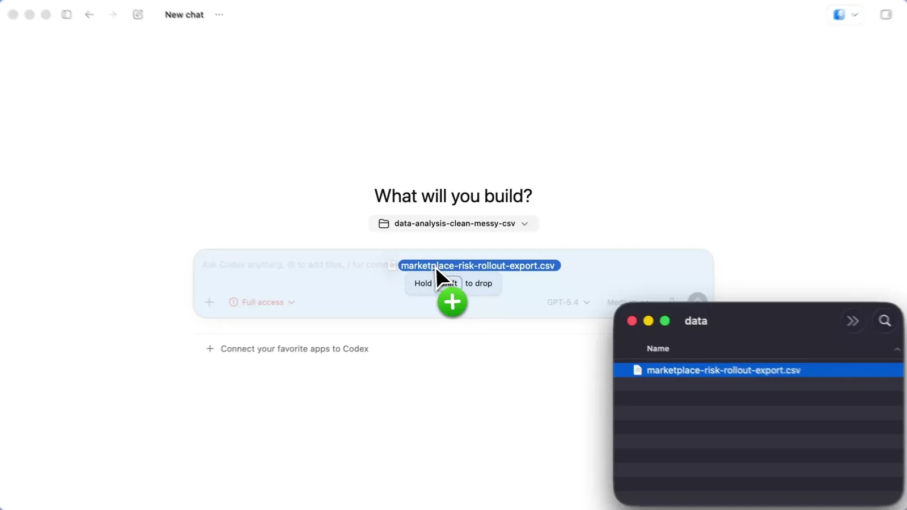

# ChatGPT / Codex

## دسترسی از ایران و محدودیت منطقه‌ای

ایران در [فهرست رسمی کشورهای پشتیبانی‌شدهٔ ChatGPT](https://help.openai.com/en/articles/7947663-chatgpt-supported-countries) نیست؛ بررسی در ۱ نوامبر ۲۰۲۶. برای رفع محدودیت اتصال ممکن است به ابزار عبور از محدودیت شبکه یا پروکسی نیاز باشد. تغییر IP محدودیت منطقه‌ای حساب را برطرف نمی‌کند و خطر مسدودشدن حساب باقی است. دسترسی از ایران آزموده نشده است؛ شرایط Codex و ارائه‌دهندهٔ API را هم جدا بررسی کنید.

## معرفی
وایب‌هاب ورودی نصب و اجرای برنامهٔ ChatGPT / Codex را فراهم می‌کند. انتخاب محیط Chat، Work یا Codex و ورود به حساب را در خود برنامه انجام دهید.

## نصب
از [وب‌سایت رسمی](https://chatgpt.com/download/) نسخه ویندوز را نصب کنید؛ سپس فهرست اپ‌ها را تازه‌سازی کنید.

## اجرا و پروکسی
پروفایل انتخابی هنگام اجرای بعدی به برنامه داده می‌شود. برنامه باز را ابتدا خودتان ببندید. عبور تمام ترافیک اپ تضمین نشده است.

## افزونه و اسکیل
مراحل مشترک سازگاری، نصب و حذف در [راهنمای پایهٔ اسکیل‌ها](/learning/skill-basics) آمده است؛ دسترسی افزونه‌ها را برای نسخه و حساب خودتان جدا بررسی کنید.

## حساب‌های Codex
در رابط فعلی وایب‌هاب پنل جداگانهٔ تعویض حساب Codex وجود ندارد. برای ورود از مسیر رسمی خود برنامه یا [راهنمای CLI](https://learn.chatgpt.com/docs/cli) استفاده کنید. تنظیم اتصال API با ورود به حساب ChatGPT یکسان نیست؛ مراحل نصب نسخهٔ فعلی را از منبع رسمی بگیرید.

## تمرین تصویری: افزودن فایل در محیط Codex

این نمونه مربوط به محیط Codex در برنامهٔ دسکتاپ است، نه پنجرهٔ Chat. یک فایل CSV آزمایشیِ بدون اطلاعات شخصی را با کشیدن و رهاکردن یا کنترل افزودن فایل به درخواست اضافه کنید. نام فایل پیوست را قبل از ارسال بررسی و خروجی موردنظر را مشخص کنید؛ مثلاً «ستون‌های خالی و ردیف‌های تکراری را گزارش کن و فایل اصلی را تغییر نده».

برای سؤال و گفت‌وگو Chat، برای نتیجهٔ چندمرحله‌ای Work و برای کار توسعه با فایل‌های پروژه و ابزارهای فنی Codex را انتخاب کنید. ابتدا مسیر و فایل را مشخص کنید و بعد نتیجهٔ پیشنهادی را با ورودی اصلی مقایسه کنید. دسترسی به فایل محلی با اتصال به فضای ابری یکسان نیست.

[راهنمای رسمی استفاده از ChatGPT](https://learn.chatgpt.com/docs/use-chatgpt) · [شروع در دسکتاپ](https://learn.chatgpt.com/docs/quickstart?setup=app) · [منبع تصویر و نمونهٔ کار با فایل](https://learn.chatgpt.com/docs/app)
